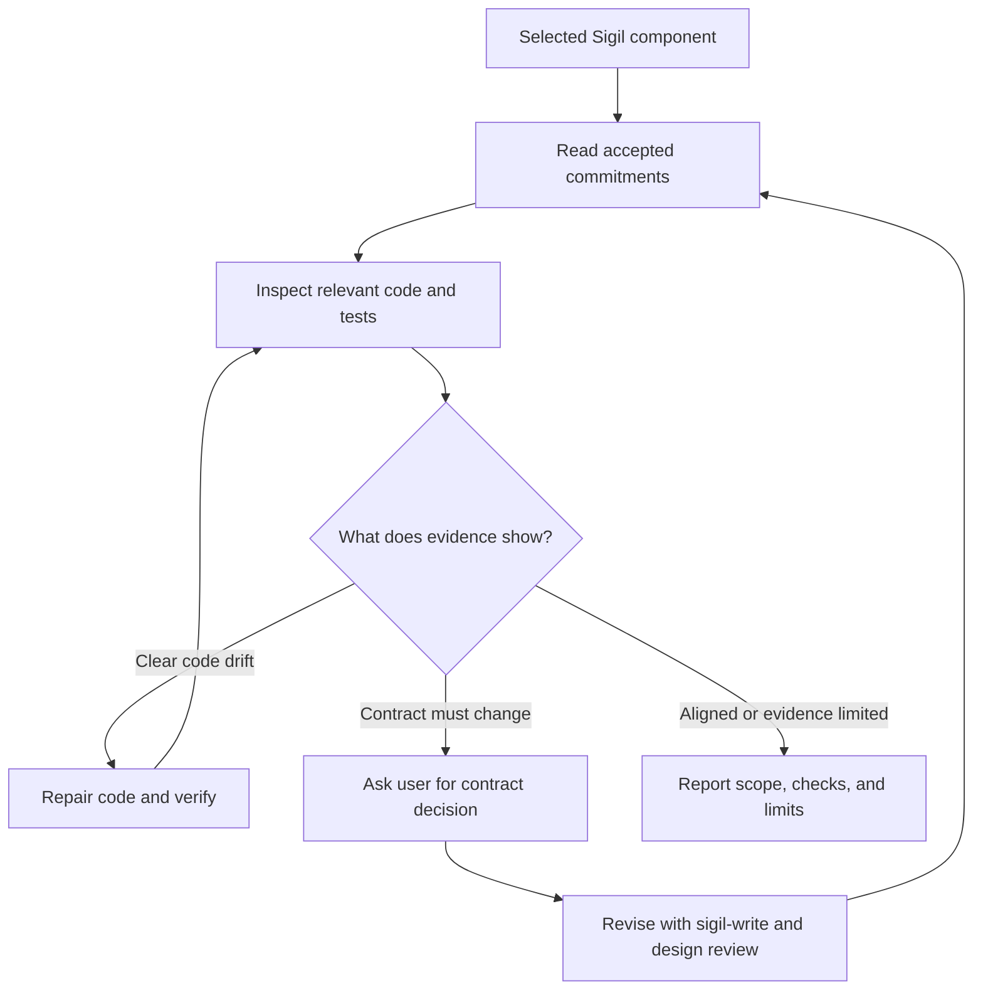
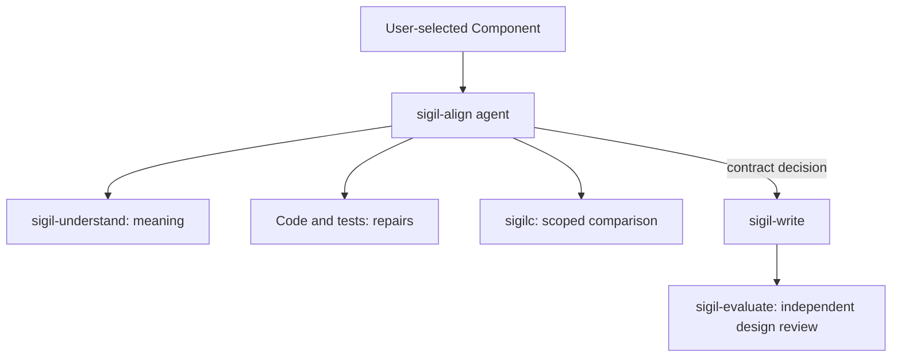
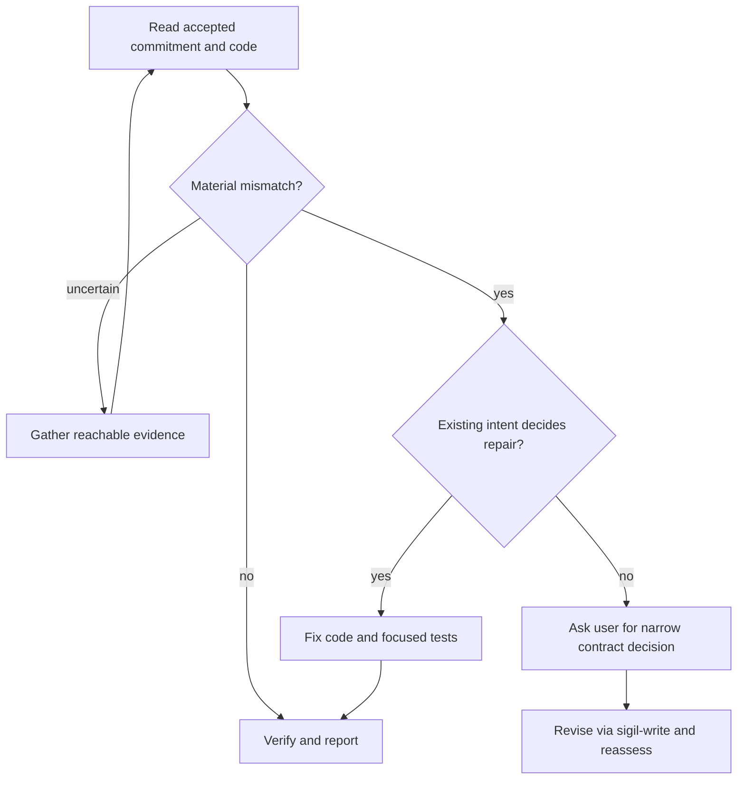
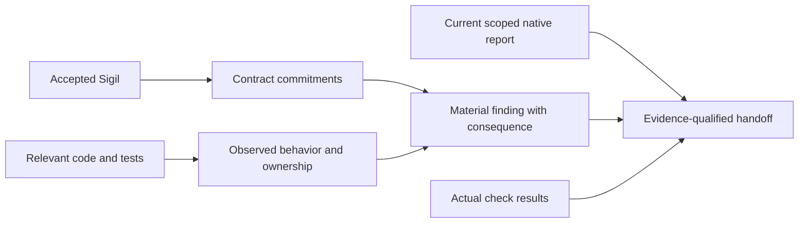
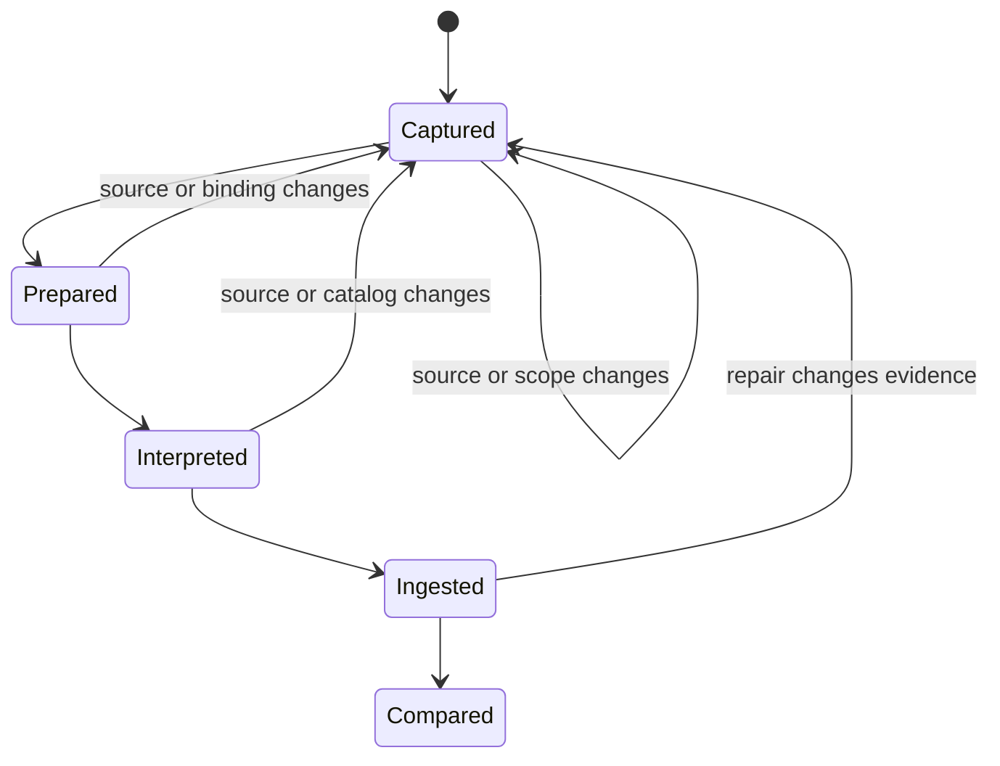

# Sigil Implementation Alignment Skill - Plan

## Goal Capsule

- **Objective:** An agent can bring the implementation of a selected Sigil component into agreement with its accepted contract and show what evidence supports the result, without asking the user to resolve code-only defects.
- **Means:** Add a Sigil 0.9 skill for implementation review, repair, and verification.
- **Product authority:** The accepted Sigil contract and explicit user decisions define intended behavior. Code, tests, annotations, and compiler reports supply implementation evidence.
- **Open blockers:** None.
- **Execution profile:** Implement the skill and its catalog integration in this repository; verify agent behavior in disposable workspaces before calling it ready.
- **Stop condition:** The selected component's determinate code drift is repaired and checked, or a consequential contract decision remains with the user; report any native comparison or coverage limit explicitly.

---

## Product Contract

### Summary

Add `sigil-align`, a skill that reviews a selected component against its implementation, repairs clear code drift, and checks the result. It returns a focused contract decision to the user only when the accepted design must change.

### Problem Frame

The pre-#67 compatibility reviewer found implementation drift and ownership gaps but was read only. The current Sigil 0.9 understanding, writing, and evaluation skills explicitly stop before implementation conformance. As a result, an agent can read a compact contract yet has no current skill responsible for closing the loop from a detected mismatch to corrected code and credible verification.

### Key Decisions

- **Keep implementation alignment in a separate skill.** The existing design evaluator remains an independent, read-only reviewer. Governs R1.
- **Treat the selected component as the review root.** Relevant implementation evidence may cross file boundaries; a Sigil Tag import alone does not imply a runtime dependency. Governs R2, R3.
- **Use native comparison as scoped evidence.** The repair loop must also inspect real code and tests because compiler states depend on the supplied projections and do not certify delivery by themselves. Governs R9, R10.

### Requirements

**Entry and diagnosis**

- R1. Provide a callable Sigil 0.9 implementation-alignment skill that reuses `sigil-understand` for contract meaning and keeps `sigil-evaluate` focused on design review.
- R2. Start from one explicitly selected component, or one unambiguously selected by the current task, and inspect only the code, tests, and contract context needed to assess its commitments.
- R3. Compare material observable behavior and architecture against the accepted contract without demanding a code declaration for every Sigil sentence or turning optional implementation choices into obligations.
- R4. Give each material finding a contract anchor, observed code or test evidence, consequence, and concrete next action; distinguish confirmed drift, missing implementation, missing evidence, and a possible contract change.

**Repair and contract decisions**

- R5. Fix confirmed code drift, missing implementation, and code ownership violations when existing commitments determine the answer; add or update focused tests for behavior changed by the repair.
- R6. Continue through determinate code repairs without a user approval step, and retrieve accessible evidence that can resolve an uncertainty.
- R7. If alignment requires a consequential change to the accepted contract, present the smallest decision and its trade-offs to the user before changing that commitment; after the decision, use `sigil-write` and its independent `sigil-evaluate` review, then reassess the code.

**Verification and handoff**

- R8. Run relevant code and test checks after repairs and repeat the repair loop while observed defects remain.
- R9. When compatible native tooling is available, obtain fresh Design and Implementation projections for the selected scope without exposing Design promises to the Implementation interpreter, then run `sigilc compare` after repairs.
- R10. Distinguish Drift, Converged, Closed, unavailable comparison, and actual test results; never report full alignment from stale, incomplete, or unobserved evidence.
- R11. Return the reviewed scope, code changes, resolved and remaining findings, checks actually run, native comparison state when established, and specific coverage limits.

### Actors

- A1. **User:** Owns consequential decisions that revise the accepted contract.
- A2. **Alignment agent:** Reads the contract and code, diagnoses drift, repairs code, and verifies the result.
- A3. **Independent interpreters:** Reconstruct Design and Implementation separately from their permitted inputs when the native comparison path needs fresh projections.
- A4. **sigilc:** Computes scoped worlds and their comparison from supplied projections.

### Key Flows

- F1. **Clear code drift**
  - **Trigger:** The selected contract promises behavior or ownership that the implementation does not provide.
  - **Actors:** A2, and A3–A4 when native comparison is available.
  - **Steps:** Read the contract and relevant code, record the mismatch, repair code and focused tests, run relevant checks, refresh comparison evidence, and reassess remaining findings.
  - **Outcome:** The code is corrected without a user decision, with actual verification and scope limits reported. Covers R2–R6, R8–R11.
- F2. **Contract decision**
  - **Trigger:** Evidence shows a consequential contract change is needed and existing intent cannot choose the new commitment.
  - **Actors:** A1, A2.
  - **Steps:** Complete independent code repairs, present the narrow contract choice, apply the user's decision through `sigil-write`, and repeat alignment against the revised design.
  - **Outcome:** The agent does not silently rewrite the promise to match current code. Covers R6–R7, R11.
- F3. **Incomplete comparison evidence**
  - **Trigger:** A native projection or check is unavailable, stale, or incomplete.
  - **Actors:** A2, A3–A4 when available.
  - **Steps:** Refresh reachable inputs, continue supported code inspection and repair, and identify what could not be established.
  - **Outcome:** The handoff distinguishes observed repair from unproved native alignment. Covers R9–R11.



### Acceptance Examples

- AE1. **Covers R3–R6, R8–R11.** Given a contract that allows only the active search request to publish results, when code lets a stale response replace visible results, the skill fixes the code, adds a focused test, reruns checks, and reports the correction without asking the user.
- AE2. **Covers R3–R4, R6.** Given a contract that does not specify storage or cancellation mechanics, when code uses one valid approach, the skill does not report that implementation choice as a contract defect or ask for added Sigil detail.
- AE3. **Covers R4, R7, R11.** Given code evidence that suggests a different user-visible policy than the accepted contract, when existing intent does not authorize changing the promise, the skill explains the decision and waits for the user's choice before revising Sigil.
- AE4. **Covers R9–R11.** Given a Converged comparison with an unresolved obligation or stale projection, when code inspection finds a real missing behavior, the skill repairs the behavior and does not call the component Closed until current evidence supports that state.

### Scope Boundaries

- Reviews one selected component and its relevant implementation evidence; it does not claim a workspace-wide audit from a focused run.
- Does not copy every code branch, edge case, or helper into Sigil. The contract remains a small statement of consequential promises.
- Does not treat ownership annotations, passing tests, or a compiler exit code alone as proof that implementation realizes the contract.
- Does not import legacy 0.7 expansion, module-index, or namespace rules into Sigil 0.9.

### Dependencies and Assumptions

- A selected, accepted Sigil 0.9 contract is available. When no component can be selected unambiguously, the skill needs a target before assessment.
- Native comparison depends on compatible `sigilc` tooling and fresh, independently interpreted inputs. Code review and determinate repairs can still proceed when that path is unavailable, with the limitation stated.

### Sources / Research

- Historical reviewer: `packages/compiler/skills/current-code-compatibility/SKILL.md` at the first parent of merge `5144b4d` (PR #67).
- Current skill boundaries: `integrations/skills/sigil-understand/SKILL.md`, `integrations/skills/sigil-evaluate/SKILL.md`, and `integrations/skills/sigil-write/SKILL.md`.
- Native comparison behavior: `packages/sigilc/README.md` and `packages/sigilc/src/comparison.rs`.
- Ownership annotations: `spec/decisions/adr-020-contract-owned-implementation-ownership-queries.md`.

---

## Planning Contract

**Product Contract preservation:** Unchanged. All R, A, F, and AE IDs retain their original meaning.

### Key Technical Decisions

- KTD1. **One orchestration skill with existing specialist boundaries.** `sigil-align` owns code inspection, repair, and verification. It uses `sigil-understand` for design meaning; a true contract revision goes through `sigil-write` and its independent `sigil-evaluate` review. This keeps the design reviewer read-only. Covers R1, R5–R7.
- KTD2. **Component-rooted evidence, not file-rooted inference.** Start with the selected Component and its owning Sigil source, use `sigil retrieve --component … --purpose implementation` when available to find candidate code, then follow actual behavior and tests across files. Treat Tag imports and `@sigil implements` annotations as discovery clues. Covers R2–R4.
- KTD3. **Separate native interpreters on one current scope.** The alignment agent owns scope, snapshots, `sigilc` preparation, ingest, and comparison; fresh read-only Design and Implementation children receive no inherited conversation, only their respective prepared inputs and required authority. Record whether the host enforces read-only access or merely instructs it. Preserve source, binding, catalog, frontend, and scope identity; recapture after relevant edits. Covers R9–R10.
- KTD4. **Evidence-qualified completion.** A structured native state, code inspection, and test results are distinct evidence. `Closed` is reportable only for a current coherent Design and fresh Implementation without unresolved obligations; even then, explain the limits of the supplied interpretation. Covers R4, R8–R11.
- KTD5. **Use the existing 0.9 packaging path.** Add a normal catalog skill with declared sibling dependencies and update validator, CLI expectations, release smoke, and docs. Do not change compiler semantics or legacy 0.7 behavior for this skill. This implements the confirmed scope and avoids a second distribution path. Covers R1, R9.
- KTD6. **Resume contract decisions from current sources.** A pending user choice carries the selected Component, contract/code/scope identities, completed repairs and checks, and the unresolved commitment. On return, reread current sources and refresh stale evidence before applying the decision. No workflow database or compiler world directory is a task ledger. Covers R6–R8, R11.

### High-Level Technical Design

The following sketches define the planned handoffs and evidence boundaries. The skill remains instructions and fixtures; it does not add a service or model runner.

**Responsibilities**



**Alignment decisions**



**Native comparison protocol**

```mermaid
sequenceDiagram
  participant A as Alignment agent
  participant C as sigilc
  participant D as Fresh Design interpreter
  participant I as Fresh Implementation interpreter
  A->>C: Export frontend and select explicit scope
  A->>C: Check stale; prepare Design
  C-->>D: Prepared Design inputs
  D-->>A: Design Turtle
  A->>C: Ingest Design; obtain current catalog
  A->>C: Prepare Implementation
  C-->>I: Captured code, ontology, catalog, binding
  I-->>A: Implementation Turtle
  A->>C: Ingest Implementation; compare same frontend and scope
```

**Evidence flow**



**Freshness lifecycle**



### Scope and Sequencing

Build the agent-facing loop first, then its optional native evidence path, then catalog integration and observed evaluation. Code and test repairs remain useful when native comparison is unavailable. Existing `sigilc` behavior is an implementation prerequisite, not a promised compiler change. If execution reveals a concrete protocol defect, record it and revise this plan before expanding scope.

Keep temporary captures and interpreter outputs outside authored Sigil and source discovery. The Implementation interpreter may receive the current Design catalog required by `sigilc`; it must not receive Design prose, promises, the Design interpreter's reasoning, or inherited chat context. An expanded native Design closure or implementation membership is disclosed as comparison coverage, not presented as a component-only proof.

### Deferred to Follow-Up Work

- Workspace-wide alignment audits and persistent orchestration are outside this component-scoped skill. Consider them only when a real repeated need appears.
- Compiler semantic changes and legacy 0.7 workflow migration are separate work unless a demonstrated defect blocks this plan.

---

## Output Structure

```text
integrations/skills/sigil-align/
  SKILL.md
  VERSION
  compatibility.json
  agents/openai.yaml
  references/alignment-loop.md
  references/native-comparison.md
  evals/README.md
  evals/alignment-fixture.md
```

The file tree shows the expected skill bundle. Existing validators, CLI tests, and catalog docs also change in the units below.

---

## Implementation Units

### U1. Component review and code-repair loop

- **Goal:** Give an agent a callable, bounded loop that finds material implementation drift and resolves determinate code defects.
- **Requirements:** R1–R8, R11; A1–A2; F1–F2; AE1–AE3.
- **Dependencies:** None.
- **Files:** `integrations/skills/sigil-align/SKILL.md`, `integrations/skills/sigil-align/references/alignment-loop.md`, `integrations/skills/sigil-align/evals/alignment-fixture.md`.
- **Approach:** Route implementation-alignment requests explicitly. Select one Component and accepted contract, reuse `sigil-understand`, gather relevant code/test evidence (including cross-file behavior), classify each material finding, repair code and focused tests when intent determines the answer, then reassess. Keep `sigil-evaluate` design-only. For a consequential undetermined contract revision, finish independent code work and hand the user the smallest decision with the current source identities, completed work, and remaining choice. After an answer, reread current sources, refresh stale evidence, invoke `sigil-write`, and repeat alignment. Require the final handoff fields in R11. Follow KTD1–KTD2 and KTD6.
- **Patterns to follow:** `integrations/skills/sigil-understand/references/understanding.md`, `integrations/skills/sigil-write/references/writing-loop.md`, and the historical reviewer cited in Product Contract Sources for useful review questions only.
- **Test scenarios:**
  - Covers AE1. A selected contract forbids stale search results; code publishes them. The agent fixes code, adds a focused regression test, runs relevant checks, and reports the repair without user approval.
  - Covers AE2. A contract leaves storage and cancellation mechanics open; code chooses a valid approach. The agent records no drift or request to expand Sigil.
  - Covers AE3. Code evidence supports a different user-visible policy, while accepted intent cannot choose it. The agent presents the narrow choice with a resumable evidence handoff and does not alter the commitment before the user's answer; after a source change, it refreshes evidence before using that answer.
  - A selected Component spans multiple implementation files and carries an ownership annotation. The agent follows the behavior across files and does not treat the annotation alone as proof.
- **Verification:** Observed agent traces show material, anchored diagnostics; determinate repairs and focused tests proceed autonomously; contract changes wait for the user's decision.

### U2. Fresh scoped native comparison

- **Goal:** Add optional native semantic evidence to the alignment loop without overstating what `sigilc` proves.
- **Requirements:** R2, R4, R8–R11; A3–A4; F1, F3; AE4.
- **Dependencies:** U1.
- **Files:** `integrations/skills/sigil-align/references/native-comparison.md`, `integrations/skills/sigil-align/SKILL.md`, `integrations/skills/sigil-align/evals/alignment-fixture.md`.
- **Approach:** Document the current `sigil export design` and `sigilc` scope, stale, prepare, ingest, and compare sequence. Select explicit version-1 Design and Implementation membership; use the same frontend and scope throughout. Make the Design catalog current before Implementation preparation. Use separate fresh interpreters without inherited conversation, give each only its prepared inputs and required authority, and record the host's actual read-only boundary. Reprepare after source, scope, binding, catalog, or relevant code changes. Read structured compare state and freshness, not exit status alone; distinguish unavailable evidence from a genuine Drift, Converged, or Closed result. Follow KTD3–KTD4.
- **Patterns to follow:** `packages/sigilc/README.md`, `packages/sigilc/src/scope.rs`, `packages/sigilc/src/comparison.rs`, `packages/sigilc/tests/scope_cli.rs`, and `integrations/skills/sigil-compute/references/computed-evaluation.md` for host orchestration only.
- **Test scenarios:**
  - A fresh selected scope has current Design and Implementation projections. The agent compares using one scope, records the two child requests and their read-only boundary, and reports the structured state with code/test evidence separately.
  - Covers AE4. The native result is Converged with an unresolved obligation, or one projection becomes stale after a repair. The agent refreshes reachable evidence and does not call the component Closed on the old result.
  - Compatible tooling or independent interpretation is unavailable. The agent continues supported code review and repair and reports native comparison as unavailable with its reason.
  - A Tag import expands native Design closure without a runtime call. The agent discloses the broader comparison membership but does not invent a runtime dependency finding.
- **Verification:** A trace records distinct interpreter inputs, current bindings, one scope, comparison output, and a final report whose state and limitations match the evidence.

### U3. Skill catalog, installation, and documentation

- **Goal:** Make `sigil-align` a valid, discoverable Sigil 0.9 skill in source and CLI release bundles.
- **Requirements:** R1, R11.
- **Dependencies:** U1–U2.
- **Files:** `integrations/skills/sigil-align/VERSION`, `integrations/skills/sigil-align/compatibility.json`, `integrations/skills/sigil-align/agents/openai.yaml`, `scripts/validate-skill.ts`, `scripts/skill-foundation_test.ts`, `scripts/test-cli-release.ts`, `packages/cli/tests/cli_test.ts`, `integrations/README.md`, `README.md`.
- **Approach:** Declare 0.9 compatibility and required siblings `sigil-understand`, `sigil-evaluate`, and `sigil-write`; give the adapter an exact `$sigil-align` prompt. Extend the validator's known catalog and dependency checks, update exact CLI/release skill lists, and document routing and the native tooling dependency. Rely on existing dynamic installer discovery. Follow KTD5.
- **Patterns to follow:** `integrations/skills/sigil-evaluate/compatibility.json`, `integrations/skills/sigil-write/agents/openai.yaml`, `scripts/validate-skill.ts`, and `packages/cli/src/installer.ts`.
- **Test scenarios:**
  - A relocated catalog with all declared siblings validates, lists `sigil-align`, and installs it from a release bundle.
  - A catalog missing one declared sibling fails validation with a useful dependency diagnostic.
  - A malformed local reference in `sigil-align` fails validation while valid sibling links pass.
- **Verification:** The skill validator, foundation tests, CLI skill tests, and release packaging checks pass; catalog documentation names the new scope correctly.

### U4. Observed agent evaluation and release evidence

- **Goal:** Show that an installed agent follows the repair, decision, and evidence boundaries in practice.
- **Requirements:** R3–R11; F1–F3; AE1–AE4.
- **Dependencies:** U1–U3.
- **Files:** `integrations/skills/sigil-align/evals/README.md`, `integrations/skills/sigil-align/evals/alignment-fixture.md`, `docs/skill-evaluation/sigil-align.md` (create only after an observed run).
- **Approach:** Adapt the existing disposable-workspace skill evaluation format. Keep observer notes hidden from the agent; record installed catalog, tool availability, exact request, relevant input identities, trace, edits, checks, and final report. Run distinct cases for autonomous repair, no false drift, user-owned contract change, separated native projections, and stale/unavailable comparison. Fix skill guidance or fixtures when observation exposes a failure, then rerun the affected case.
- **Patterns to follow:** `integrations/skills/sigil-write/evals/README.md`, `integrations/skills/sigil-compute/evals/README.md`, and `docs/skill-evaluation/` reports when present.
- **Test scenarios:**
  - Covers AE1–AE2. In a fresh installed catalog, an agent repairs a stale-result fixture but leaves a valid unspecified implementation choice alone.
  - Covers AE3. In a fixture needing a changed promise, the agent asks only for the consequential decision, carries a resumable source-identity handoff, and refreshes changed sources before resuming via `sigil-write` after an answer.
  - Covers AE4. With stale or incomplete native evidence, the agent reports what was observed and does not claim Closed.
  - A complete native fixture exposes separate child requests with no inherited conversation; the Implementation request contains no Design prose, and the trace records whether read-only access was enforced or instructed.
- **Verification:** The recorded trace supports each claimed outcome, package checks pass, and the final skill text matches the observed successful behavior.

---

## Verification Contract

| Check | When | Required evidence |
| --- | --- | --- |
| `deno task test:skill` | U3 onward | The new bundle validates with its declared dependencies and links. |
| `deno test --allow-read --allow-write scripts/skill-foundation_test.ts` | U3 onward | Relocation, missing sibling, and bad-link cases pass. |
| Targeted CLI skill tests in `packages/cli/tests/cli_test.ts`, then `deno task test:cli` | U3 onward | Listing and installation expose `sigil-align` without regressing existing skills. |
| `deno task package:cli` | U3 onward | Release bundle contains the new skill and passes its smoke assertions. |
| `deno task test:native:protocol` and relevant `deno task test:sigilc` checks | If U2 finds a protocol compatibility concern or compiler code changes | Current scoped preparation, freshness, and comparison behavior remain sound. |
| Observed installed-skill cases from `integrations/skills/sigil-align/evals/README.md` | U4 | Agent traces show repair, restraint, decision routing, separate projections, and honest state reporting. |

`deno task test:skill:native` covers the legacy 0.7 skill and is not proof of `sigil-align` behavior. If implementation changes compiler or CLI runtime code beyond catalog expectations, run the broader affected package suite and update this verification contract.

---

## Definition of Done

- U1: The installed skill can select a Component, diagnose material conformance findings with evidence and next actions, fix determinate code drift with focused tests, and reserve only consequential contract choices for the user.
- U2: The native path uses fresh, separate Design and Implementation interpretations on one explicit scope and reports structured state, freshness, and limits; unavailable comparison cannot turn into an alignment claim.
- U3: Metadata, validator, installer/release expectations, and public skill documentation agree on the 0.9 skill and its siblings; the listed packaging checks pass.
- U4: Observed agent runs cover AE1–AE4 and the native input boundary, with a reviewable trace and any resulting skill corrections verified.
- Overall: The final handoff states reviewed scope, changes, resolved and remaining findings, checks actually run, native state or reason unavailable, and coverage limits. Remove abandoned experimental files and guidance from the diff before completion.
