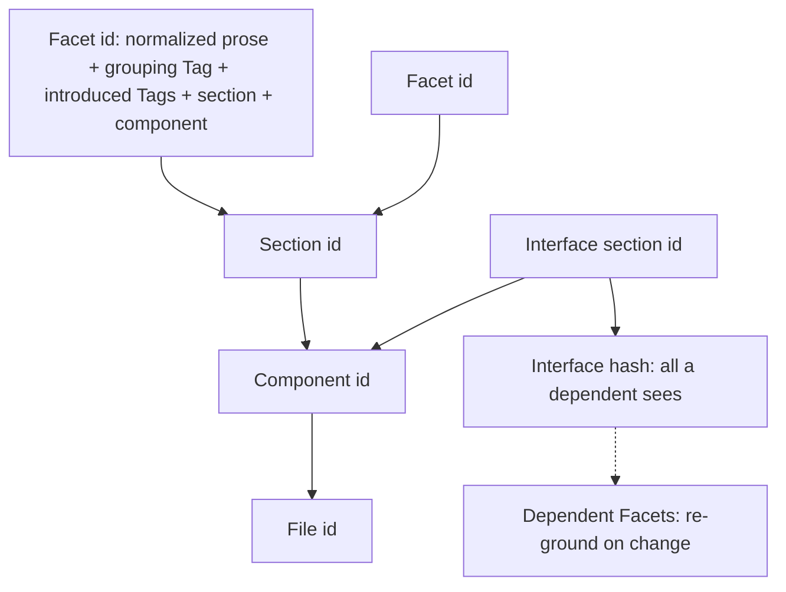
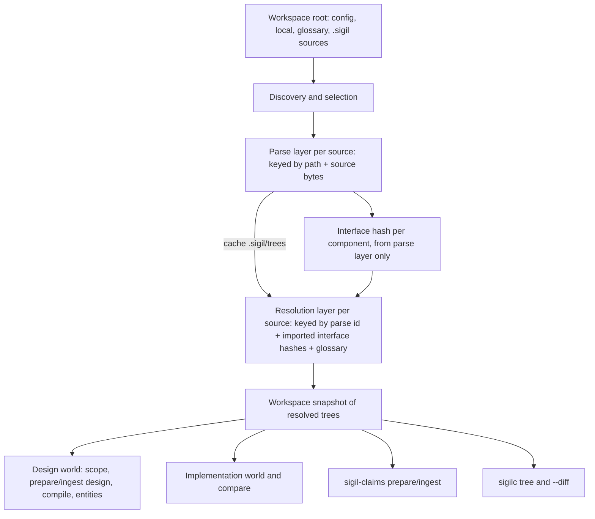
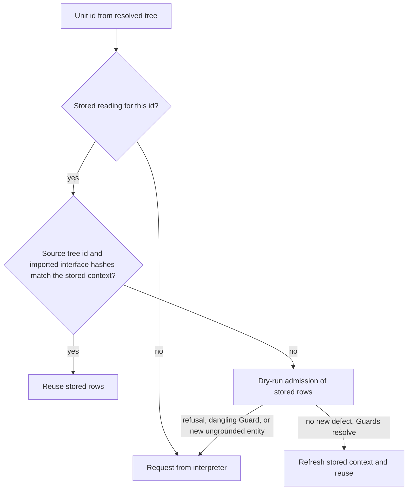

# sigilc incremental source trees - Plan

## Goal Capsule

- **Objective:** After a Sigil author edits contracts, recompiling design claims asks the external interpreter only about Facets whose meaning could have changed, so formatting edits, reordering, and a dependency's private edits cost no model calls or tokens.
- **Means:** sigilc reads `.sigil` sources itself and keeps one content-addressed tree per source, whose identities roll up from Facet to file and expose a per-component interface hash as the black-box boundary for dependents (KTD1, KTD3).
- **Product authority:** The maintainer's 2026-10-07 brainstorm decisions recorded under Product Contract Key Decisions. This plan covers the compile path only; moving the CLI and LSP onto sigilc is not active scope.
- **Stop conditions:** Stop and ask if the Rust parser cannot reach conformance parity on a corpus case without changing the language, or if a settled decision proves infeasible.
- **Execution:** Implement in this repository in three phases (see Phased Delivery); the implementing agent verifies each phase against the Verification Contract and hands it off for review as its own pull request.
- **Open blockers:** None.

---

## Product Contract

Product Contract preservation: restructured, no scope change. R2 now names imported interface hashes as an input to the resolved tree. R6 names the grouping Tag rather than a Facet name, because in Sigil's grammar `Name { … }` is a grouping Tag and a Facet is a run of prose. R6 counts references by their spelling. The "What counts as a change" Key Decision now routes referenced-interface changes through re-grounding (R13), the more specific of the two user answers. Outstanding Questions were resolved into KTD1, KTD7, KTD10 and KTD12.

### Summary

sigilc parses `.sigil` sources itself into one cached, content-addressed tree per source, replacing the TypeScript export. The tree has two layers: a parse layer that depends only on the source bytes, and a resolution layer keyed on the parse tree plus its imports' interface hashes. Every sigilc command (design world, implementation, scope, compare, and claims) reads those trees. Claims preparation re-grounds stored readings when a dependency interface moves and requests only units with no valid stored reading. Callers drop `sigil export design` and `--frontend`, and both parsers must pass a shared conformance corpus.

### Problem Frame

Today `sigil export design .` (TypeScript, `packages/core`) produces one flat JSON for the whole workspace, and every sigilc command reads it through `--frontend`. Identities in that JSON come from file paths and character offsets, and the claims cache keys each unit on raw prose text. Re-wrapping a paragraph, re-indenting, or moving a Facet within a section therefore changes the key, and the model re-reads Facets whose meaning did not change.

The cost also crosses files. A design binding records the checksum of every source in the import closure, so any edit to an imported file, including its private sections, marks every dependent `DependencyInvalidated`. The claims request presents each dependency's whole closure, so the same dependency Facets are handed over once per dependent. The author pays in wall-clock time and tokens to redo interpretation that was already correct.

The export step also splits compilation into two programs: a TypeScript producer that only sigilc consumes, and the Rust compiler. Every caller (VS Code, the benchmark, the skills) has to run the export first and keep the JSON fresh.

### Key Decisions

- **Compile path only in this work.** The CLI and LSP keep the TypeScript parser until a later phase. (session-settled: user-directed — chosen over making sigilc the only parser now, and over keeping the TS export for compilation: the incremental-compile win should not wait on porting editor features.) Governs R1, R17.
- **Merkle trees per source with a per-component interface hash.** Identity rolls up from Facet to section to component to file, so "did anything a dependent can see change?" is one comparison per import. (session-settled: user-approved — chosen over flat per-Facet ids and over one shared Facet store: rolled-up hashes make internals a black box and let a diff skip unchanged branches.) Governs R2, R8, R9, R10.
- **What counts as a change.** Moving a Facet to another section or component, or renaming its grouping Tag or a Tag it introduces, changes its id. A changed referenced dependency interface triggers re-grounding. Formatting and position within a non-Logic section are not changes. (session-settled: user-directed — chosen over treating section moves, component moves, renames, or referenced-interface changes as no-change.) Governs R5, R6, R13.
- **Re-ground before re-reading on dependency changes.** (session-settled: user-directed — chosen over always re-interpreting, which costs a model call per affected Facet, and over re-grounding only, which leaves broken claims unread.) Governs R13.
- **Strict black box for dependencies.** A dependent sees only imported interfaces, for interpretation and for invalidation alike. A dependent whose correctness relies on a dependency's internal flow requires that dependency to state it in its interface. (session-settled: user-directed — chosen over keeping dependency Logic flows as read-only claim context, and over exporting a computed flow summary in the interface hash: matches the language's interface-visibility rule.) Governs R11, R12. Conflict call-out from research: `step-excluded-action`, `step-negated-action` and `unguarded-flow` stop firing across components (`packages/sigilc/src/claims/claims.egg`, the `reachable` rules). `exclusive-foreign-write` fires only when the owning component states its exclusivity in its interface. KTD6 records the visible consequence.
- **Retire the structural export across all of sigilc.** (session-settled: user-approved — chosen over switching only the claims commands, and over a one-release deprecation of `--frontend`: one compile input path is the point of the change.) Governs R1, R15, R16.
- **Shared conformance corpus guards the two parsers.** (session-settled: user-directed — chosen over treating sigilc as the reference with the TS parser best-effort, and over freezing the grammar until phase 2.) Governs R17.
- **Whitespace collapses in prose but not in fenced payloads.** Code blocks inside Facets keep their exact bodies, because indentation carries meaning there. Governs R6.
- **Logic sections stay one unit, and their order counts.** A flow runs across the whole Logic section and step order is part of it. Editing or reordering one Logic paragraph re-reads its section. Governs R7, R14.
- **Trees are a disposable local cache.** They are not committed, consistent with `.sigil/worlds` and `.sigil/claims`. The first run after the upgrade re-reads every unit once, because stored interpretations use the old keys. Governs R3, R14.

---

### Requirements

**Reading sources**

- R1. Every sigilc command reads `.sigil` sources, workspace configuration, and the glossary from the workspace root directly, and no command accepts or requires a pre-exported structural JSON.
- R2. Each source produces its own tree of imports, components, sections, Facets, Tag introductions, references, and Inline Links, and that tree is reused while the source text, its configuration inputs, the interface hashes of its imports, and the compiler version are unchanged.
- R3. Trees live in the disposable `.sigil` cache, and deleting them changes nothing but the time the next run takes.
- R4. A source with parse or resolution errors still produces a tree that carries its diagnostics, keeps unresolved imports and ownerless units, and never yields a completed semantic verdict.
- R5. Trees keep source positions for diagnostics and editor locations, but no position, offset, or line number takes part in any identity.

**Content identity**

- R6. A Facet's id is derived from its normalized prose, the grouping Tag it sits in, the Tags it introduces, its section, and its owning component, where references count by their spelling in the prose, whitespace runs collapse to one space with ends trimmed, and fenced payload bodies stay exact.
- R7. A non-Logic section's id does not depend on the order of its Facets; a Logic section's id does, because step order is part of a flow.
- R8. Section, component, and file ids roll up from their children's ids, so an unchanged subtree has an unchanged id.
- R9. Each component exposes an interface hash covering exactly what an importer may select under the spec's interface-visibility rule, and nothing from its private sections.
- R10. Comparing a source's previous and current trees reports Facets added, removed, and changed by id, and skips every subtree whose id is unchanged.

**Imports and dependents**

- R11. A dependent's tree and its claims request include only the interface of each imported component, never a dependency's private sections.
- R12. Editing a dependency's private sections leaves every dependent's cached tree, interpretation, and freshness untouched.

**Incremental claims**

- R13. When a Facet is unchanged but the interface hash of a dependency it references changed, its stored claims are re-grounded against the new interface without a model call, and the Facet is requested again only if a claim no longer resolves.
- R14. Claims preparation requests only units whose id has no stored interpretation, where a unit is one Facet, or one whole Logic section.

**Callers and migration**

- R15. `sigil export design` and the `--frontend` option are removed, and the VS Code extension, the Slotted benchmark, the skills, and the READMEs drive sigilc against the workspace root instead.
- R16. Nothing called "frontend" remains in sigilc's commands, artifacts, or contracts; the sigilc and core Sigil contracts state that sigilc owns parsing and language resolution for compilation.
- R17. A shared corpus of valid and invalid `.sigil` fixtures, with expected structure and diagnostics, runs in CI against both the TypeScript parser and the sigilc parser, and any grammar change lands in both.



---

### Acceptance Examples

- AE1. **Covers R6, R10, R14.** Given a stored interpretation for every unit, when the author re-wraps and re-indents every paragraph in a source, the tree diff reports no changed Facets and claims preparation requests nothing.
- AE2. **Covers R6, R14.** Given a Facet whose fenced code block is re-indented, the Facet counts as changed and is requested again.
- AE3. **Covers R7, R10, R14.** Given a constraints section with three Facets, when the author swaps two of them, nothing is requested. When the author swaps two Logic paragraphs, that Logic section is requested.
- AE4. **Covers R6, R14.** Given an unchanged Facet body, when it is moved from `constraints` to `interface`, or into another component, or its grouping Tag is renamed, that Facet is requested again.
- AE5. **Covers R9, R12.** Given component A imported by B, when the author edits A's private sections, A's interface hash is unchanged and nothing in B is re-prepared or marked stale.
- AE6. **Covers R13.** Given B's Facet referencing A's interface Tag `X`, when A's interface prose for `X` changes and `X` still exists, B's stored claims are re-grounded and no model request is made. When `X` is removed, the B claims that name it fail grounding and only that B Facet is requested.
- AE7. **Covers R4.** Given a source with an unresolved import, its tree carries the diagnostic and the unresolved import, and no command reports a passing verdict for it.
- AE8. **Covers R13, R14.** Given a stored Constraint Guard in unit U that targets Facet T in the same component, when T's text changes, U fails re-grounding and is requested again together with T.

---

### Success Criteria

- On this repository's own contracts and the Slotted fixture, a workspace-wide reformat followed by claims preparation requests zero units.
- A one-Facet edit requests exactly one unit, or one Logic section.
- The conformance corpus passes against both parsers in `deno task test`.

---

<!-- ce-section: work-relationships -->
### How This Work Fits Together

This plan covers the compile path. The breakdown below is the current understanding, not a committed roadmap.

- Phase 2: the CLI and LSP move onto sigilc's parser, and the TypeScript parser is deleted.
  - Depends on this plan's sigilc parser and tree format.
  - Shares the conformance corpus (R17), which becomes its acceptance test.
- Model-assisted change matching: a typesafe.ai JEV model decides whether a change needs re-interpretation, or whether existing claims can be matched and updated.
  - Depends on this plan's re-ground step (R13) as the place it plugs in.
  - Still to decide: its inputs, and how a match result is admitted.

---

### Scope Boundaries

- The CLI's and LSP's own parsing, formatting, retrieval, and ownership features stay on `packages/core` until phase 2.
- Model-assisted change matching is deferred (see How This Work Fits Together).
- Implementation-world interpretation of code files keeps its per-source granularity; it only stops reading `frontend.json` (R1).
- Language changes: the grammar and the meaning of sections, Tags, and imports do not change.

#### Deferred to Follow-Up Work

- Deleting `packages/core/src/design-input.ts`: it stays as the TypeScript side of the conformance corpus (KTD12) until phase 2 retires the TS parser.
- Garbage collection beyond the per-source bound in KTD10, such as pruning tree entries for deleted sources outside `sigilc clean`.

---

### Dependencies / Assumptions

- Claims that today are checked against a dependency's internal Logic flow graph will no longer find those flows under the strict black-box decision. Findings on the Slotted fixture and the repository's contracts may shift. Contracts that relied on a dependency's internal flow need that flow stated in the dependency's interface.
- The claims request format and the stored interpretation keys change incompatibly, so existing prepared directories and stored interpretations are invalidated once under the disposable-cache decision.
- The interface-visibility rule in `spec/sigil-reference.md` (a Tag is importable only with evidence in its owner's interface) is the authority for what R9 covers.

---

### Sources / Research

- `packages/core/src/design-input.ts:215-248` — current component and Tag identities built from path, name, and offset.
- `packages/sigilc/src/frontend.rs` and `packages/sigilc/src/frontend_validation.rs` — the flat structural input and the invariants a native reader must now guarantee.
- `packages/sigilc/src/claims/memo.rs` — per-unit interpretation cache; Logic cached per section; Guards addressed by unit key and Facet index; closure excluded from the key.
- `packages/sigilc/src/claims/prepare.rs` — request format 3 widened presentation to the whole closure; prose is the raw `prose_range` slice, so payloads never reach the interpreter today.
- `packages/sigilc/src/claims/identity.rs` — admission and grounding; ungrounded rows are flagged as defects, with no re-read trigger.
- `packages/sigilc/src/inputs.rs` and `packages/sigilc/src/store.rs` — design bindings record every closure source's checksum and yield `DependencyInvalidated`; publication uses temp-file-plus-rename.
- `packages/sigilc/src/scope.rs` — closure worklist and the global `conservative_full_bundle` fallback.
- `packages/core/src/parser.ts`, `resolver.ts`, `inline-content.ts`, `tag-matching.ts`, `source-text.ts`, `workspace.ts`, `config.ts`, `glossary.ts`, `path.ts`, `diagnostics.ts` — the TypeScript pipeline the Rust parser mirrors; `packages/cli/src/fs-adapter.ts` holds the source-discovery skip rules.
- `spec/sigil.ebnf`, `spec/sigil-reference.md` (conformance examples C01–C06, diagnostics catalog, interface visibility) — normative grammar and behavior.
- `packages/core/tests/fixtures/design-input-080.json`, `design-cycle-080.json`, `design-scope-080.json` — current cross-language goldens whose embedded source texts seed fixture workspaces.
- `docs/plans/2026-09-30-1020-fix-interface-tag-visibility-plan.md` — prior decisions on interface-only importability.
- `docs/plans/2026-09-18-1719-feat-claims-flow-decomposition-plan.md` — origin of Logic-section units and cross-component flow laws.

---

## Planning Contract

### Key Technical Decisions

- KTD1. **Two-layer trees: parse layer and resolution layer.** The parse layer depends only on the source's normalized workspace-relative path, its bytes, and the tree format version, and it carries every Facet content id. The path is part of the key because the component IRI inside every Facet id embeds it, so a renamed or duplicated source never reuses another path's ids. The resolution layer is keyed on the parse tree id, the imported components' interface hashes, and the glossary digest, and it adds resolved Tag targets, import status, and diagnostics. Resolved dependency Tags never enter a Facet id, so a dependency interface change reaches dependents through re-grounding (R13), never through id churn. Governs R2, R6, R13.
- KTD2. **BLAKE3 with domain separation for every node id.** Ids use the existing `sources::hash` (BLAKE3), with a distinct kind-and-version tag per node kind (Facet, group, section, component, interface, file). SHA-256 stays only for the per-diagnostic `source_digest` in reports. Governs R6, R8.
- KTD3. **Facet ids keep the `facet:` namespace with a content hash.** A Facet id is `facet:` plus the hash of its component IRI, section, grouping Tag name, sorted introduced Tag names, normalized prose, and exact payload type and body. The 2nd and later Facets with an identical hash in the same section take an occurrence ordinal suffix; identical content makes their order immaterial. Component and Tag IRIs (`urn:sigil:component:…`, `…:tag:…`) keep today's format, so catalog and Turtle identities are unchanged. Governs R5, R6, R7.
- KTD4. **Roll-up rules.** A non-Logic section hashes its sorted Facet and group ids; a Logic section hashes them in source order. A component hashes its name and section ids. The interface hash is computed from the parse layer alone. It covers the component IRI, the interface section id, and the component's own Tags evidenced in its interface by definition, grouping heading, or spelled reference. Because it needs no resolution data, every interface hash exists before any source resolves, and valid import cycles need no ordering. A slightly over-inclusive Tag set can only cause extra invalidation, never a missed one. A file hashes its path, its sorted import declarations, and its component ids. Governs R7, R8, R9.
- KTD5. **Re-grounding runs in `prepare`, as a dry admission.** Each stored reading records the grounding context it was admitted under: the selected source's resolved tree id, provider component → interface hash, and the set of defects admission flagged at the time. `prepare` reuses a unit without re-checking only when the tree id and every interface hash still match. Otherwise it dry-runs admission over the stored rows. The unit goes stale on a refusal, a dangling Guard target, or an ungrounded entity absent from the stored defect set; success refreshes the stored context. Including the source's own tree id means that same-source changes (a Guard's target edited, a local Tag renamed or removed) also re-check stored rows. Recording the defect set means a defect that admission had already accepted does not force a re-read. Stored rows are replaced only when a fresh reading is admitted at `ingest`. Guards address their target by Facet id, not by unit key and index. Governs R13, R14. (session-settled: user-directed — chosen over always re-interpreting and over re-grounding only: R13 governs.)
- KTD6. **Claims request format 5 under the black box.** A request presents the selected source's units plus the interface units of each imported component. Its entity list covers local entities and Tags reachable through imported interfaces. Imported interface units are context, not interpretation targets: their stored readings come from the shared Facet-id memo and join the dependent's program. A dependent's `prepare` never requests them; they are requested when their own source is prepared, and until then the dependent's findings report them as uninterpreted context. `REQUEST_FORMAT` becomes 5 and the memo key version becomes v5. The claims contract's `decisions` role lists the laws that no longer fire across components. A Constraint naming an entity it can no longer see surfaces through the existing ungrounded-row defect. Governs R11, R14.
- KTD7. **The design world adopts the same black box.** A design binding replaces its dependency checksums and whole-closure structure hash with the source's resolved tree id plus imported interface hashes. `prepare design` presents the source's own tree and its imports' interface subtrees. The projection format is bumped, so stored projections read as `Incompatible` once. The global `conservative_full_bundle` fallback is removed: an unresolved import makes only its own source invalid. Governs R11, R12, AE5.
- KTD8. **Prepare/ingest binding over trees.** A claims binding covers the selected source's resolved tree id, its imported interface hashes, the guidance fingerprint, the vocabulary generation, the request format, and the presented unit ids. Edits to unrelated files or to a dependency's private sections no longer reject `ingest`. A mismatch message names the field that moved. `prepare` also reports a workspace digest (the hash of every resolved tree id) as run evidence. Governs R12, R14.
- KTD9. **Hand-written Rust parser, shared generated data, no new crates.** The parser mirrors the TypeScript modules and sigilc's hand-written `turtle.rs` style. One generator script emits the Unicode 15.1 word-character table and the HTML5 named-entity table for both TypeScript and Rust, so the two parsers read identical data. Avoiding new crates also keeps `eqval::fingerprint()`, which hashes `Cargo.lock`, stable. Governs R1, R17.
- KTD10. **Content-addressed tree cache under `.sigil/trees/`.** Parse entries are keyed by path, bytes, and format version (KTD1); resolution entries by the KTD1 resolution key. Both are stored by key, with a per-source pointer to the last two resolved trees so R10 can diff them. Writes use temp-file-plus-rename, as `store.rs` does. A corrupt or version-mismatched entry counts as a cache miss. Each source keeps at most its current and previous entries, `sigilc clean` removes the directory, and the directory is gitignored. Glossary and config digests key the resolution layer; config changes also change source selection. Governs R2, R3, R10.
- KTD11. **CLI surface.** `--root DIR` (default `.`) becomes the workspace root for every command. `sigil-claims` gains `--store DIR` (default `<root>/.sigil`), so callers such as the benchmark can isolate readings. A new `sigilc tree [--source PATH] [--diff]` prints resolved trees as deterministic JSON, and with `--diff` prints the R10 diff against the previous tree. VS Code relies on sigilc's existing report-version check in place of the export's schema check. Governs R1, R10, R15.
- KTD12. **The conformance corpus compares a normalized structural view.** Cases live in `spec/conformance/<case>/` as a workspace plus `expected.json`. The view lists components, sections, Facets (section, grouping Tag, prose range, introduced Tags, references with resolved target names, payload range), imports and selections with status, links, and diagnostics as code, stage, severity, range, and related ranges. It omits ids, because TypeScript keeps offset ids. It omits messages, because they embed V8 `JSON.parse` text. TypeScript projects the view from `loadDesignInput`, Rust from its resolved trees. Governs R17.

### High-Level Technical Design

Data flow from workspace to the commands that consume trees:



The claims `prepare` decision for each unit of the selected source (KTD5):



Directional sketch of id composition, not an implementation spec:

```text
facet_id     = "facet:" + H("facet/v1", component_iri, section, group_tag?, sort(introduced_tags), norm(prose), payload?) [+ ":" ordinal]
section_id   = H("section/v1", kind, logic ? ordered(children) : sorted(children))
component_id = H("component/v1", name, section_ids)
interface    = H("interface/v1", component_iri, interface_section_id, sort(importable_tags))
file_id      = H("file/v1", path, sorted(imports), component_ids)
norm(prose)  = collapse whitespace runs to " ", trim ends
```

### Assumptions

- The existing `sources::glob` matches the TypeScript `globMatches` for every pattern the corpus covers; the corpus pins any difference before callers migrate.
- `encodeURIComponent` compatibility in `packages/sigilc/src/frontend.rs` is correct today and moves unchanged into the new module.

### Phased Delivery

- **Phase A, native reading (U1–U4).** It adds the corpus, the Rust parser, and trees beside the existing JSON path, without changing behavior.
- **Phase B, compiler and callers on trees (U5, U6, U8).** Every sigilc command switches to trees and the new `--root`/`--store` surface. In the same phase, every in-repo caller, skill, and doc moves to that surface and to tree ids, because `deno task test` drives sigilc through those callers. The export still exists but nothing calls it.
- **Phase C, retirement (U7).** It removes the export and the `frontend` module and updates the contracts.

Each phase leaves `deno task test` green and can land as its own pull request.

### Risks & Dependencies

| Risk | Mitigation |
|---|---|
| Parser parity takes longer than planned: about 2,500 TypeScript lines across parser, resolver, inline content, tags, workspace, and config | Corpus-first (U1); port module by module against the corpus; reuse the existing goldens' embedded sources as fixtures |
| Facet id change invalidates catalog-reserved unit ids, stored design projections, and eqval required units | One-time `Incompatible` through the projection-format bump (KTD7); README and CHANGELOG say to run `sigilc clean` once |
| Slotted benchmark findings shift because cross-component flow laws stop firing | Record the shift in the benchmark docs; list the affected laws in the claims contract (KTD6) |
| Windows CI differences: path separators, CRLF, symlinks | Corpus cases with CRLF sources and nested paths; reuse sigilc's path normalization |
| Concurrent writers (VS Code and CLI) to the tree cache | Atomic temp-file-plus-rename writes, and a bad entry counts as a miss (KTD10) |

### System-Wide Impact

- **VS Code users** need a sigilc built from this change, because the extension stops calling `sigil export design`. The `languageExecutable` setting goes away.
- **Skill users** follow new command lines in `integrations/skills/sigil*`. The Tag inventory moves to `sigilc tree`.
- **Benchmark evidence** records the workspace digest (KTD8) in place of `frontendSha256`, so older retained runs stay readable but are not comparable.
- **Release smoke tests** in `.github/workflows/native-release.yml` and `scripts/fixtures/release-consumer/main.rs` change shape.

---

## Implementation Units

### U1. Conformance corpus and shared language data

- **Goal:** Establish the shared corpus and the generated data tables, proven against the current TypeScript parser before any Rust parser exists.
- **Requirements:** R17; KTD9, KTD12.
- **Dependencies:** None.
- **Files:**
  - Create `spec/conformance/README.md`, `spec/conformance/<case>/` workspaces with `expected.json`
  - Create `scripts/generate-language-tables.ts`; modify `packages/core/scripts/generate-word-characters.ts` (fold in or delegate)
  - Create `packages/sigilc/src/language/data/word_characters.rs`, `packages/sigilc/src/language/data/html_entities.rs` (generated)
  - Create `packages/core/tests/conformance_test.ts` (projects `loadDesignInput` into the KTD12 view)
  - Modify `deno.json` (generator task; include `spec/conformance` in fmt)
- **Approach:**
  1. Seed cases from the spec's C01–C06 examples, `parser_080_test.ts`, `tag_resolution_test.ts`, `inline_content_test.ts`, `workspace_080_test.ts`, and the sources embedded in the three `*-080.json` goldens.
  2. Cover every diagnostic code that can appear in the structural path, including the config and glossary workspace codes.
  3. Generate `expected.json` from the TypeScript projection once, then review it by hand against the spec.
- **Execution note:** Characterization-first: the corpus must pass on TypeScript before U3 starts.
- **Patterns to follow:** `packages/core/tests/fixtures/commonmark-inline-links.json` (data-driven cases); `packages/core/scripts/generate-word-characters.ts`.
- **Test scenarios:**
  - Every corpus case passes the TypeScript conformance test.
  - A case with CRLF line endings and a BOM projects the same ranges as its LF twin, offset by the extra bytes.
  - Regenerating the tables yields byte-identical files (generator is deterministic).
  - A deliberately wrong `expected.json` fails with a diff naming the field.
- **Verification:** `deno task test:core` runs the corpus and passes; the generated Rust tables compile.

### U2. Rust source text and workspace loading

- **Goal:** sigilc discovers and selects workspace sources and validates config, local config, and glossary, emitting the same workspace diagnostics as TypeScript.
- **Requirements:** R1, R4; KTD9.
- **Dependencies:** U1.
- **Files:**
  - Create `packages/sigilc/src/language/mod.rs`, `text.rs`, `workspace.rs`, `config.rs`, `glossary.rs`, `diagnostics.rs`
  - Modify `packages/sigilc/src/lib.rs`, `packages/sigilc/src/sources.rs` (share glob and path helpers)
  - Create `packages/sigilc/tests/language_workspace.rs`
- **Approach:**
  1. Port strict UTF-8 and NUL rejection, physical lines, and byte ranges from `source-text.ts`.
  2. Port nearest-ancestor config discovery, nested-config exclusion, include/exclude selection, and the `.git`, symlink, and `.sigil/` skip rules from `packages/cli/src/fs-adapter.ts`.
  3. Port glossary parse and per-file context-overlap diagnostics only; projections stay TypeScript-only.
  4. Order and coalesce diagnostics as `packages/core/src/diagnostics.ts` does.
- **Patterns to follow:** `packages/sigilc/src/sources.rs` (`discover`, `checked_path`, `glob`); `packages/core/src/workspace.ts`, `config.ts`.
- **Test scenarios:**
  - A workspace with nested `.sigil/config.json` excludes the nested subtree and reports `NESTED_CONFIG` where TypeScript does.
  - Invalid config JSON yields `CONFIG_PARSE` with stage `workspace` and no sources.
  - A source with invalid UTF-8 yields `INVALID_ENCODING` and no tree.
  - Default excludes (`node_modules/**` and the rest) and `.sigil/` contents are never selected.
  - A symlinked `.sigil` file is skipped.
  - Glossary term collision yields `GLOSSARY_TERM_COLLISION`.
- **Verification:** The workspace-shaped corpus cases pass through a Rust runner.

### U3. Rust parser, inline content, and resolver

- **Goal:** sigilc parses and resolves sources into the structural model, and every corpus case passes on both parsers.
- **Requirements:** R1, R4, R17; KTD9, KTD12.
- **Dependencies:** U2.
- **Files:**
  - Create `packages/sigilc/src/language/parse.rs`, `inline.rs`, `tags.rs`, `resolve.rs`
  - Create `packages/sigilc/tests/conformance.rs`
- **Approach:**
  1. Port the section grammar, prose-run Facets, grouping Tags, fenced payloads, and imports from `parser.ts`.
  2. Port the 79-column width rule from `prose-width.ts`.
  3. Port CommonMark-subset links and images and `*Tag*` definitions from `inline-content.ts`, using the generated entity table.
  4. Port longest-match word-boundary references from `tag-matching.ts`.
  5. Port import resolution, interface-evidence importability, and collision checks from `resolver.ts`.
  6. Move the `encodeURIComponent` helper out of `frontend.rs` unchanged.
- **Execution note:** Work case by case against the corpus; do not tune expected output to match Rust.
- **Patterns to follow:** `packages/sigilc/src/turtle.rs` (hand-written parser style); the TypeScript modules named above.
- **Test scenarios:**
  - Every corpus case passes the Rust conformance runner.
  - A line ending in `{` covered by a complete link stays prose.
  - An unknown section's balanced body is skipped with `UNKNOWN_SECTION`.
  - Importing a Tag only evidenced outside the provider's interface yields `UNRESOLVED_IMPORTED_TAG`.
  - An HTML entity in a link title decodes the same as TypeScript (`&amp;`, a numeric reference, and an unknown name).
  - A Unicode word boundary case from Unicode 15.1 matches TypeScript.
- **Verification:** `cargo test --locked` runs the conformance runner green, and `deno task test:core` stays green on the same corpus.

### U4. Merkle trees, tree cache, and diff

- **Goal:** Produce two-layer per-source trees with content ids, roll-up hashes, and interface hashes, cached and diffable.
- **Requirements:** R2, R3, R5–R10; KTD1–KTD4, KTD10.
- **Dependencies:** U3.
- **Files:**
  - Create `packages/sigilc/src/tree/mod.rs`, `ids.rs`, `cache.rs`, `diff.rs`
  - Modify `.gitignore` (add `**/.sigil/trees/`)
  - Create `packages/sigilc/tests/tree.rs`
- **Approach:**
  1. Compute parse-layer ids per KTD3 and KTD4.
  2. Compute every component's interface hash from the parse layer first (KTD4), then resolve each source with its imports' interface hashes in its resolution key (KTD1), so import cycles need no ordering.
  3. Build a workspace snapshot that holds every resolved tree.
  4. Cache per KTD10.
- **Technical design:** See the id-composition sketch in High-Level Technical Design.
- **Test scenarios:**
  - Covers AE1. Re-wrapping and re-indenting every paragraph leaves every Facet id and the file id unchanged.
  - Covers AE2. Re-indenting a fenced payload body changes that Facet's id only.
  - Covers AE3. Swapping two constraints Facets keeps the section id; swapping two Logic paragraphs changes the Logic section id.
  - Covers AE4. Moving a Facet between sections, between components, or renaming its grouping Tag changes its id.
  - Covers AE5. Editing A's `logic` or `constraints` leaves A's interface hash unchanged and B's resolution key unchanged.
  - Two identical Facets in one section receive distinct ids via the ordinal suffix, and deleting one leaves the other's id as the base id.
  - The diff between two trees lists added, removed, and changed Facets, and does not descend into equal subtrees.
  - Renaming a source with unchanged bytes yields Facet ids under the new component IRI, and two byte-identical sources at different paths get distinct ids.
  - Two sources that import each other (the cycle fixture) both resolve, and editing one's interface changes the other's resolution key.
  - A truncated cache entry is treated as a miss and rebuilt.
  - Deleting `.sigil/trees/` changes no output.
- **Verification:** Tree tests pass; building trees for this repository's contracts twice reuses every cache entry on the second run.

### U5. Design, implementation, and scope commands on trees

- **Goal:** Every sigilc design, implementation, scope, entities, and compare command reads the workspace snapshot instead of `--frontend`, with interface-hash freshness.
- **Requirements:** R1, R4, R11, R12, R15; KTD7, KTD11.
- **Dependencies:** U4.
- **Files:**
  - Modify `packages/sigilc/src/cli.rs`, `main.rs`, `scope.rs`, `inputs.rs`, `catalog.rs`, `design.rs`, `report.rs`, `store.rs`
  - Create `packages/sigilc/src/tree/command.rs` (`sigilc tree`)
  - Modify `packages/sigilc/tests/support/mod.rs` (`.sigil` workspace builder replacing JSON builders)
  - Modify `packages/sigilc/tests/cli.rs`, `design.rs`, `design_cli.rs`, `scope.rs`, `scope_cli.rs`, `inputs.rs`, `store.rs`, `catalog.rs`, `report.rs`, `implementation.rs`, `implementation_cli.rs`, `comparison.rs`, `eqval.rs`
  - Create `packages/sigilc/tests/tree_cli.rs`
- **Approach:**
  1. Replace each `DesignInput` field read with the matching snapshot query, module by module.
  2. Rebuild the design binding per KTD7 and bump the projection format.
  3. Present dependency interface subtrees in `prepare design`.
  4. Remove `conservative_full_bundle`.
  5. Drop the capture-against-disk check, because sigilc now reads the bytes itself.
  6. Convert the `*-080.json` goldens into fixture workspaces under `packages/sigilc/tests/fixtures/`.
- **Execution note:** Migrate the support builder first, so each test file moves to `.sigil` fixtures before its module changes.
- **Patterns to follow:** `packages/sigilc/src/store.rs` freshness and publication; existing CLI argument parsing in `cli.rs`.
- **Test scenarios:**
  - Covers AE5. After an ingested design projection for B, editing A's private section leaves `stale design` reporting B `fresh`.
  - Editing A's interface marks B `dependency-invalidated`.
  - Covers AE7. A source with an unresolved import is reported invalid and blocks `compile design` for its scope, while unrelated sources stay fresh.
  - `prepare design` output for B contains A's interface subtree and none of A's private Facets.
  - A projection stored under the old format reads as `incompatible`.
  - `sigilc tree --source X` prints deterministic JSON, and `--diff` after a one-Facet edit lists exactly that Facet as changed.
  - Implementation `prepare`, `compile`, and `compare` work from `--root` with `--selection`.
- **Verification:** All sigilc tests pass without any JSON design-input fixture; `cargo clippy -D warnings` is clean.

### U6. Claims on trees: black box, memo, re-grounding, binding

- **Goal:** `sigil-claims prepare/ingest` read trees, present interfaces only, key the memo on unit ids, re-ground at prepare, and bind on tree identities.
- **Requirements:** R11, R13, R14; KTD5, KTD6, KTD8, KTD11.
- **Dependencies:** U5.
- **Files:**
  - Modify `packages/sigilc/src/claims/cli.rs`, `prepare.rs`, `memo.rs`, `identity.rs`, `context.rs`, `findings.rs`, `program.rs`
  - Modify `packages/sigilc/src/bin/sigil-claims.rs`
  - Modify `packages/sigilc/tests/claims_cli.rs`, `claims_prepare.rs`, `claims_dialect.rs`, `claims_context.rs`, `claims_findings.rs`, `claims_laws.rs`, `claims_guidance.rs`, `claims_egglog_skill.rs`
- **Approach:**
  1. Build requests from the snapshot (KTD6) and make units the tree's Facet ids, with Logic sections as one unit.
  2. Store each reading with its grounding context: the source tree id, the interface hashes, and the admitted defect set (KTD5).
  3. Add the dry-admission pass to `prepare` (KTD5).
  4. Re-address Guards by Facet id.
  5. Replace `export_digest` with the KTD8 binding.
  6. Add `--store` and emit the workspace digest.
  7. Rewrite the claims tests that hand-edit export JSON as `.sigil` fixtures.
- **Execution note:** Write the AE1, AE6, and AE8 integration tests first; they define the behavior that matters most.
- **Test scenarios:**
  - Covers AE1. After a full ingest, reformatting every source makes `prepare` request zero units.
  - Covers AE3. Swapping two Logic paragraphs requests exactly that Logic section.
  - Covers AE6. Changing A's interface prose while Tag `X` survives makes `prepare` for B request nothing and refresh the stored context. Removing `X` requests only the B Facet whose rows name `X`.
  - A's edited interface unit is never requested by B's `prepare`. It is requested when A is prepared, and B's findings list it as uninterpreted context until then.
  - Covers AE8. Editing a Guard's target Facet requests both the target and the Guard's unit.
  - Renaming a Tag defined in the selected source requests only the units whose stored rows name the old Tag; other units pass the dry admission and are reused.
  - A stored reading that already carried an ungrounded-row defect is reused after an unrelated dependency interface change.
  - The request for B contains no Facet from A's `logic`, `state`, or `constraints`, and no entity introduced only there.
  - Editing an unrelated source between `prepare` and `ingest` does not reject `ingest`. Editing the selected source does, naming the tree id field.
  - A Constraint naming a dependency entity that is now invisible is reported as an ungrounded-row defect.
  - Two runs with different `--store` directories never reuse each other's readings.
  - A store holding v4 memo entries reads as empty and requests every unit once.
- **Verification:** All claims tests pass; the egglog laws suite passes, with the cross-component flow cases rewritten to state flows in interfaces.

### U7. Retire the export and the frontend module; update contracts

- **Goal:** Remove `sigil export design`, the `frontend` module, and every `--frontend` mention, and bring the Sigil contracts in line.
- **Requirements:** R15, R16; KTD6, KTD7.
- **Dependencies:** U8.
- **Files:**
  - Delete `packages/sigilc/src/frontend.rs`, `packages/sigilc/src/frontend_validation.rs`, `packages/sigilc/tests/frontend.rs`, `frontend_080.rs`, `structural_binding_080.rs`
  - Modify `packages/sigilc/src/lib.rs`, `packages/sigilc/README.md`
  - Modify `packages/sigilc/_module.sigil`, `sources.sigil`, `scope.sigil`, `store.sigil`, `report.sigil`, `claims.sigil`, `catalog.sigil`, `eqval.sigil`
  - Modify `packages/core/src/design-input.sigil`, `packages/core/_module.sigil` as needed
  - Modify `packages/cli/src/args.ts`, `commands.ts`, `main.ts`, `core-adapter.ts`, `packages/cli/_module.sigil`, `packages/cli/README.md`
  - Delete `packages/cli/tests/design_export_test.ts`; modify `packages/cli/tests/cli_test.ts`
  - Modify `CHANGELOG.md`, `PRE_RELEASE.md`, `COMPATIBILITY.md`
- **Approach:**
  1. Replace the `FrontendBoundary` Facets with a short `SourceTrees` commitment stating that sigilc owns parsing and resolution for compilation.
  2. Drop the `ResolvedDesignInput` imports from the sigilc contracts.
  3. Add a `decisions` Facet to `claims.sigil` listing the laws that no longer fire across components.
  4. Keep the contract prose short (one or two sentences per commitment).
  5. Update the `@sigil implements` annotations to the new targets.
- **Patterns to follow:** Existing `decisions` Facets in `packages/sigilc/claims.sigil`.
- **Test scenarios:**
  - `sigil export design` is an unknown command with a usage error.
  - Every sigilc command rejects `--frontend` with a usage error naming `--root`.
  - `build/sigil check .` passes on the edited contracts with no unresolved `@sigil implements` targets.
  - No identifier, flag, artifact, or contract in `packages/sigilc` contains "frontend".
- **Verification:** `deno task test` passes; a repository search for `--frontend` and `export design` finds only CHANGELOG history.

### U8. Migrate callers, skills, and docs

- **Goal:** Every caller drives sigilc against the workspace root, in the same phase as the sigilc command-line change, so `deno task test` stays green.
- **Requirements:** R15; KTD8, KTD11.
- **Dependencies:** U6.
- **Files:**
  - Modify `integrations/editor/vscode/src/compilation.ts`, `extension.ts`, `package.json`, `README.md`, `tests/unit/compilation.test.ts`, `integrations/editor/vscode/_module.sigil`
  - Modify `scripts/validate-native-protocol.ts`
  - Modify `scripts/fixtures/release-consumer/main.rs`, `.github/workflows/native-release.yml`
  - Modify `scripts/slotted-benchmark/batch.ts`, `claims.ts`, `fixture.ts`, `report.ts` and their `*_test.ts`; benchmark docs
  - Modify `integrations/skills/sigil/SKILL.md`, `integrations/skills/sigil/references/compilation-execution.md`, `integrations/skills/sigil-compute/references/computed-evaluation.md`, `integrations/skills/sigil-compute/evals/computed-evaluation-fixture.md`, `integrations/skills/sigil-write/references/contract-prose.md`
  - Modify `docs/quickstart.md`, `docs/setting-up-a-project.md`, `CONTRIBUTING.md`
- **Approach:**
  1. VS Code drops the export step and the `languageExecutable` setting, and invokes `sigilc compile … --root`.
  2. The benchmark passes `--root` (the fixture workspace) and `--store` (its private directory), records the workspace digest, and replaces in-process `loadDesignInput` with `sigilc tree`.
  3. `validate-native-protocol.ts` takes the unit and entity ids for its fixed Turtle from `sigilc tree` instead of the export, because unit ids become content ids (KTD3).
  4. The `sigil-write` Tag inventory switches from `jq` over `.entities` to `sigilc tree`.
  5. Run the skill sync script if the skill-language validators require it.
- **Test scenarios:**
  - The VS Code unit test for compilation spawns only sigilc, with `--root`.
  - `deno task test:native:protocol` passes using `--root`.
  - The release-consumer smoke test compiles a design without an export step.
  - Covers AE1. The Slotted benchmark fixture test, run twice with a reformat between runs, records zero requested units on the second `prepare` when sharing a store.
  - `deno task test:skill` and `deno task test:skill:native` pass with the new command lines.
- **Verification:** `deno task test` passes end to end, including the VS Code extension and Slotted benchmark tasks.

---

## Verification Contract

| Gate | Command | Applies to |
|---|---|---|
| Rust format and lint | `cargo fmt --check --manifest-path packages/sigilc/Cargo.toml`; `cargo clippy --locked --manifest-path packages/sigilc/Cargo.toml -- -D warnings` | U2–U7 |
| Rust tests, conformance runner included | `deno task test:sigilc` | U1–U7 |
| TypeScript corpus and core tests | `deno task test:core` | U1, U3 |
| TS format, lint, typecheck | `deno task fmt`; `deno task lint`; `deno task check` | U1, U7, U8 |
| Native protocol | `deno task test:native:protocol` | U5–U8 |
| Benchmark | `deno task test:slotted-benchmark` | U8 |
| Full suite | `deno task test` | end of each phase |
| Contract check | `build/sigil check .` after `deno task build:cli` | U7, U8 |

CI (`.github/workflows/ci.yml`) runs these gates on Linux, macOS, and Windows; each phase must pass on all three.

---

## Definition of Done

- Every R1–R17 is satisfied and every AE1–AE8 has a passing test named in a unit.
- The Success Criteria hold: a measurement on this repository's contracts and on the Slotted fixture shows zero requested units after a workspace-wide reformat, and exactly one unit (or one Logic section) after a one-Facet edit.
- The conformance corpus passes on both parsers in CI on all three platforms.
- No `--frontend`, `sigil export design`, or sigilc `frontend` module remains outside CHANGELOG history.
- The Sigil contracts for sigilc, core, CLI, and the VS Code extension pass `sigil check`, with short commitments.
- Abandoned-attempt code and unused JSON fixtures are removed from the diff.
- Per unit: its test scenarios exist and pass, and its Verification line holds.
