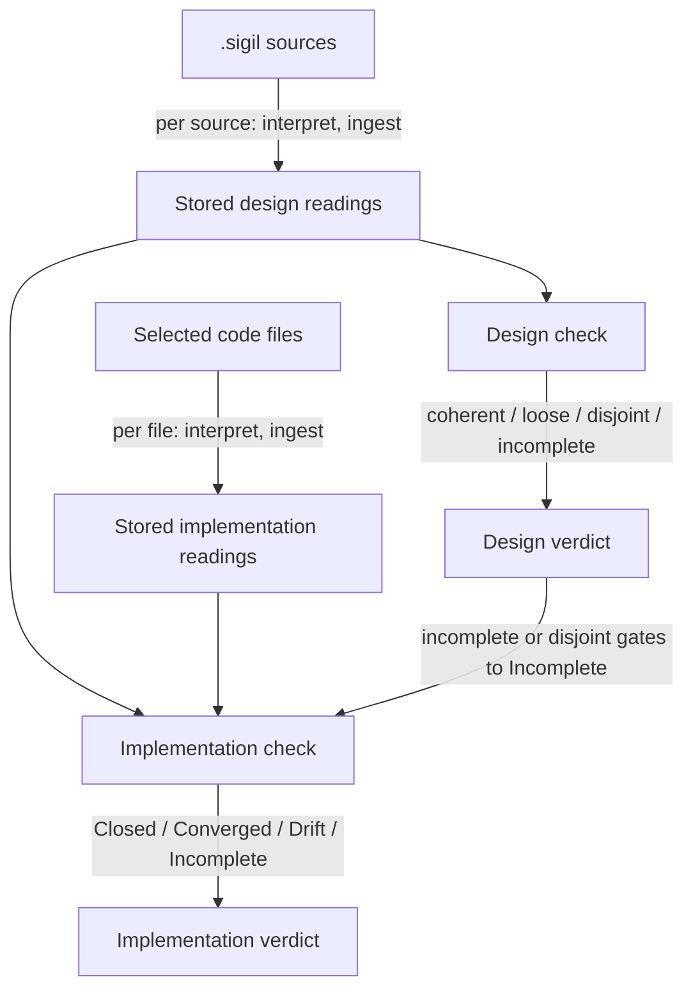
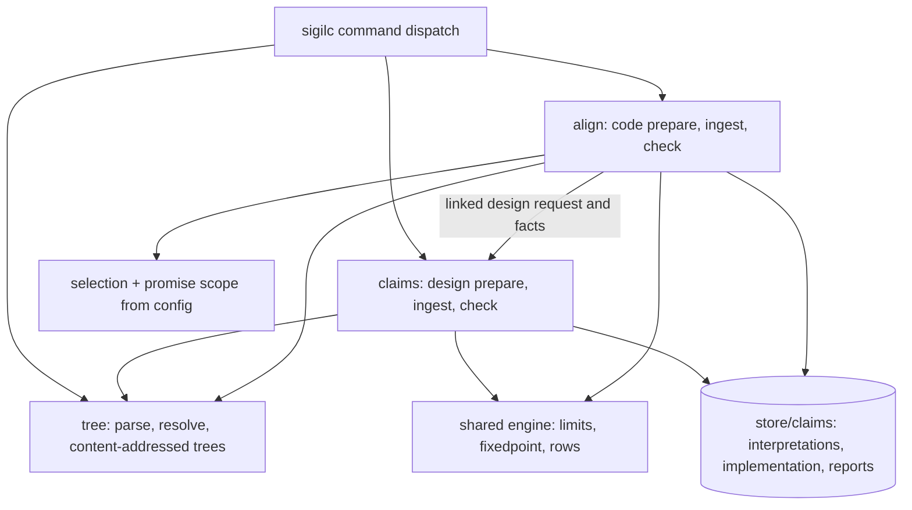
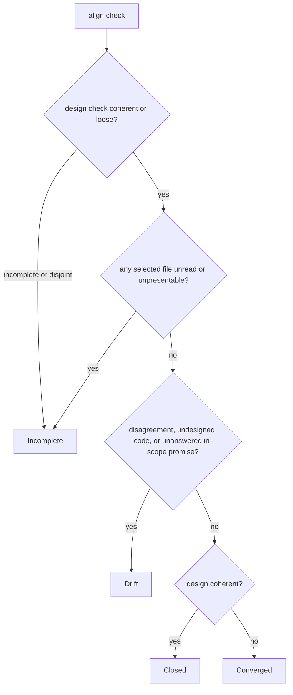
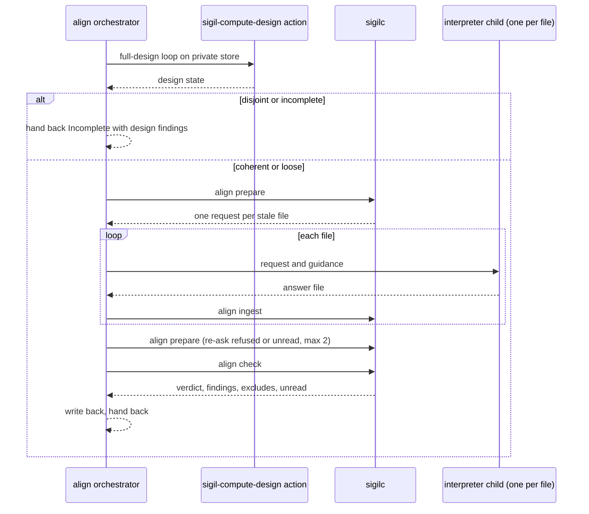

# Claims check replaces sigilc's Turtle worlds - Plan

## Goal Capsule

- **Objective:** A Sigil user checks a design, and the code that implements it, with one native tool and one interpretation loop. They learn when code breaks a design promise, and when code exists that the design never accounts for.
- **Means:** Retire `sigilc`'s Turtle Design and Implementation worlds, move the `sigil-claims` loop into `sigilc` unchanged, and add a per-file Implementation check with its own code vocabulary and laws (KTD2, KTD5, KTD8).
- **Product authority:** The maintainer's 2026-10-09 brainstorm and planning decisions, recorded under Product Contract Key Decisions. Not active scope: `sigil-align`'s advisory review, the legacy 0.7 `sigil` skill, per-language code parsing, and `@sigil` code annotations as evidence.
- **Stop conditions:** Stop and ask if linking the Slotted design plus its implementation readings breaches the saturation limits in the shared engine module, if a settled decision proves infeasible, or if the Slotted implementation cannot reach Closed or Converged without designing plumbing the user has not agreed to.
- **Execution:** Implement in this repository in phase order: the `sigilc` foundation (U1–U4), the Implementation check (U5–U8), skills and editor (U9–U12), then release and benchmark (U13–U15). Each unit is verified against the Verification Contract.
- **Open blockers:** None.

---

## Product Contract

Product Contract preservation, with changes listed by ID.
- R5, R16 and R18 changed, and R21 added, from user decisions in the planning session. The selection now lives in workspace config, promises are scoped to configured design roots, and `sigil-compute-align` runs the design loop first.
- Three Key Decisions were added for those choices.
- The Outstanding Questions were resolved into KTD2, KTD5, KTD6, KTD7, KTD9 and KTD12.

### Summary

`sigilc` becomes Sigil's only native binary. Its design check is today's `sigil-claims` loop, and a new implementation check reads code file by file. The interpreter describes each file in code terms, then maps what it found onto the names the design declares. The check reports Closed, Converged, Drift or Incomplete. Code the design does not account for is Drift.

### Problem Frame

Sigil has two ways to check a design. The Turtle path (`sigilc prepare/ingest/compile design`) and the claims path (`sigil-claims prepare/ingest/check`) each have their own interpretation format, store, vocabulary and verdict set. On the Slotted design, the claims path caught planted problems that the Turtle path missed.

The Implementation side is tied to the weaker path. `prepare implementation` and `compare` need the frozen catalog that only the Turtle Design world produces. `compare` checks only in one direction, design to code. It asks whether each design obligation is met, and never whether code exists that no obligation covers. No 0.9 skill uses it: `sigil-align` tells agents not to invoke `sigilc` because "Its Sigil 0.9 implementation comparison path is unverified."

Keeping both paths means carrying two of everything, while the better design check cannot reach code.

### Key Decisions

- **Retire the Turtle Design path entirely.** The claims check is the only design check, and nothing keeps a Turtle Design world alive to feed Implementation. Governs R2, R3. (session-settled: user-directed — chosen over keeping Turtle Design only to feed Implementation, and over dropping Implementation alignment until a claims version exists: claims already catches what the Turtle path missed, and a half-kept path keeps every duplicate.)
- **Retirement and the claims-based Implementation check ship as one plan.** Governs R1–R21. (session-settled: user-directed — chosen over retiring Design first and leaving Implementation without a catalog, and over rebuilding Implementation first.)
- **Implementation readings use their own code vocabulary.** What the code is and does is stated in code terms, and separate rows map it onto design names. Governs R6, R7. (session-settled: user-directed — chosen over reusing the design claim dialect with an "observed" modality, and over keeping Turtle against a new catalog: observation and mapping stay separate and reviewable, and undesigned code becomes visible.)
- **Undesigned code fails the check.** Governs R11. (session-settled: user-directed — chosen over a warning that never fails and over a context-only note: the design must account for the code it governs.)
- **The unit of code is the whole file.** No per-language parser, now or as recorded follow-up. Governs R5, R11. (session-settled: user-directed — chosen over tool-parsed top-level definitions, over parsing as later follow-up, and over trusting the interpreter's element list as the only floor.)
- **The interpreter writes every mapping.** `@sigil implements|uses|tests` annotations (ADR-020) are not read as evidence. Governs R8. (session-settled: user-directed — chosen over treating annotations as tool-written mappings with the interpreter filling gaps, and over annotations as the only mapping.)
- **One binary: everything lives in `sigilc`.** Governs R1. (session-settled: user-approved — chosen over keeping `sigil-claims` as a second binary and over renaming the merged tool `sigil-claims`.)
- **The Implementation verdict keeps Closed / Converged / Drift and adds Incomplete.** It is gated on the design check. Governs R12, R13. (session-settled: user-directed — chosen over reusing the design's coherent/loose/disjoint/incomplete names: the two verdicts must not be confused.)
- **Skills split by side.** `sigil-compute` becomes `sigil-compute-design`, and a new `sigil-compute-align` runs the Implementation check. They are the computed partners of `sigil-evaluate` and `sigil-align`. Governs R15–R17. (session-settled: user-directed — the user's own shape, chosen over adding an implementation action to `sigil-compute`, over switching `sigil-align` to computed evidence, and over shipping CLI and benchmark only.)
- **The VS Code compile commands move to the new check.** Governs R18. (session-settled: user-approved — chosen over removing the commands and over deferring the port.)
- **The old compare laws carry over even where the benchmark does not plant them.** Governs R10. (session-settled: user-approved — chosen over keeping only the laws the benchmark exercises: `requires` through a dependency and `excludes` would otherwise lose their regression bar silently.)
- **Removal ships as a breaking 0.x release.** Governs R19, R20. (session-settled: user-approved — chosen over a deprecation window: Sigil is pre-production, and `sigil export design` was removed the same way.)
- **The selection lives in workspace config.** Governs R5, R18. (session-settled: user-approved — chosen over a conventional `selection.json` file and over an explicit flag with no default: one committed place that the CLI, VS Code and the skill all read.)
- **Promises are judged only inside configured design roots.** Governs R21. (session-settled: user-approved — chosen over judging only components the code touches, and over always judging the whole design: components implemented elsewhere must not force permanent Drift, and a component with no code must still be caught.)
- **`sigil-compute-align` runs the design loop first.** Governs R16. (session-settled: user-approved — chosen over reading code and handing back Incomplete, and over stopping before code: one request yields a real verdict.)

### Requirements

**One binary, Turtle retired**

- R1. `sigilc` is the only native binary. The design check and the Implementation check are its commands, and `sigil-claims` is no longer built, packaged or installed.
- R2. The Turtle Design path is removed: `prepare/ingest/stale/compile design`, `entities`, the Turtle ontology, and the frozen Design catalog.
- R3. The Turtle Implementation path and `compare` are removed, along with the generated worlds cache. `clean` still removes worlds left in an existing store.
- R4. Apart from the day-count bound in R10, the design check behaves as `sigil-claims` does today: per-source interpretation against imported interfaces, the linked check, the coherent/loose/disjoint/incomplete states, and their exits.

**Reading code**

- R5. The Implementation check reads the files a selection picks (`dirs`, `include`, `exclude`, `vendorDirs`). The selection lives in the workspace config. Each selected file is one unit, captured whole.
- R6. The interpreter answers each file with data-only egglog rows in a code vocabulary. Element rows describe what the code is and does in code terms. `realizes` rows map an element onto a design name.
- R7. A `realizes` row names only a name the design declares. A row that coins a name, or uses a name the file may not use, is refused.
- R8. Every `realizes` row comes from the interpreter. Code annotations are not read.
- R9. Refusal, re-asking and freshness work per file, as they work per Facet for the design. A wrong row refuses only its own file. A refused or unread file keeps the check Incomplete. Only files whose content, or the design they are read against, changed are asked again.

**Judging code against the design**

- R10. Laws judge design promises against Implementation readings. They cover at least every law the old `compare` enforced: provides, requires through a dependency, excludes, required state owner, exclusive ownership, and numeric budget. The numeric budget law also covers day-count bounds, which the design and code vocabularies can both state.
- R11. Code is undesigned when a selected file has no `realizes` row, or when an element the interpreter lists has none. Undesigned code makes the verdict Drift. Files the selection excludes are not judged.
- R12. The verdict is:
  - Incomplete while any selected file is unread, or while the design check is incomplete or disjoint.
  - Otherwise Drift on any disagreement, any undesigned code, or any required design promise the code leaves unanswered. Each unanswered promise gets a finding naming it.
  - Otherwise Closed when the design is coherent.
  - Otherwise Converged, meaning the design is only loose.
- R13. Exits follow the compiler's convention: 0 for Closed or Converged, 1 for Drift or Incomplete, 2 for usage, 3 for operational failure.
- R14. Each finding cites the design claims, the Implementation rows by file and element, and the law that produced it. Every Implementation report lists the exclude patterns in force and how many selected files they removed.
- R21. The workspace config names the design roots the code implements; the default is the whole workspace design. Promises of components outside those roots and their required imports are not judged, and the report lists those components.

**Skills and editor**

- R15. `sigil-compute` is renamed `sigil-compute-design`. Its behavior is unchanged apart from invoking `sigilc`. Every live reference to the old name is updated, and the rename is recorded as a new CHANGELOG entry. Released CHANGELOG entries and recorded evaluation evidence keep the old name.
- R16. A new `sigil-compute-align` skill runs the Implementation loop: prepare, interpret each file, ingest, check. Before reading code it runs `sigil-compute-design`'s full-design action on the same store. It hands back the verdict and findings. `sigil-align` stays advisory.
- R17. `sigil-compute-align` teaches selection excludes as the intended way to keep plumbing out of the check (logging, build glue, generated code), and the alternative of designing it. The skill proposes new excludes to the user and never adds or widens them on its own.
- R18. The VS Code `sigil.compileFile` and `sigil.compileWorkspace` commands run the new design and Implementation checks over stored readings. They keep the executable and focus settings, and read the selection from workspace config.

**Release and callers**

- R19. The release workflow, installers, release consumer fixture, native protocol validator, and `sigilc`'s own CLI tests use the new commands. Nothing outside the legacy 0.7 `sigil` skill and its validator references a retired command or the `sigil-claims` binary; those two keep targeting the pinned old compiler.
- R20. READMEs, the quickstart, COMPATIBILITY and CHANGELOG describe the single binary. CHANGELOG records the removals as breaking.

### Key Flows

- F1. Design check
  - **Trigger:** An author, or `sigil-compute-design`, checks a design.
  - **Steps:** Prepare each source; the interpreter answers each request; ingest each answer; run the linked check.
  - **Outcome:** coherent, loose, disjoint or incomplete, with findings.
  - **Covered by:** R1, R4
- F2. Implementation check
  - **Trigger:** `sigil-compute-align`, or an author, checks code against a design whose readings are stored.
  - **Steps:** Prepare each selected file; the interpreter writes element and `realizes` rows; ingest each answer; run the Implementation check over the stored design and Implementation readings.
  - **Outcome:** Closed, Converged, Drift or Incomplete, with findings.
  - **Covered by:** R5–R14, R16, R21

### Acceptance Examples

These use the design from the claims guidance examples. `SearchService` provides *search results*, and `SearchPanel` exclusively owns *active request*.

- AE1. **Covers R11, R12.** Given `src/log.rs` is selected and maps to no design name, when the check runs, then the verdict is Drift and a finding names `src/log.rs` as undesigned.
- AE2. **Covers R5, R11, R17.** Given the selection excludes `src/log.rs`, when the check runs, then `src/log.rs` is neither read nor judged.
- AE3. **Covers R6, R11.** Given `service.rs::normalize` is a helper whose `realizes` row names *search results*, when the check runs, then it is not undesigned.
- AE4. **Covers R10, R14.** Given `cache.rs` is read as writing *active request*, when the check runs, then the verdict is Drift. The exclusive-ownership finding cites the design's ownership claim and the `cache.rs` element.
- AE5. **Covers R12, R13.** Given one design source is unread, when the Implementation check runs, then it reports Incomplete and exits 1, whatever the code readings say.
- AE6. **Covers R9.** Given one file's answer contains a malformed row, when it is ingested, then only that file is refused and left unread. The verdict is Incomplete, and the next prepare asks for that file alone.
- AE7. **Covers R7.** Given an answer maps an element onto `RetryPolicy`, which the design does not declare, when it is ingested, then that file's answer is refused.
- AE8. **Covers R12.** Given every file is read, nothing is undesigned, no law disagrees, and every required promise is answered, when the design is coherent, then the verdict is Closed. When the design is only loose, it is Converged.
- AE9. **Covers R12, R13.** Given every file and design unit is read and nothing else is wrong, when no code realizes the required promise that `SearchService` provides *search results*, then the verdict is Drift, a finding names that promise, and the check exits 1.

### Success Criteria

- The Slotted benchmark gains an implementation of the Slotted design with planted problems: an undesigned file, an undesigned function inside a file that otherwise realizes a design name, a plumbing file that sits near a design name without realizing it, a second owner of exclusive state, a missing promise, and a breach of a day-count limit the Slotted design already states. Apart from the planted missing promise, the implementation answers every required promise. `sigil-compute-align` reports Drift, and each planted problem is scored across the repeated passes of a benchmark batch, not from one run.
- The same implementation without its planted problems reports Closed or Converged, with no undesigned findings, in every valid pass of a batch.
- The Slotted design's existing planted problems are found by the merged `sigilc` design check at least as often as `sigil-claims check` finds them before the merge.

### Scope Boundaries

- `sigil-align` stays advisory and does not consume the computed check.
- The legacy 0.7 `sigil` skill is not migrated. It pins `sigilcVersion: ^0.1.0`, so it keeps working against the old binary.
- No per-language parsing of code into definitions. Element rows describe a file; they are not checked against a parsed list.
- `@sigil` code annotations and the ADR-020 ownership query are unchanged and play no part in the check.
- Dogfooding the check on Sigil's own packages is not a success signal for this work.

#### Deferred to Follow-Up Work

- A `sigilc` store-sync command for write-back, replacing the compare-and-swap each skill performs by hand.
- Checkpointed write-back so an interrupted large-selection run keeps finished files.
- Path-scoped read permissions for interpreter children.

### Dependencies / Assumptions

- Sigil is a pre-production 0.x toolchain (`PRE_RELEASE.md`). Removing a CLI surface without a deprecation window follows the `sigil export design` precedent in `CHANGELOG.md`.
- The Slotted benchmark has a design fixture and four planted design problems, but no implementation codebase yet. This work adds one.
- Slotted states no latency, cost or risk budget; its numeric limits are day counts. Adding the day-count bound grows the design dialect, so stored design readings are asked once more.
- Today `install.sh`, `install.ps1` and the release workflow treat `sigil-claims` as an optional second binary. The Deno CLI installer only reads `sigilcVersion`.

### Sources / Research

- `packages/sigilc/README.md`: both binaries' command surfaces and the prepare/ingest boundary.
- `packages/sigilc/src/cli.rs` (around line 351): Implementation exits 3 with "current Design catalog unavailable" without a frozen catalog.
- `packages/sigilc/src/comparison.rs` and `packages/sigilc/src/comparison.egg`: the old compare laws and the Drift/Converged/Closed rule, which only checks design to code.
- `packages/sigilc/src/implementation.rs`: Implementation sources are whole files, assembled "without a source-language resolver".
- `packages/sigilc/src/claims/guidance/examples.md`: the `SearchService` / `SearchPanel` example used in the Acceptance Examples.
- `integrations/skills/sigil-align/SKILL.md`: the "do not invoke `sigilc`" rule.
- `integrations/editor/vscode/src/compilation.ts`: the editor's compile commands and state checks.
- Callers to migrate: `.github/workflows/native-release.yml`, `scripts/fixtures/release-consumer/main.rs`, `scripts/validate-native-protocol.ts`, `scripts/build-cli-release.ts`, `scripts/test-cli-release.ts`, `packages/sigilc/tests/claims_cli.rs` (`the_compilers_own_command_surface_is_unchanged`).
- Live `sigil-compute` name references: `README.md`, `integrations/README.md`, `COMPATIBILITY.md`, `scripts/validate-skill.ts`, `scripts/skill-foundation_test.ts`, `scripts/slotted-benchmark/`, `docs/skill-evaluation/sigil-compute.md`. Historical: released `CHANGELOG.md` entries and `docs/skill-evaluation/evidence/sigil-compute/`.
- `spec/decisions/adr-020-contract-owned-implementation-ownership-queries.md` and `spec/decisions/adr-011-generated-rationale-evidence-and-review-records.md`: the annotations this work leaves aside.
- Prior plans this builds on: `docs/plans/2026-10-07-1637-feat-claims-linked-check-plan.md`, `docs/plans/2026-10-08-1009-feat-claims-interpretation-robustness-plan.md`, `docs/plans/2026-10-07-1123-feat-sigilc-incremental-source-trees-plan.md`.

---

## Planning Contract

### Key Technical Decisions

**`sigilc` foundation**

- KTD1. **Lift shared engine pieces before deleting anything.** The claims code borrows the following from Turtle modules, and they move to surviving modules first:
  - `Limits`, `fixedpoint`, `rows` and `check_limits` from `eqval.rs`
  - `quote` from `assertions.rs`
  - `DesignBasis`, `SourceBasis`, `ImportedInterface` and `ContextIdentity` from `inputs.rs`
  - `Output`, `store_dir` and `read` from `cli.rs`

  Hash domain strings stay byte-identical: `sigil-claims-memo`, `sigil-claims-binding-v2`, `sigil-flow-graph-v1`, and the egglog program name `sigil-claims`. Renaming them would invalidate every stored reading for no gain.
- KTD2. **Design commands keep `sigil-claims`' exact flags; the Implementation check is the `align` group.**
  - Design: `sigilc prepare --source`, `sigilc ingest --binding --claims [--claims-repeat]`, `sigilc check [--source]` and `sigilc extract-guidance --out`. These carry the same flags, outputs and exits as today, so `sigil-compute-design` and the benchmark change only the binary name.
  - Implementation: `sigilc align prepare --out`, `sigilc align ingest --binding --claims` and `sigilc align check`.
  - Surviving commands: `tree` and `clean`.
  - Removed: `scope`, `ontology`, `entities`, `compare`, `stale` and every `design` or `implementation` subcommand.
  - The binary becomes version 0.3.0 and reports `sigilc 0.3.0`. Governs R1, R2, R3.
- KTD3. **The selection lives at `tools.sigilc.implementation` in `.sigil/config.json`, and in the local config.** It uses the config's existing namespaced `tools` extension point, so the core config schema and parser do not change. `sigilc` validates its own namespace strictly. The fields are today's `Selection` fields (`paths`, `dirs`, `include`, `exclude`, `vendorDirs`, `allowEmpty`) plus `design`, a list of design source roots. Implements R5, R21 under their Key Decisions.
- KTD4. **Promise scope reuses the scope closure.** The configured design roots expand through required imports and owners the way `scope.rs` resolves `design.paths` today. `scope.rs` stays as a library and loses its command. An absent `design` key means the whole workspace. Implements R21.

**Code vocabulary and reading**

- KTD5. **Two kinds of `realizes`, plus code-term rows.** A `realizes` row naming a component means membership: the element does work that at least one in-scope design claim of that component accounts for. Where the element sits does not decide membership, so an element doing work no in-scope claim covers gets no `realizes` row, even inside a file whose other elements belong to a component. A `realizes` row naming a Tag means delivery: this element delivers that Tag. Only membership makes an element act as a component, which mirrors the design-side rule that a Tag cannot act (commit 92b4eea). The other rows describe the code:
  - element: name, kind
  - act: element, relation in `uses`, `owns`, `invokes` or `dependsOn`, design name
  - measure: element, numeric name, number

  Further rules:
  - Element names are local to their file, and the tool qualifies them with the path.
  - A cross-file `uses` may target only a design name, never another file's element, so per-file reading stays sufficient.
  - A file answer with zero rows, or with no element row, is unread.
  - Test code has its own element kind, `test`. A test element realizes the names it exercises, so it is never undesigned, but its rows never count as membership or delivery. A test therefore cannot answer a promise or act as a second owner.

  Exact row spellings are settled while writing the guidance in U6. Implements R6, R7, R11.
- KTD6. **A code file is read against every name in promise scope.** Names are presented component-qualified (`Booking::booking request`). A bare label is accepted when it is unique within scope. An ambiguous bare label refuses the file, and the reason lists the qualified alternatives. A narrower per-file list would need to know what the file realizes, which is exactly what the reading produces. Implements R7.
- KTD7. **Per-file freshness grounds on cited names, not the whole design.**
  - The memo key is the file content hash plus the code vocabulary generation and the code guidance fingerprint. Paths stay out of the key, so a rename or a duplicate file reuses its reading.
  - Beside each reading the store keeps the digest of the design names its rows cite. When names change, the stored rows are re-admitted.
  - A file is asked again when its content changes, when a cited name changes or disappears, or when names are added and the file holds undesigned elements.
  - A file is also asked again when a name is added to, or a claim changes on, any component its stored rows name by membership. Otherwise a newly added promise that the code already delivers would show as a false unanswered-promise Drift that never clears.
  - Unrelated design edits ask nothing again. Implements R9.
- KTD8. **The Implementation laws, code vocabulary and code guidance live in their own files under their own fingerprint.** Today's guidance fingerprint covers `claims.egg` and `vocabulary.rs`, so putting Implementation laws there would ask every stored design reading again on each law edit. The new module is `packages/sigilc/src/align/`. Implements R6, R10.
- KTD9. **Day-count bounds are separate named measures.**
  - Design side: `maxDurationDays`, `maxLeadDays` and `maxSpanDays`.
  - Code side: `durationDays`, `leadDays` and `spanDays`, in whole days. The interpreter converts.

  Slotted puts two limits (7 days, 180 days ahead) on one *booking request*, so a single generic name could not tell them apart. A required design bound that no code measure answers counts as unanswered. The design vocabulary generation bumps once. Latency keeps `latencyBudgetMs` against `latencyMs`. Implements R4, R10.
- KTD10. **Each presented file gets its own binding.**
  - `align prepare` writes one subdirectory per presented file, under a tool-chosen safe stem.
  - The binding holds the path, the content hash, the digest of the names in scope, the selection digest, and the code guidance fingerprint and vocabulary generation.
  - A mismatch at ingest refuses that file and names the field that moved, so an edit to one file never blocks the others. Implements R9.
- KTD11. **Files that cannot be units are listed, never silently dropped.**
  - A zero-byte file is not a unit.
  - A non-UTF-8 file, or one over the presentation limit, is listed as unpresentable and keeps the verdict Incomplete until it is excluded.
  - Symlinks are skipped and listed.
  - Workspace design sources inside the selection are auto-excluded and listed apart from user excludes.

  Implements R5, R12, R14.

**Store, report and surfaces**

- KTD12. **Store layout.**
  - Implementation readings live under `<store>/claims/implementation/`, beside the existing design readings in `<store>/claims/interpretations/`. Stored design readings carry over, but KTD9's generation bump asks them once more.
  - The Implementation report is `<store>/claims/workspace.align.json`, with a judgment context beside it.
  - `clean` removes `worlds/` and `trees/`, tolerates their absence, and keeps `claims/`. Implements R3.
- KTD13. **Findings carry locations.** Each finding cites its design claims together with their Facet source span from the tree, and its code rows together with their file path. The VS Code projection needs locations, and Turtle reports were its only source. Implements R14, R18.
- KTD14. **The `sigil-compute-align` loop.**
  - First check that the workspace config has `tools.sigilc.implementation`. If it does not, hand back before any child runs, with a proposed minimal selection block (dirs plus suggested excludes) as output only.
  - Seed a private store, then run `sigil-compute-design`'s full-design action (R16).
  - If the design still ends disjoint or incomplete, stop before reading code and hand back Incomplete with the design findings.
  - Otherwise prepare once, run one fresh child per presented file, and ingest each answer serially.
  - Re-ask at most twice per file, and only for refused or unread files. Never re-ask because of Drift or undesigned findings, because that pushes children toward mapping everything.
  - Write back design and implementation readings with today's seed, compare and rename rule.
  - Never write the selection, excludes, code or design. Proposed excludes are output only.

  Implements R16, R17.
- KTD15. **`sigil skill install` prunes retired managed skills.** The installer already keeps `.sigil-managed.json`. It removes managed entries whose names have left the bundled catalog, which retires `sigil-compute` from existing installs. Unmanaged paths are never touched. Implements R15.
- KTD16. **The Slotted implementation fixture owns a repaired, trimmed copy of the Slotted design, plus small TypeScript code.**
  - `examples/slotted` is deliberately Disjoint: it plants a range-change contradiction and a Booking/Rooms ownership conflict over the archived room mark. Under R12 that gates every Implementation verdict to Incomplete, so the implementation fixture cannot use it.
  - The fixture copy repairs both plants, keeping the archived room mark exclusive to one owner, uncontested. Its design check ends coherent or loose.
  - The copy is trimmed to a self-contained subset: the booking request with its 7-day and 180-day bounds, that one uncontested exclusive state, and one provided Tag, with only the imports these need. Promise scope (KTD4) expands through whole imported sources, so trimming is what keeps the clean code small enough to answer every in-scope required promise.
  - `examples/slotted` stays unchanged for the design benchmark.
  - Each planted problem is a code overlay the harness applies, with its own answer key.

  Implements the Success Criteria.

The code vocabulary (KTD5) came closest to needing a bake-off. The flow analysis and the design-side Tag rule left one structurally sound shape, so it is decided by judgment.

### High-Level Technical Design

The module map after the change. Turtle modules are gone, `align/` is new, and the arrows show what each part reads.

The Implementation verdict decision, owned by R12 and R21:

The `sigil-compute-align` loop (KTD14):

### Deferred to Implementation

- Exact row spellings of the code vocabulary, and the presentation limit in bytes, settled while writing guidance and tests.
- Whether the Implementation judgment context reuses the design `Context` types or gets its own.
- The final Slotted design roots and file layout for the fixture.

---

## Implementation Units

| U-ID | Title | Key files | Depends on |
|---|---|---|---|
| U1 | Lift shared engine pieces | `packages/sigilc/src/engine.rs`, `src/basis.rs`, `src/command.rs` | — |
| U2 | Retire the Turtle surface | `packages/sigilc/src/{turtle,catalog,design,comparison,...}.rs`, `src/store.rs`, `tests/` | U1 |
| U3 | Design check under `sigilc`; drop `sigil-claims` | `src/cli.rs`, `src/claims/cli.rs`, `src/bin/sigil-claims.rs` | U2 |
| U4 | Day-count bounds in the design dialect | `src/claims/vocabulary.rs`, `src/claims/guidance/` | U3 |
| U5 | Selection and promise scope from config | `src/align/selection.rs`, `src/sources.rs`, `src/language/config.rs` | U3 |
| U6 | Code vocabulary and `align prepare` | `src/align/{vocabulary,prepare,guidance}.rs` | U5 |
| U7 | `align ingest`: admission, refusal, freshness | `src/align/{dialect,admit,memo}.rs` | U6 |
| U8 | Implementation laws, verdict and report | `src/align/{laws.egg,program,check,report}.rs` | U4, U7 |
| U9 | Rename `sigil-compute` to `sigil-compute-design` | `integrations/skills/sigil-compute-design/` | U3 |
| U10 | Add `sigil-compute-align` | `integrations/skills/sigil-compute-align/` | U8, U9 |
| U11 | Installer prunes retired managed skills | `packages/cli/src/installer.ts` | U9 |
| U12 | VS Code on the new checks | `integrations/editor/vscode/src/compilation.ts` | U8 |
| U13 | Release, packaging, validators and docs | `.github/workflows/native-release.yml`, `install.sh`, `scripts/` | U3, U8 |
| U14 | Benchmark harness on `sigilc` with an implementation action | `scripts/slotted-benchmark/` | U9, U10 |
| U15 | Slotted implementation fixture and answer key | `examples/slotted-implementation/`, `scripts/slotted-benchmark/` | U8, U14 |

### Phase A — `sigilc` foundation

### U1. Lift shared engine pieces

**Goal:** Move everything the claims and tree code borrows from Turtle modules into surviving modules, with no behavior change.

**Requirements:** R1, R4 (KTD1)

**Dependencies:** none

**Files:**
- Create: `packages/sigilc/src/engine.rs`, `packages/sigilc/src/basis.rs`, `packages/sigilc/src/command.rs`
- Modify: `packages/sigilc/src/lib.rs`, `src/eqval.rs`, `src/assertions.rs`, `src/inputs.rs`, `src/cli.rs`, `src/claims/{cli,link,prepare,program}.rs`, `src/tree/{design_input,command}.rs`
- Test: existing `packages/sigilc/tests/claims_*.rs`, `tests/tree*.rs`

**Approach:**
1. Move `Limits`, `fixedpoint`, `rows` and `check_limits` into `engine.rs`, and `quote` beside them.
2. Move the shared basis types into `basis.rs`, and `Output`, `store_dir` and `read` into `command.rs`.
3. Repoint imports. Leave the Turtle modules compiling against the moved items until U2 deletes them.

**Patterns to follow:** the module split done for source trees in `docs/plans/2026-10-07-1123-feat-sigilc-incremental-source-trees-plan.md`.

**Test scenarios:**
- Test expectation: none -- a behavior-neutral move. The full existing `cargo test` suite passing unchanged is the proof.

**Verification:** No claims, tree or language test changes, and every one passes.

### U2. Retire the Turtle surface

**Goal:** Delete the Turtle Design and Implementation paths, their commands, store index and tests, leaving `sigilc` with `tree` and `clean` until U3.

**Requirements:** R2, R3 (KTD2, KTD12)

**Dependencies:** U1

**Files:**
- Delete: `packages/sigilc/src/{turtle,catalog,design,implementation,comparison,report,assertions,inputs}.rs`, the remainder of `src/eqval.rs`, `src/{design,comparison,kernel}.egg`
- Delete tests: `packages/sigilc/tests/{assertions,catalog,comparison,design,design_cli,design_freshness_cli,eqval,implementation,implementation_cli,inputs,report,store,turtle,scope_cli}.rs`
- Modify: `packages/sigilc/src/{main,cli,store,scope,lib}.rs`, `tests/cli.rs`, `tests/support/mod.rs`
- Modify contracts: `packages/sigilc/{_module,store,scope,sources}.sigil`; retire `packages/sigilc/{turtle,catalog,eqval,report}.sigil`; drop the `Turtle` export in `packages/core/src/design-input.sigil`
- Test: `packages/sigilc/tests/cli.rs`, new `packages/sigilc/tests/store_clean.rs`

**Approach:**
- `store.rs` keeps only worlds removal for `clean` (KTD12). The world lock goes with the worlds; the claims code takes no lock today, and KTD14 ingests serially.
- `scope.rs` keeps its resolution and loses its command (KTD4).
- `@sigil implements` annotations that pointed at the deleted contracts go with their code.

**Test scenarios:**
- `sigilc --help` lists none of `prepare design`, `compile design`, `entities`, `compare`, `ontology`, `scope` or `stale`.
- `sigilc compile design --root .` exits 2 as an unknown command.
- `clean` on a store holding `worlds/`, `trees/` and `claims/interpretations/` removes the first two and keeps the readings.
- `clean` on a store with no `worlds/` succeeds.

**Verification:** No source file under `packages/sigilc/src` references Turtle types, and the remaining suite passes.

### U3. Design check under `sigilc`; drop `sigil-claims`

**Goal:** `sigilc` runs today's claims design commands with identical flags, outputs and exits, and the second binary is gone.

**Requirements:** R1, R4 (KTD2)

**Dependencies:** U2

**Files:**
- Delete: `packages/sigilc/src/bin/sigil-claims.rs`
- Modify: `packages/sigilc/src/{main,cli}.rs`, `src/claims/cli.rs`, `packages/sigilc/Cargo.toml` (version 0.3.0), `packages/sigilc/README.md`, `packages/sigilc/claims.sigil`
- Test: `packages/sigilc/tests/{claims_cli,claims_linked,claims_incremental,claims_refusal,claims_guidance}.rs`

**Approach:**
- The top-level dispatch routes `prepare`, `ingest`, `check` and `extract-guidance` to the claims CLI.
- The test helpers switch to `CARGO_BIN_EXE_sigilc`.
- `the_compilers_own_command_surface_is_unchanged` becomes a test that the merged surface lists the design commands and no retired ones.
- `claims_guidance.rs` drops its ontology fingerprint use.

**Test scenarios:**
- `sigilc prepare --source a.sigil --out DIR`, then ingest, then `check`, gives the same linked report a recorded `sigil-claims` run gave on the same inputs.
- Readings stored before the merge are reused without re-asking, because memo keys are unchanged (before U4 bumps the generation).
- `sigilc --version` prints `sigilc 0.3.0`.
- `cargo build` produces no `sigil-claims` artifact.
- The module-ownership test still finds a declaring Tag for every claims module.

**Execution note:** Before this unit lands, record a design benchmark batch with the current `sigil-claims` binary at a recorded model and effort. It is the pre-merge baseline for the design-parity Success Criterion, which U14 compares against.

**Verification:** Every claims test passes against `sigilc`. `sigil-claims` appears in no Rust source except the hash-domain string literals and the egglog program name that KTD1 keeps byte-identical.

### U4. Day-count bounds in the design dialect

**Goal:** Designs can state day-count limits as distinct named measures (KTD9).

**Requirements:** R4, R10

**Dependencies:** U3

**Files:**
- Modify: `packages/sigilc/src/claims/vocabulary.rs` (numeric names, generation bump), `src/claims/guidance/{vocabulary,examples}.md`, `src/claims/claims.egg` (conflicting-measure covers the new names), `packages/sigilc/{claims,vocabulary}.sigil`, `integrations/skills/sigil-egglog/references/` where numeric names are taught
- Test: `packages/sigilc/tests/{claims_dialect,claims_laws,claims_guidance}.rs`

**Test scenarios:**
- A Facet stating "starts at most 180 days ahead" is admitted as a `maxLeadDays` measure of 180 on *booking request*.
- `maxDurationDays` 7 and `maxLeadDays` 180 on the same Tag stay two measures, and no conflict fires.
- Two Facets giving different `maxLeadDays` for one Tag raise `conflicting-measure`.
- A non-numeric day value refuses only its unit.
- After the bump, every stored design reading is stale and is asked once more.

**Verification:** The design guidance teaches the three names, and the fingerprint test reflects the new generation.

### Phase B — Implementation check

### U5. Selection and promise scope from config

**Goal:** `sigilc` reads `tools.sigilc.implementation` and resolves the selected files, the exclusions, and the design roots in promise scope.

**Requirements:** R5, R14, R21 (KTD3, KTD4, KTD11)

**Dependencies:** U3

**Files:**
- Create: `packages/sigilc/src/align/mod.rs`, `src/align/selection.rs`
- Modify: `packages/sigilc/src/sources.rs` (report what each exclude removed; auto-exclude workspace design sources), `src/language/config.rs` (strict `tools.sigilc` namespace), `spec/sigil-config.md`, `spec/sigil-config.schema.json` (document the namespace only)
- Test: `packages/sigilc/tests/align_selection.rs`, `tests/sources.rs`

**Approach:** Discovery keeps today's include, exclude, vendor and internal rules. It also returns a per-pattern count of removed files and lists auto-excluded design sources separately. Promise scope runs the design roots through the `scope.rs` closure.

**Test scenarios:**
- Config `dirs: ["src"]`, `exclude: ["**/generated/**"]` selects `src/a.ts` and reports one file removed by that pattern.
- A `.sigil` source under `src/` is auto-excluded and listed apart from user excludes.
- `design: ["booking.sigil"]` gives a promise scope of Booking plus its required imports and owners. Components outside it are listed.
- An absent `design` key scopes the whole workspace design.
- An unknown key inside `tools.sigilc.implementation` exits 2, naming the key.
- A missing `tools.sigilc.implementation` exits 2 with a message naming the config key.
- `allowEmpty: true` with no matching files gives an empty selection; without it, exit 2.

**Verification:** The selection and scope that come back are deterministic and fingerprinted for KTD10's binding.

### U6. Code vocabulary and `align prepare`

**Goal:** `sigilc align prepare` writes one request per stale file, carrying the file, the qualified names in scope with their design claims as context, and the code guidance.

**Requirements:** R5, R6, R7, R9 (KTD5, KTD6, KTD8, KTD10, KTD11)

**Dependencies:** U5

**Files:**
- Create: `packages/sigilc/src/align/{vocabulary,prepare,guidance}.rs`, `src/align/guidance/{rows,examples,rejected}.md`
- Modify: `packages/sigilc/src/claims/cli.rs` (`extract-guidance --implementation`), `packages/sigilc/claims.sigil` or a new `packages/sigilc/align.sigil` declaring the align modules
- Test: `packages/sigilc/tests/align_prepare.rs`

**Approach:**
- The names list comes from the linked design request restricted to promise scope (`claims/link.rs`), qualified per KTD6.
- The guidance teaches that an unmapped element is a correct answer and must never be invented away. It includes a negative example: an undocumented export helper in a Booking file stays unmapped.
- The guidance carries the SearchService/SearchPanel example in code form.

**Patterns to follow:** `packages/sigilc/src/claims/{prepare,guidance}.rs` for request shape, binding digests, non-empty output refusal and the compiled-in guidance bundle.

**Test scenarios:**
- On a fresh store, prepare writes one subdirectory per selected file, each holding a binding and a request.
- After all files are ingested, a second prepare presents none.
- A non-UTF-8 file and an over-limit file are listed as unpresentable and not presented.
- A zero-byte file is listed and not presented.
- A symlink is listed as skipped.
- The names list shows `SearchService::search results` and includes the design claims for each name.
- An output directory that is not empty is refused with exit 2.
- `extract-guidance --implementation` into a directory inside the workspace is refused.

**Verification:** A request can be answered from its own directory alone, with no reads of `.sigil` sources or other code files.

### U7. `align ingest`: admission, refusal, freshness

**Goal:** Ingest admits a file's rows against its names list, refuses only that file on a defect, and stores readings with KTD7 grounding.

**Requirements:** R6, R7, R8, R9, R11 (KTD5, KTD6, KTD7, KTD10)

**Dependencies:** U6

**Files:**
- Create: `packages/sigilc/src/align/{dialect,admit,memo}.rs`
- Test: `packages/sigilc/tests/align_ingest.rs`, `tests/align_freshness.rs`

**Patterns to follow:**
- `packages/sigilc/src/claims/dialect.rs`: the data-only parse and its limits.
- `claims/identity.rs`: `on_list` and `EntityNames`, for name refusal.
- `claims/memo.rs`: `split` and refresh, for re-admission.
- `claims/cli.rs` ingest: per-unit refusal, and `Unread`.

**Test scenarios:**
- Covers AE6. A malformed row refuses that file only, and the next prepare presents that file alone.
- Covers AE7. A `realizes` row naming `RetryPolicy` refuses the file.
- An ambiguous bare label is refused, and the reason lists the qualified alternatives.
- A qualified label, and a unique bare label, are both admitted.
- An answer containing a rule or nested expression is refused whole.
- An empty answer leaves the file unread.
- An answer with rows but no element row leaves the file unread.
- A cross-file `uses` naming another file's element is refused.
- If the file is edited between prepare and ingest, the binding mismatch names the content hash.
- Renaming a Tag a stored reading cites makes that file stale on the next prepare. An unrelated design edit makes nothing stale.
- Adding a Tag makes stale only the files whose stored readings hold undesigned elements.
- Adding a Tag that SearchService provides makes SearchService's member files stale, and leaves other files fresh.
- A renamed file with unchanged bytes reuses its reading.

**Verification:** Readings land under `<store>/claims/implementation/`, and a second identical ingest is a no-op.

### U8. Implementation laws, verdict and report

**Goal:** `sigilc align check` links design and Implementation readings, runs the laws, and writes the verdict report with exits.

**Requirements:** R10, R11, R12, R13, R14, R21 (KTD5, KTD9, KTD12, KTD13)

**Dependencies:** U4, U7

**Files:**
- Create: `packages/sigilc/src/align/{laws.egg,program,check,report}.rs`
- Test: `packages/sigilc/tests/align_laws.rs`, `tests/align_check.rs`

**Approach:**
- Laws:
  - provides, through a member element delivering the Tag
  - requires through dependsOn
  - excludes
  - required state owner
  - exclusive ownership
  - numeric budgets, latency and day counts
  - required claims whose relation the code vocabulary can state, which carries the old `required-proposition` law
  - undesigned files and elements
  - unanswered in-scope promises

  Logic flows, cases and negative claims are judged only as breaches, never as unanswered.
- The report carries:
  - the verdict, the design state it was gated on, and the incomplete reasons (design incomplete, design disjoint, unread files, unpresentable files)
  - located findings, plus the undesigned and unanswered lists
  - the excludes in force with their counts, and the out-of-scope components
  - identity digests

**Patterns to follow:** `packages/sigilc/src/claims/{program,findings,link}.rs` and the law style of `claims.egg`. `comparison.egg` is the reference for the old obligations while it still exists in git history.

**Test scenarios:**
- Covers AE1. An undesigned `src/log.rs` gives Drift and a finding naming it.
- Covers AE2. With `src/log.rs` excluded, it is not judged, and the report shows the exclude with a count of 1.
- Covers AE3. A helper delivering *search results* is not undesigned.
- A `test` element exercising *search results*, with no production element delivering it, still gives the AE9 Drift. A test that writes *active request* raises no exclusive-ownership finding.
- Covers AE4. A `cache.rs` element owning *active request* gives an exclusive-ownership Drift that cites both sides.
- Covers AE5. With one design source unread, the verdict is Incomplete with reason design incomplete, and the exit is 1.
- Covers AE8. A complete, clean reading over a coherent design is Closed; over a loose design it is Converged.
- Covers AE9. A missing *search results* delivery gives Drift, names the promise, and exits 1.
- Requires through a dependency is satisfied when a SearchPanel element uses a SearchService name that some SearchService member delivers.
- Code `leadDays` 365 against design `maxLeadDays` 180 gives a budget Drift.
- A required `maxLeadDays` with no code measure is unanswered.
- An `excludes` breach gives Drift.
- With a design disjoint, the verdict is Incomplete with reason design disjoint.
- A promise of a component outside the configured roots is not judged, and that component is listed.
- With an unpresentable file present, the verdict is Incomplete until the file is excluded.
- An empty selection with `allowEmpty` makes every in-scope required promise unanswered, so the verdict is Drift.
- Each finding carries its Facet span and file path.

**Verification:** Exits match R13 for all four verdicts, and the report validates against its version.

### Phase C — Skills and editor

### U9. Rename `sigil-compute` to `sigil-compute-design`

**Goal:** The design skill runs under its new name against `sigilc`, and every live reference follows.

**Requirements:** R15 (KTD2)

**Dependencies:** U3

**Files:**
- Rename: `integrations/skills/sigil-compute/` to `integrations/skills/sigil-compute-design/` (SKILL.md frontmatter, `agents/openai.yaml` prompt `$sigil-compute-design`, references, evals)
- Modify:
  - `scripts/validate-skill.ts` (`FOUNDATION_SKILLS`) and `scripts/skill-foundation_test.ts`
  - `README.md`, `integrations/README.md`, `COMPATIBILITY.md`, `docs/skill-evaluation/sigil-compute.md` (renamed to `sigil-compute-design.md`), `docs/computed-evaluation-demo.md`
  - `integrations/skills/sigil-write/references/contract-prose.md` and `integrations/skills/sigil-egglog/evals/*-fixture.md`, for `sigil-claims` wording
  - `integrations/skills/sigil-align/SKILL.md`: its "do not invoke `sigilc`" line now names `sigil-compute-align` as the computed check's owner
  - `CHANGELOG.md`: a new entry
- Test: `scripts/skill-foundation_test.ts`, `deno task test:skill`

**Approach:** Every `sigil-claims` command in the skill references becomes `sigilc` with the same flags (KTD2). Released CHANGELOG entries and `docs/skill-evaluation/evidence/sigil-compute/` keep the old name.

**Test scenarios:**
- Skill validation passes with `sigil-compute-design` listed and `sigil-compute` absent.
- No live file outside the historical exceptions mentions `sigil-compute ` as a skill name, or the `sigil-claims` binary.
- The skill's evals fixture still covers its 11 scenarios with `sigilc` commands.

**Verification:** `deno task test:skill` and the foundation test pass.

### U10. Add `sigil-compute-align`

**Goal:** A new skill runs the KTD14 loop and hands back the Implementation verdict, findings and proposed excludes.

**Requirements:** R16, R17 (KTD14)

**Dependencies:** U8, U9

**Files:**
- Create: `integrations/skills/sigil-compute-align/{SKILL.md,VERSION,compatibility.json}`, `agents/openai.yaml`, `references/computed-alignment.md`, `evals/README.md`, `evals/computed-alignment-fixture.md`
- Modify: `scripts/validate-skill.ts` (`FOUNDATION_SKILLS` with dependencies `sigil-compute-design`, `sigil-understand`, `sigil-egglog`), `scripts/skill-foundation_test.ts`, `integrations/README.md`, `README.md`

**Approach:**
- Mirror `sigil-compute-design`'s orchestration contract.
- Routing: load only for a computed or `sigilc` implementation check, or by name. A plain "align this implementation" request stays with `sigil-align`.
- The hand-back keeps the Implementation verdict names apart from the design states.

**Patterns to follow:** `integrations/skills/sigil-compute-design/references/computed-evaluation.md` for the seed, write-back, identity and re-ask rules.

**Test scenarios** (evals fixture):
- Routing: "run the computed implementation check" loads this skill; "review this implementation" stays with `sigil-align`.
- With no `tools.sigilc.implementation` in the workspace config, no child launches, the hand-back carries a proposed selection block, and the config is unchanged.
- On a fresh store, the design loop runs before any code child.
- A disjoint design launches no code child and hands back Incomplete with the design findings.
- An undesigned plumbing file gives Drift plus a proposed exclude, and the workspace config is unchanged.
- A refused file gets at most two re-asks with its reasons passed word for word. A file still refused is listed as unread.
- A Drift with undesigned elements triggers no re-ask.
- A second run with no edits launches no child.
- A failed run leaves the workspace store unchanged.

**Verification:** `deno task test:skill` passes, and the evals fixture covers each scenario.

### U11. Installer prunes retired managed skills

**Goal:** `sigil skill install` removes managed skills whose names have left the bundled catalog (KTD15).

**Requirements:** R15

**Dependencies:** U9

**Files:**
- Modify: `packages/cli/src/installer.ts`
- Test: `packages/cli/tests/installer_test.ts` (or the existing installer test file)

**Test scenarios:**
- A manifest-managed `sigil-compute` entry is removed on install, and `sigil-compute-design` is installed.
- An unmanaged `sigil-compute` directory is left in place and reported.
- A reinstall with an unchanged catalog removes nothing.

**Verification:** `deno task test:cli` passes.

### U12. VS Code on the new checks

**Goal:** `sigil.compileFile` and `sigil.compileWorkspace` run `sigilc check` or `sigilc align check` and project the located findings.

**Requirements:** R18 (KTD13)

**Dependencies:** U8

**Files:**
- Modify: `integrations/editor/vscode/src/{compilation,extension,diagnostic-projection}.ts`, `integrations/editor/vscode/package.json` (drop `sigil.compile.selection`), `integrations/editor/vscode/_module.sigil`
- Test: `integrations/editor/vscode/tests/unit/{compilation,diagnostic-projection}.test.ts`, `tests/extension/index.ts`

**Approach:**
- `compileFile` on a `.sigil` source runs `check --source`.
- On a code file with implementation focus, it runs `align check` and filters to that file.
- An Incomplete verdict shows its reasons and points to the skills for readings.

**Test scenarios:**
- Each of the eight states (four design, four Implementation) maps to its label and exit.
- A finding with a Facet span projects onto that range.
- A code finding projects onto its file.
- An Incomplete verdict shows its reasons.
- A report of the wrong version is rejected as incompatible.
- Cancellation kills the process.

**Verification:** `deno task test:vscode` and `deno task test:vscode:extension` pass.

### Phase D — Release and benchmark

### U13. Release, packaging, validators and docs

**Goal:** Every release path ships and tests one `sigilc`, and the docs describe it.

**Requirements:** R19, R20

**Dependencies:** U3, U8

**Files:**
- Modify:
  - `.github/workflows/native-release.yml`: smoke `sigilc --version`, `sigilc check` and `sigilc align check`; the legacy-layout test expects no claims binary.
  - `scripts/build-cli-release.ts`, `scripts/test-cli-release.ts`
  - `install.sh`, `install.ps1`: no `sigil-claims`, but keep the cleanup of managed links from older installs.
  - `scripts/fixtures/release-consumer/main.rs`
  - `scripts/validate-native-protocol.ts`: rewritten around claims and align artifacts.
  - `COMPATIBILITY.md`: one native row.
  - `CHANGELOG.md`: breaking removals.
  - `README.md`, `docs/quickstart.md`, `packages/cli/{spec,README}.md`, `packages/sigilc/README.md`, `.github/release.sigil`
- Leave unchanged: `scripts/validate-native-skill.ts`, `integrations/skills/sigil/`

**Test scenarios:**
- The native protocol validator drives design prepare, ingest and check, and align prepare, ingest and check, on a fixture with canned answers. It asserts each state and exit.
- The release consumer runs `sigilc --version` and `sigilc check` on the release fixture, and finds no `sigil-claims`.
- The installers leave no `sigil-claims` link after upgrading over a 0.2 layout.

**Verification:** `deno task test:native:protocol` passes, and a search for `sigil-claims` and `compile design` hits only historical CHANGELOG entries, the legacy skill and its validator, and recorded evidence.

### U14. Benchmark harness on `sigilc` with an implementation action

**Goal:** The benchmark runs the design action on `sigilc` and gains an implementation action with its own staging, allowlist, verdict parsing and invalid-pass rules.

**Requirements:** Success Criteria (KTD14)

**Dependencies:** U9, U10

**Files:**
- Modify: `scripts/slotted-benchmark/{claims,batch,hosts,agents,report,fixture,main}.ts`, `scripts/slotted-benchmark/README.md`
- Test: `scripts/slotted-benchmark/{claims,batch,agents,report,integration}_test.ts`

**Approach:**
- Pin `bin/sigilc`.
- The design action stages `examples/slotted`. The implementation action stages `examples/slotted-implementation` (KTD16).
- Stage `sigil-compute-design`, or `sigil-compute-align` together with its dependencies.
- The design-parity comparison reads the pre-merge baseline recorded before U3 (see U3's execution note). The batch manifest stores both binaries' digests.
- The allowlist gains `Bash(sigilc *)` and a byte-compare tool for write-back.
- The implementation verdict set is closed, converged, drift, incomplete or failed.
- A pass is invalid if the selection, code or `.sigil` hash changes.

**Test scenarios:**
- A design pass on `sigilc` scores the four existing planted design problems from the linked report.
- An implementation pass parses a hand-back verdict only when a matching report exists in the right store.
- A pass whose code hash changed is marked invalid.
- The orchestrator allowlist contains no `sigil-claims` entry.

**Verification:** `deno task test:slotted-benchmark` passes.

### U15. Slotted implementation fixture and answer key

**Goal:** A fixture-owned, repaired and trimmed Slotted design, with a small TypeScript implementation in a clean variant plus planted overlays, and an answer key the harness scores (KTD16).

**Requirements:** Success Criteria, R10, R11, R12, R21

**Dependencies:** U8, U14

**Files:**
- Create: `examples/slotted-implementation/` (a workspace with its own `.sigil/config.json` holding the `tools.sigilc.implementation` block, the repaired and trimmed design sources, and the clean code under `src/`), `scripts/slotted-benchmark/implementation/plants/` (one overlay per planted problem), and the answer key in `scripts/slotted-benchmark/fixture.ts` or a sibling module
- Leave unchanged: `examples/slotted/`
- Test: `scripts/slotted-benchmark/fixture_test.ts`

**Approach:**
- Copy the Slotted sources the trimmed subset needs. Keep one of the two contradicting range-change claims, and leave the archived room mark with a single exclusive owner.
- The six plants:
  - an undesigned file
  - an undesigned function in a designed file
  - plumbing beside a design name
  - a second owner
  - a missing promise
  - a day-count breach
- The fixture preflight checks every plant anchor.

**Test scenarios:**
- Replaying canned design answers for the fixture's design gives coherent or loose, never disjoint.
- Each plant overlay applies cleanly, and its anchors are found.
- Replaying canned answers for the clean variant through `align check` gives Closed or Converged with no undesigned findings.
- Replaying canned answers for each plant gives Drift with that plant's expected finding.
- Adding the `.sigil` design file under `src/` changes nothing, because design sources are auto-excluded.

**Verification:** The fixture tests pass deterministically from canned answers. The live batch for the Success Criteria runs as part of the Verification Contract.

---

## Verification Contract

| Gate | Command | Proves | Units |
|---|---|---|---|
| Rust suite | `deno task test:sigilc` | Claims, align, tree, language and store behavior; AE1–AE9 | U1–U8 |
| Skills | `deno task test:skill` and `deno test --allow-read --allow-write scripts/skill-foundation_test.ts` | Skill catalog, dependencies, links, rename | U9, U10 |
| CLI installer | `deno task test:cli` | Pruning of retired managed skills | U11 |
| VS Code | `deno task test:vscode` and `deno task test:vscode:extension` | State mapping and located diagnostics | U12 |
| Native protocol | `deno task build:sigilc && deno task test:native:protocol` | End-to-end design and align protocol with canned answers | U13 |
| Benchmark harness | `deno task test:slotted-benchmark` | Harness, fixture, plants and answer key | U14, U15 |
| Aggregate | `deno task test` | Everything above in one run | all |
| Behavioral | A live Slotted benchmark batch per action (design on `sigilc`; implementation clean and planted), at a recorded model and effort | The three Success Criteria | U10, U14, U15 |

The release consumer and installer smoke steps run in `native-release.yml` on CI only.

## Definition of Done

- Every unit's verification holds and `deno task test` passes.
- The behavioral batch meets the three Success Criteria, and its manifest records the model, effort and `sigilc` digest.
- `sigilc --help` lists only `tree`, `clean`, the design commands and the `align` group. No `sigil-claims` binary is built, packaged or installed.
- Outside the historical and legacy exceptions in U13, no file references a retired command, the `sigil-claims` binary, or the `sigil-compute` skill name.
- The `sigilc` package's `.sigil` contracts describe the merged binary, and the module-ownership test passes.
- No abandoned-attempt code, dead Turtle helpers, or unused fixtures remain in the diff.

---

## System-Wide Impact

- **Users with installed skills:** an existing `sigil-compute` install stops working with the binary change. U11 prunes it, and CHANGELOG says so.
- **Stored readings:** design readings carry over but are asked once more after U4. Old `worlds/` caches are inert, and `clean` removes them.
- **VS Code users:** `sigil.compile.selection` goes away in favor of workspace config. Diagnostics now come from claims findings.
- **Legacy 0.7 users:** unaffected while they keep the pinned `^0.1.0` binary. An upgraded `sigilc` link no longer serves them, which `native-release.yml`'s legacy-layout test covers.

## Risks & Dependencies

- **Interpreter over-mapping.** A child that maps everything hides undesigned code. Mitigations: the guidance says an unmapped element is correct, re-asks never fire on Drift, and the benchmark plants "plumbing beside a design name" to measure it.
- **Request size.** KTD6 presents every in-scope name to each file. Narrow design roots (R21) are the user's lever. If token cost proves too high, a per-component names list is the follow-up.
- **Saturation limits.** Linking design and implementation readings in one program could breach the engine limits on Slotted. This is a Goal Capsule stop condition, and U8's tests run on the full Slotted fixture.
- **Benchmark baseline drift.** The design-parity criterion compares live batches across a binary rename. The batch manifest pins both binaries' digests so the comparison is attributable.

---

## Deferred / Open Questions

### From 2026-10-09 review

- **The planted-problem success criterion has no pass bar** — Success Criteria (first criterion: planted implementation problems) (P2, product-lens, confidence 75)

  A batch that catches the over-mapping plant (plumbing beside a design name) only once in five passes would still count as success, so the main risk to undesigned-code detection would go unmeasured. The other two criteria have bars ("in every valid pass", "at least as often"); this one only says each plant is "scored across the repeated passes". The maintainer should set a per-plant detection rate, such as every valid pass or a stated minimum share for the over-mapping plant, and the Definition of Done should check it.
