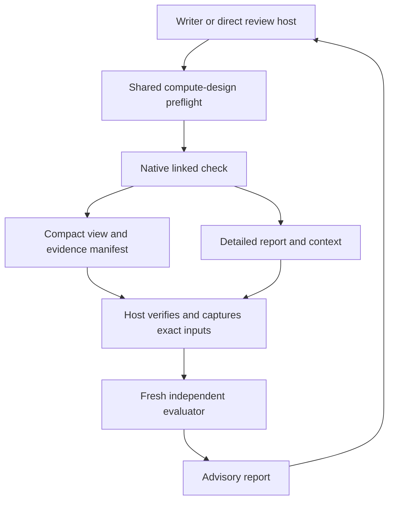
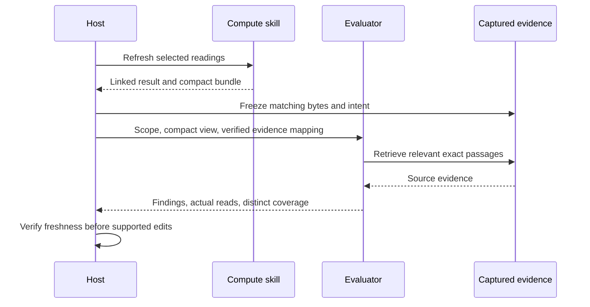
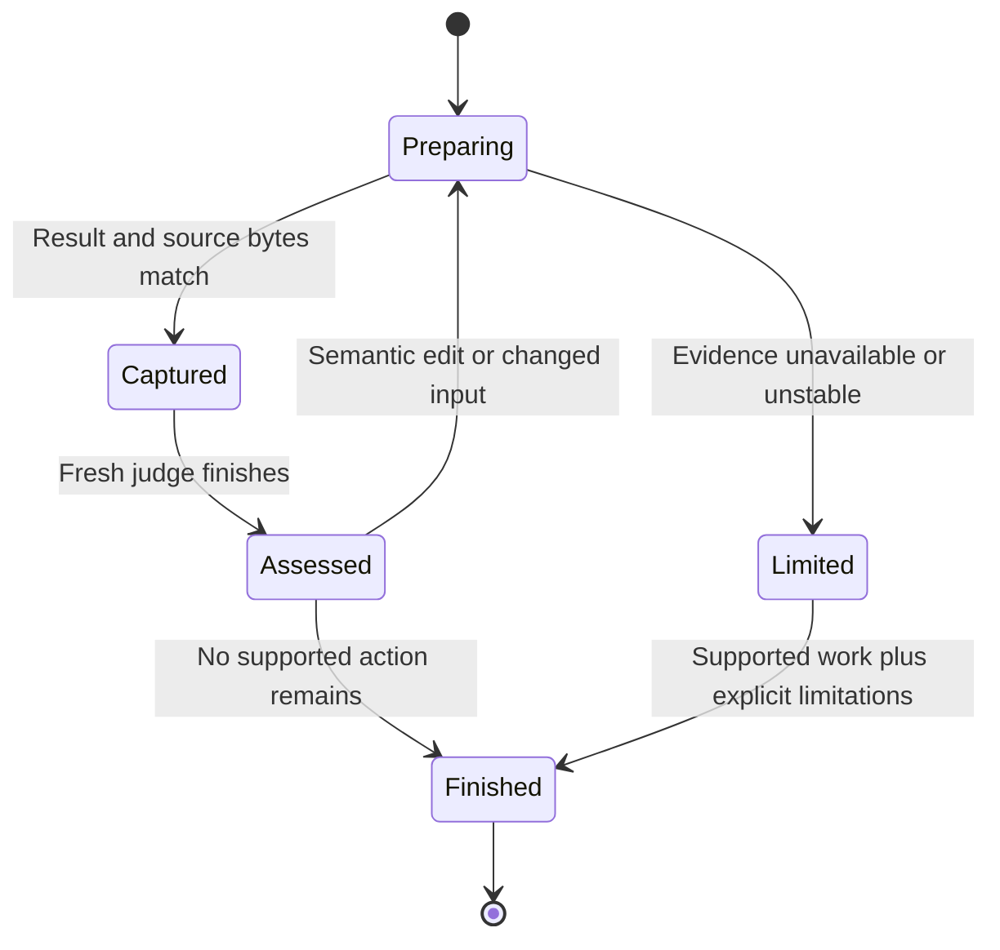
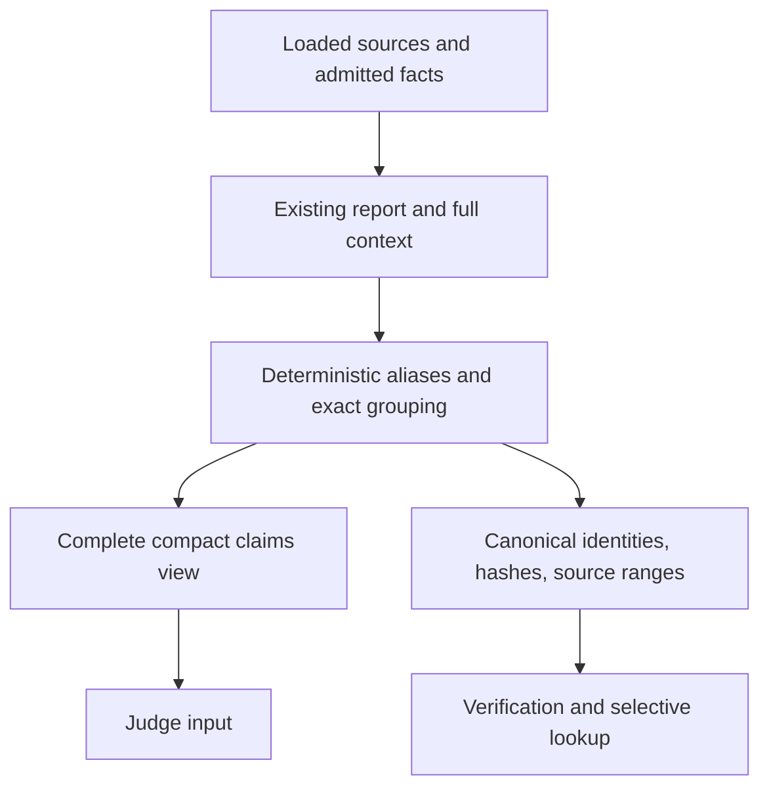

# Claims-Guided Sigil Review and Writing - Plan

## Goal Capsule

- **Objective:** Help authors produce small, human-readable Sigil designs whose consequential promises are machine-readable, with less repeated interpretation and lower judge input cost.
- **Means:** Native compact evidence and shared computation preflight, followed by captured independent review (KTD1–KTD4).
- **Product authority:** This Product Contract records the confirmed scope. Existing Sigil language authority and the evaluator's commitment-preservation rules remain applicable.
- **Execution:** Implement U1–U5 and satisfy the Verification Contract before declaring completion. Implementation and shipping require a subsequent work invocation.
- **Stop conditions:** Preserve unsupported human choices and report unavailable evidence under R10–R14. No launch-blocking question remains.

---

## Product Contract

### Summary

Use incremental computed claims as the primary evidence for advisory design evaluation and the writing loop.
Give each fresh judge a complete compact claims view for its assessment scope, with coverage information and source evidence available on demand.
Use the assessment to improve Tag identities, resolve supported defects, and simplify the human contract.

### Problem Frame

Authors already have a working computed-design workflow, but advisory evaluation and writing remain separate from its results.
The retained Slotted benchmark exposes undeclared names that could reveal missing Tags, inconsistent vocabulary, or harmless contextual mentions.
Those possibilities need judgment before changing the design.

Repeatedly interpreting unchanged prose wastes work, while sending the full judgment-context artifact to a judge can increase its input substantially.
In the successful pass of `claims-sigilc-design-20261010`, the linked context contains 670,216 bytes and the seven visible Sigil sources contain 37,377 bytes.
The report contains 61 undeclared-name findings across 52 distinct names.
These are artifact measurements, not token counts or proof that all reported names need Tags.
The batch has one valid pass and two failed passes; the valid pass detects all four planted problems.

### Key Decisions

- **Reuse computed readings and judge the complete compact view each time.** Governs R2 and R3. (session-settled: user-directed — chosen over caching advisory judgments and reviewing only changed claims: retain broad assessment context without adding judgment invalidation machinery.)
- **Keep computation in `sigil-compute-design` and reduce what the evaluator reads.** Governs R1, R3, and R4. (session-settled: user-approved — chosen over duplicating interpretation inside `sigil-evaluate`: preserve existing incremental computation while addressing the growing report separately.)
- **Keep claims connected to source meaning.** Governs R4–R7. Claims are the normal starting point; source evidence resolves uncertainty and makes promises absent from the reading reachable.

### Requirements

**Computed evidence and judge input**

- R1. Direct evaluation and the writer's delegated review must obtain current computed evidence through the shared `sigil-compute-design` workflow, retaining its responsibility for interpretation and computation.
- R2. Repeated computation must reuse valid stored readings and request only units the computation identifies as needing interpretation, including affected dependencies.
- R3. Each advisory assessment must freshly judge the complete compact claims view for its declared scope, rather than reuse prior advisory judgments.
- R4. The judge's normal input must contain compact claims, computed findings, coverage, relevant intent, and source references, with detailed context retrieved on demand.
- R5. Compacting evidence must preserve distinct commitments and their meaning, including role, modality, conditions, ownership, provenance, and the identities needed to establish freshness.
- R6. The assessment must expose unread units, units read without commitments, and unavailable evidence; it must inspect relevant prose when those limits prevent judging a consequential promise.
- R7. The evaluator must distinguish supported design defects from interpretation problems and optional detail using the existing [missing-detail admission rule](../../integrations/skills/sigil-evaluate/references/design-review.md).

**Tag quality and compact writing**

- R8. Undeclared-name findings must be assessed as candidates for reusing a Tag, importing its existing identity, defining a meaningful missing concept, or leaving contextual prose untagged.
- R9. The writer must make the smallest supported correction or simplification that preserves independent promises and produces clear human prose with machine-readable identities.
- R10. Corrections determined by existing intent must proceed autonomously, while consequential unresolved policy or ownership choices remain explicit questions for the human.
- R11. After a semantic revision, the writer must refresh computation and obtain fresh independent advisory review under the existing [review contract](../../integrations/skills/sigil-evaluate/references/review-contract.md).

**Coverage and completion**

- R12. Results must keep computed state and coverage separate from advisory judgment; neither a passing computation nor an empty findings list establishes complete design sufficiency.
- R13. Unavailable computation or evidence must leave the affected coverage explicitly incomplete while supported writing and advisory work continue under the existing workflow.
- R14. Repeated or oscillating findings must stop the affected correction cycle with the unresolved issue visible, without removing commitments merely to silence the check.

### Key Flows

- F1. **Direct evaluation:** Select the assessment scope and relevant intent, refresh computed evidence, judge its compact view, retrieve source evidence where necessary, and return the advisory findings with actual coverage. **Covers R1–R8, R12–R13.**
- F2. **Writing:** Draft the smallest supported contract, compute it, delegate independent evaluation, apply determined corrections, and repeat after a semantic change until no supported action remains or a specific issue prevents progress. A new design is drafted before computation can begin. **Covers R1–R3, R8–R14.**

### Acceptance Examples

- AE1. **Unchanged design:** Given valid stored readings, another evaluation requests no fresh interpretation and still performs a fresh advisory assessment of the complete compact claims view for the scope. **Covers R2–R3.**
- AE2. **Changed concept:** Given a revised Tag or promise, computation refreshes the affected readings and dependencies while retaining valid unaffected readings; review uses the resulting current evidence. **Covers R2, R5, R11.**
- AE3. **Mixed undeclared names:** Given findings for `session cookie`, a synonym of an existing Tag, and contextual wording such as “who is acting,” the evaluator checks their roles and recommends only supported identity changes. The writer does not mechanically turn every phrase into a Tag. **Covers R7–R10.**
- AE4. **Promise absent from claims:** Given an unread unit or a unit read without commitments whose prose may carry consequential behavior, the judge can retrieve that prose and identify the evidence limit or missed promise. The unit does not disappear from assessment because it has no claims. **Covers R4, R6, R12–R13.**
- AE5. **Smaller contract:** Given repeated formulations of one commitment, the writer consolidates them while retaining a separate promise about another state or failure mode; the revised design receives fresh computation and independent review. **Covers R5, R9, R11.**
- AE6. **Unresolved policy:** Given a genuine conflict over whether a pending booking range may change and no authoritative intent choosing either behavior, the writer preserves the decision for the human rather than deleting one promise to make the report pass. **Covers R7, R10, R14.**
- AE7. **Large computed output:** Given a large context artifact, the judge starts with the compact evidence view and can retrieve individual supporting passages without loading the full artifact by default. **Covers R4–R6.**

### Success Criteria

Compare the current and proposed review workflows on the same retained design cases and comparable judge settings.
Record actual judge input tokens, source/context retrieval, interpretation work, and elapsed time; distinguish initial computation from unchanged and edited reruns.
The compact workflow must reduce judge input tokens while retaining detection of the agreed material cases and avoiding unsupported Tag additions or lost promises.
Report runtime changes as measurements rather than assuming smaller input guarantees lower latency.

Use the four planted Slotted problems as a starting point for quality checks, alongside the Tag, missing-claim, and simplification examples above.
Track whether findings distinguish real missing commitments from implementation freedom and interpretation errors.
No numerical speedup or token-reduction percentage is assumed in advance.

### Scope Boundaries

The active work is the shared computed-evidence path into `sigil-evaluate` and `sigil-write`, including whatever compact presentation is needed to satisfy R4–R6.
Both direct review and authoring use the same judgment rules.

Deferred work includes advisory judgment caching, review of only changed claims, and a general benchmark platform expansion.
Language redesign, new claims laws, implementation conformance, and wholesale rewriting of example designs are outside this work.
Evaluation continues to leave design edits to the writer; computed-cache updates retain their existing ownership.

### Dependencies and Assumptions

The existing computation loop and incremental store provide the interpretation reuse required by R2.
The current judgment context supplies unit prose, coverage, assertions, derived claims, obligations, and candidate simplifications; its present serialization is not assumed to be suitable as the judge's normal input.
Existing language authority, mechanical validation, independent review, and evidence-freshness rules remain in effect unless the integration requires an explicit compatible adjustment.

### Planning Resolutions

Compact output construction, scope and captured evidence, and token measurement are resolved by KTD1–KTD6 below.
The Product Contract's scope and R/F/AE IDs are preserved.

### Sources and Research

- [Computation orchestration](../../integrations/skills/sigil-compute-design/references/computed-evaluation.md): incremental reading, linked checks, report states, failure behavior, and cache ownership.
- [Incremental claims tests](../../packages/sigilc/tests/claims_incremental.rs): unchanged reuse, affected-unit refresh, and dependency invalidation.
- [Judgment context](../../packages/sigilc/src/claims/context.rs): available evidence and the boundary between computed conclusions and advisory judgment.
- [Current design review](../../integrations/skills/sigil-evaluate/references/design-review.md), [review contract](../../integrations/skills/sigil-evaluate/references/review-contract.md), and [writing loop](../../integrations/skills/sigil-write/references/writing-loop.md): correction authority, independent review, freshness, and stopping rules.
- [Local retained benchmark](../../analyze-demo/slotted-runs/benchmarks/claims-sigilc-design-20261010/report.md): the successful pass's name findings and four planted problems. Raw local artifacts are ignored by Git and may not be present in another checkout; the measurements above record the inspected snapshot.

---

## Planning Contract

Product Contract preservation: unchanged requirements, decisions, scope, and R/F/AE IDs; the former deferred planning questions are resolved here.

### Key Technical Decisions

- KTD1. **Add a deterministic native presentation at linked `check`.** Extend the existing report/context emission seam in `packages/sigilc/src/claims/cli.rs` with `reviewView` and `reviewEvidence` result paths. Keep report version 6, context version 1, existing paths, exit/state semantics, and ingest output unchanged. This reuses the linked request, admitted facts, and saturated result without another model or saturation pass. Governs R1–R5. (session-settled: user-approved — chosen over projecting the large JSON within the evaluator: native computation already owns the identities, locations, and evidence needed to make a compact view.)
- KTD2. **Separate readable claims from exact evidence.** Emit a small text view plus a versioned JSON evidence manifest using the surface below. The view represents every unit and all admitted claim-body variants; the manifest supplies the full identity and source lookup. Full context remains available for selective retrieval. Deduplicate exact repeated representations with all provenance retained, never merely similar promises. Governs R4–R6 and R8.
- KTD3. **Prepare readings through the compute skill, then finish with an unfiltered linked check.** Add an internal review-preparation procedure to the shared orchestration contract. For whole-design review it uses the existing full-design action; for selected review it processes the linked unread queue only for selected sources and ends with the same linked check. Use native preparation to determine actual requested units, skip readers when there are none, and retain current retry and cache-writeback ownership. Do not change the existing standalone one-source ingest action into a linked action. Governs R1–R3 and R12–R13.
- KTD4. **Freeze computed evidence before independent assessment.** The writer computes against the original workspace, verifies and captures the generated bundle and matching sources, and passes them to a fresh evaluator. The evaluator consumes that evidence without running computation against `captured_root`. Direct review without supplied evidence runs the same compute preflight before judging. Temporary artifacts and compute-owned cache writes are explicitly allowed in that preflight; authored source remains read-only. Governs R1, R5, R11–R13. (session-settled: user-approved — chosen over treating the entire direct-review workflow as filesystem read-only: the shared computation must retain its existing temporary output and incremental cache behavior.)
- KTD5. **Extend the advisory envelope without relabeling source reads.** Keep `sigil-design-review/v1` and its existing required fields; add a versioned `computed_evidence` extension required when the compact path is used. It identifies the native bundle, exact artifact hashes, original root, computation dependency manifest, tool/skill authority, and computation scope. Computed dependencies are separate from `assessed_inputs`, which continues to mean evidence actually inspected. Freshness checks cover both. Legacy/source-only reports remain recognizable and cannot establish compact-path coverage. Governs R5–R7 and R11–R13.
- KTD6. **Measure the actual advisory workflow.** Use bounded paired runs of the retained pre-change evaluator and the new evaluator with identical design, intent, judge model, effort, and host settings. Record actual judge input usage across all turns, including evidence lookups, and report interpreter/host computation usage separately. Measure cold, unchanged, and edited runs; retain incomplete runs instead of counting them as improvements. Implements Product Contract Success Criteria.

### Compact Evidence Surface

The following artifact names and fields are additions to implement, not existing capabilities.
Use source-derived filenames and the existing claims store boundary: `<scope>.linked.review.md` for `reviewView` and `<scope>.linked.review.json` for `reviewEvidence`.
The versioned evidence file hashes the exact view, report, and full-context bytes; the review host separately hashes the evidence file when capturing it, avoiding a self-referential digest.

| Part | Judge's normal view | Evidence retained for verification or lookup |
| --- | --- | --- |
| Scope and state | Explicit computation scope, report filter, state, and coverage totals | Existing computation identity, workspace digest, linked source bindings, tool and language identities |
| Vocabulary | Short local aliases with human labels and owning components | Canonical entity identities; aliases are local to this bundle |
| Units | Every unit's alias, source, role, component, and coverage | Facet identity and exact source SHA-256 with UTF-8 byte range for every unit |
| Assertions | All seven `Body` variants with their fields and distinct origins | Canonical claim identities and mapping to full-context assertions |
| Conclusions | Unique derived conclusions, obligations and fulfillment, findings, and candidate simplifications | Laws, witnesses, all origin claims, and full details |
| Coverage | Unread, read-without-commitment, refusals, and unresolved imports remain distinct | Complete underlying arrays, even when the computed state is Disjoint |
| Inputs | Brief evidence-bundle identity and retrieval locations | Exact loaded source/configuration membership and byte identities, including absent optional context |

Aliases are assigned deterministically from sorted canonical identities; never reuse interpreter preparation handles across sources.
Render Claim modality and expected value, Property value, Measure number, Reading outcome, Step ordinal, Guard operand/value and step association, and Undeclared name plus its optional declared identity.
Conditions not represented by this vocabulary stay reachable through source evidence; this work does not invent new claims laws.

Keep the complete workspace compact view for the first version.
The advisory request declares its narrower target separately, and findings outside that target are supporting context rather than implied assessment of their source.
Preserve `check --source` as a finding filter with global context/completeness; review preflight uses an unfiltered final check so evidence is not accidentally lost.
Unrelated unread sources can leave computation incomplete without making a fully supported selected advisory assessment incomplete.
Do not interpret unrelated sources solely to make the global status pass.

### Capture, Retrieval, and Freshness

Native evidence must record hashes from the exact loaded bytes used by the final check, using the existing SHA-256 location machinery in `packages/sigilc/src/locations.rs`.
Use `DesignInput.sources`, structural units, and loaded context; where workspace configuration is consumed separately, carry its original read identity through `packages/sigilc/src/language/workspace.rs` and `packages/sigilc/src/tree/design_input.rs` rather than rereading it later to manufacture provenance.
Preserve a missing-file marker where absence affected configuration.
Normalized tree identities and memo keys remain useful for computation reuse but are insufficient for exact-byte review freshness.

The host freezes the view, evidence manifest, report, and full context in temporary capture storage outside discovery.
It captures the computation dependency sources/configuration with original path mappings, compares source membership and exact hashes against the native manifest, and captures intent and relevant linked policy separately.
A mismatch refreshes the affected capture/computation before dispatch; persistent change follows the existing incomplete/handoff rule instead of a new retry system.
Before applying a correction, compare current membership, source/context/intent bytes, original resolution root, authority identities, and captured bundle hashes.
The bundle freezes the reading evidence used by that assessment; a later cache update does not rewrite the captured evidence or certify a different one.

Source lookup starts from a bundle-local unit/claim alias and its verified mapping.
Use ordinary local JSON selection and captured-file byte-range reads; no new lookup service or model-generated summary is needed.
Resolve Inline Links from original source locations, then map them to captures under existing read-root restrictions.
Every semantic correction or simplification must cite inspected source/intent evidence, including all independent promises it preserves.
Also inspect source when meaning, a suspected missing commitment, or coverage is consequentially uncertain, even for an `interpreted` unit.
Report unverified extraction completeness honestly; arbitrary omitted promises cannot be guaranteed detectable from claims alone.

### Compatibility and Failure Behavior

If the compiler is missing, too old to provide the new pointers, or returns an unusable bundle, preserve any independently valid observed computation and report the unavailable compact path.
Continue supported source-grounded advisory work under R13; never silently load the entire full-context artifact as a substitute compact view, reconstruct interpretation inside the evaluator, or install a compiler without an installation request.
Tool unavailability alone retains the existing possibility of a completed source-grounded advisory assessment, with computed coverage explicitly unavailable.
Missing required semantic evidence still makes the affected advisory assessment incomplete.

Computed evidence adds no new approval gate and grants no permission to edit design sources during evaluation.
Keep generic review routed to `sigil-evaluate`; the compute skill becomes its internal dependency while explicit computed-check requests still route directly to computation.
Update declared sibling dependencies in evaluator and writer metadata and the validator, preserving a one-way dependency on computation.
The `sigil-align` advisory caller must continue to work through the documented source-grounded fallback.

### High-Level Technical Design

Ownership and artifact flow:

Review protocol and source retrieval:

Evidence lifecycle:

Compaction data stages:

### Alternatives and Scope Discipline

A skill-side projection was considered, but it would duplicate native source joining, body handling, identity validation, and schema handling.
The existing native check provides a direct, inspectable emission seam, so the mechanisms do not need competing prototypes before choosing one.
An LLM summarization pass would add cost and a new opportunity to erase a promise.
Neither is included.

Scoped claim-graph extraction, a new lookup CLI/service, an advisory cache, native snapshot persistence, and a general benchmark runner are not built.
Existing full compact context, captured-file lookup, review captures, and bounded observed runs satisfy the current requirements.
Reconsider these only if measured size or retrieval cost prevents the stated success criteria, or the existing capture mechanism cannot preserve evidence identity.

### Sequencing and Implementation Details

U1 supplies artifacts; U2 supplies shared preflight; U3 consumes both in advisory review and writing; U4 validates installed behavior; U5 establishes the measured outcome.
Retain baseline skill files and comparison inputs before changing evaluator instructions.
Exact helper names and rendering punctuation are implementation details; artifact identity, coverage, and scope rules above are fixed.

---

## Implementation Units

### U1. Emit compact linked evidence

**Goal:** Produce the compact view and verifiable source lookup without changing existing computation semantics.

**Requirements:** R4–R6, R8, R12; AE4 and AE7; KTD1–KTD2.

**Dependencies:** None.

**Files:** New `packages/sigilc/src/claims/review.rs` and `packages/sigilc/tests/claims_review.rs`; modify `packages/sigilc/src/claims/mod.rs`, `packages/sigilc/src/claims/cli.rs`, `packages/sigilc/claims.sigil`, and `packages/sigilc/tests/claims_linked.rs`. Use `packages/sigilc/src/locations.rs`, `packages/sigilc/src/tree/design_input.rs`, and `packages/sigilc/src/language/workspace.rs` for exact loaded-input provenance where necessary.

**Approach:**

1. Add a projection of the already computed linked request/report/context using the Compact Evidence Surface.
2. Emit the view and manifest under the existing claims store and advertise both paths in the structured check result.
3. Populate every unit's location and source identity from structural input, including units without findings, and capture configuration identity at its actual read boundary.
4. Extend the native design contract for the new presentation while preserving the current prose-carrying context promise.

**Patterns:** `claims/context.rs` for evidence assembly, `claims/prepare.rs` for deterministic local handles, `locations.rs` for SHA-256 byte coordinates, and existing report storage conventions.

**Test scenarios:**

1. Covers AE7. A linked fixture with repeated identities emits a deterministic compact view and resolvable aliases while the original report/context still deserialize with their current schemas.
2. Claim polarity/modality, role, numeric measure, Logic order/guards, and `Undeclared.declared` survive rendering; two independent promises are not collapsed.
3. Covers AE4. Interpreted, read-without-commitment, unread, and noncommitting units all remain addressable, including a unit with no finding.
4. A source-filtered check retains current filtered findings and global coverage, while its view explicitly identifies the complete computation context.
5. Reformatting or moving UTF-8 prose can reuse interpretations but produces new exact source hashes/ranges; an unknown alias or mismatched bundle cannot resolve to another revision.
6. A configuration read changed before artifact emission is identified by the bytes actually used; absent configuration and omitted sources are distinguishable from later additions.

**Verification:** Native artifact/schema and evidence-mapping tests pass, with no change to old check states, exits, or full-context meaning.

### U2. Compose review preparation in the compute skill

**Goal:** Supply current linked evidence without duplicating interpretation or rereading unchanged units.

**Requirements:** R1–R3, R12–R13; F1–F2, AE1–AE2; KTD3.

**Dependencies:** U1.

**Files:** `integrations/skills/sigil-compute-design/SKILL.md`, `integrations/skills/sigil-compute-design/references/computed-evaluation.md`, `integrations/skills/sigil-compute-design/evals/computed-evaluation-fixture.md`, and its `evals/README.md` and `VERSION`; regression scenarios in `packages/sigilc/tests/claims_incremental.rs` only where existing coverage does not already prove the native behavior.

**Approach:** Document the internal review-preparation route alongside the existing one-source and full-design actions. Use their shared private-store, reader, retry, and writeback rules, with the selected unread queue and final linked check specified by KTD3. Return actual linked provenance and compact paths rather than relabeling an ingest result.

**Patterns:** Existing full-design queue and compare-to-seed cache writeback.

**Test scenarios:**

1. Covers AE1. A whole-design or selected-source review rerun with valid readings launches no interpreter and still yields a current linked bundle.
2. Covers AE2. A semantic edit requests affected units under native invalidation rules; unaffected readings remain reusable.
3. A selected source beside an unrelated unread source gets requested evidence without widening interpretation; the global incomplete state remains explicit.
4. A refused selected unit follows the existing bounded re-ask and leaves its final reason visible alongside usable evidence.
5. Standalone one-source invocation retains its ingest-only handback; review preparation labels its linked result accurately.

**Verification:** Observed host traces demonstrate queue selection, zero-reader reuse, retained failures, and existing writeback behavior; narrative instructions alone are not evidence of these outcomes.

### U3. Bind compact evidence into evaluation and writing

**Goal:** Make claims the normal review input while retaining correction authority and exact independent coverage.

**Requirements:** R1, R3–R14; F1–F2, AE3–AE6; KTD4–KTD5.

**Dependencies:** U1–U2.

**Files:** `integrations/skills/sigil-evaluate/SKILL.md`, its `references/review-contract.md`, `references/design-review.md`, `references/mechanical-validation.md`, and `evals/design-review-fixture.md`; `integrations/skills/sigil-write/SKILL.md`, its `references/writing-loop.md`, `references/contract-prose.md`, `evals/writing-loop-fixture.md`, `evals/mechanical-validation-fixture.md`, and `evals/README.md`.

**Approach:**

1. Define and validate the versioned computed-evidence extension and distinguish computed dependency identities from source passages actually inspected.
2. Put shared preflight before writer capture; direct review runs it only when it lacks valid supplied evidence.
3. Require verified selective evidence lookup before semantic corrections; preserve the existing missing-detail admission and human-choice dispositions.
4. Make the no-design-write rule and compute-owned temporary/cache exception consistent across entrypoints and mechanical guidance.
5. Refresh evidence after edits and retain the existing stopping, fallback, and portable-handoff behavior.

**Patterns:** Existing review request/report identities, original-path mapping, authorizing-commitment check, and commitment/consequence issue history.

**Test scenarios:**

1. A delegated evaluator receives valid captured evidence, launches no compute reader, and changes neither authored sources nor the capture.
2. A same-path overwritten artifact, changed provider, changed policy, changed source membership, or relocated resolution root invalidates affected freshness before automatic edits.
3. Covers AE3. A declared-but-unreferenced concept is reused; a supported new concept is owned once; contextual wording remains prose; ambiguous ownership stays a human choice.
4. Covers AE4. An interpreted Facet with two promises but one extracted claim remains retrievable, and a proposed edit must preserve the second promise after inspection.
5. Covers AE5–AE6. Simplification preserves independent state/failure promises, while a policy conflict without authorizing intent is not resolved by deleting a promise.
6. A missing or older compiler, inaccessible lookup, or malformed compact bundle produces the correct distinct coverage limitations without silently recreating interpretation or claiming token savings.
7. Original-root imports and source-relative external links resolve before capture mapping; newly retrieved context enters the actual-read ledger.
8. A repeated or oscillating issue stops its cycle while unrelated supported corrections continue.

**Verification:** Controlled freshness replay cases and fresh observed evaluator/writer runs meet the contract. Preserve the distinction between replay evidence and actual independent delegation.

### U4. Update installed dependencies and guidance

**Goal:** Installed skills expose the same workflow as the source checkout.

**Requirements:** R1, R11, R13; KTD4–KTD5.

**Dependencies:** U2–U3.

**Files:** Evaluator/writer `compatibility.json`, `VERSION`, and `agents/openai.yaml` under `integrations/skills`; `scripts/validate-skill.ts`, `scripts/skill-foundation_test.ts`, `packages/cli/tests/installer_test.ts`, and `README.md`.

**Approach:** Add direct compute dependencies to evaluator/writer and update the validator's declared graph; retain compute's existing understand/egglog dependencies and avoid a reverse evaluator dependency. Update installed prompts and routing guidance, including the advisory fallback used by `sigil-align`.

**Patterns:** `FOUNDATION_SKILLS`, installer catalog derivation, and relocated-catalog tests.

**Test scenarios:**

1. A relocated catalog resolves compute, understand, and egglog for evaluate/write; removing a required sibling yields the existing actionable failure.
2. An invalid reverse dependency or documentary link is still rejected by the catalog validator.
3. Installed prompts route generic design review through evaluate and explicit computed checks through compute.
4. Advisory callers with unavailable computation retain source-grounded assessment with the stated limitation.

**Verification:** Package, installer, and relocated catalog checks pass; `test:skill:native` is not used as proof because it validates the legacy 0.7 skill.

### U5. Demonstrate quality and token savings

**Goal:** Establish the Product Contract's measured outcome on retained, reproducible cases.

**Requirements:** Success Criteria, R2–R9, R11–R14; AE1–AE7; KTD6.

**Dependencies:** Retain baseline before U3; execute comparisons after U1–U4.

**Files:** New `integrations/skills/sigil-evaluate/evals/claims-review-fixture.md` and `docs/skill-evaluation/claims-guided-review.md`; extend evaluator/writer eval guidance with references to the fixture and retain evidence under `docs/skill-evaluation/evidence/claims-guided-review/` following existing evidence practice.

**Approach:**

1. Retain the pre-change skill tree, source/intent inputs, and their hashes. Use an ordinary host's fresh agents; do not introduce a model runtime or general runner.
2. Run matched baseline/proposed evaluations on Slotted and the bounded Tag, omitted-promise, simplification, and policy fixtures from U3, with three paired repetitions of the Slotted comparison.
3. Record actual per-assessment judge input usage from host usage records, accounting for cumulative counters once and keeping cached input explicit. Count the entire supplied view and lookup results.
4. Record interpreter calls/tokens separately, plus elapsed time, cold/unchanged/edited status, material findings, unsupported additions, preserved commitments, and incomplete outcomes.

**Test scenarios:**

1. Covers AE1–AE2. Unchanged reruns perform zero new interpretation; changed runs refresh only native-required units while each assessment uses a fresh judge.
2. The four planted Slotted problems remain detected on complete comparison pairs; failed or incomplete runs do not count as successful savings.
3. Covers AE3–AE6. Fixture judgments avoid indiscriminate Tags, lost promises, and unauthorized policy choices.
4. Covers AE7. Aggregate actual judge input tokens on complete matched pairs are lower than baseline, including all evidence retrieval. Missing usage telemetry makes this criterion unverified rather than passed.

**Verification:** Publish the observed comparison with exact identities and limitations. If the token criterion fails, revise the compact presentation or retrieval guidance within this scope and repeat the affected comparison without weakening the quality cases.

---

## Verification Contract

These checks are implementation obligations; none were executed during planning.

| Check | Command or evidence | Applies to | Passing signal |
| --- | --- | --- | --- |
| Compact native behavior | `cargo test --locked --manifest-path packages/sigilc/Cargo.toml --test claims_review --test claims_context --test claims_cli --test claims_linked --test claims_incremental` | U1–U2 | New artifacts and existing semantics both pass |
| Native regression | `deno task test:sigilc` | U1 | Full native suite passes |
| Skill metadata and relocation | `deno task test:skill` and `deno test --allow-read --allow-write scripts/skill-foundation_test.ts` | U2–U4 | Dependency graph, authority, and links resolve |
| Installer behavior | `deno test --allow-env --allow-read --allow-write --allow-run --filter 'skill ' packages/cli/tests/cli_test.ts` and affected `packages/cli/tests/installer_test.ts` cases | U4 | Distributed skills work in relocated fixtures |
| Formatting and static checks | `deno task fmt`, `deno task lint`, and `cargo fmt --manifest-path packages/sigilc/Cargo.toml --check` | Changed code/scripts | Changed implementation respects repository checks |
| Behavioral skill evaluation | Fresh host traces plus controlled replay evidence for U2–U3 fixtures | U2–U3 | Actual independence, source preservation, correct dispositions, and honest coverage |
| Token and quality comparison | U5's retained paired runs | U5 | Lower aggregate actual judge input on complete matched pairs with no loss of required material findings or commitments |

This repository exposes no `release:validate` task in `deno.json`; do not invent one.
If execution produces a CLI distribution, use the existing build/release validation scripts for that distribution in addition to the catalog checks.
The native tests do not establish agent behavior or token savings.

---

## Definition of Done

- U1's emitted view and evidence mapping preserve all body variants, coverage, source identity, and existing report/context behavior.
- U2's observed preparation reuses readings and handles selected scope without false whole-design coverage.
- U3's observed writer/evaluator loop uses fresh captured evidence, preserves independent promises, and respects human-owned choices.
- U4's installed catalog and routing work with the new dependency graph and documented fallback.
- U5 records a passing, complete comparison under the Verification Contract; unavailable telemetry or failed quality cases remain unfinished work.
- Every requirement and acceptance example has evidence in the relevant unit, and remaining limitations are explicit.
- Remove abandoned prototype or experimental implementation code from the final diff; keep only the chosen implementation and its necessary evidence.
