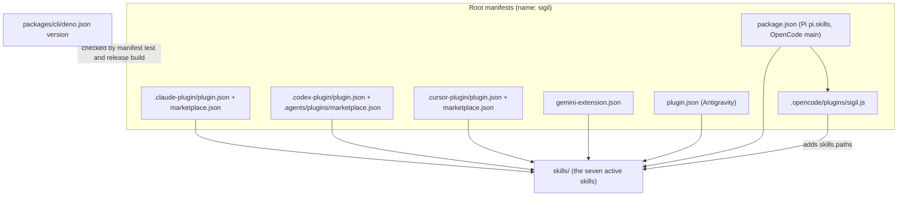

# Native Skill Installation - Plan

## Goal Capsule

- **Objective:** A coding-agent user can install and update the Sigil skills through their agent's own plugin system, following a Sigil guide written for that agent, without installing the `sigil` binary first.
- **Means:** Move the seven active skills to a root `skills/` folder that every supported agent reads natively (KTD1), ship one manifest per agent around it (KTD2–KTD7), remove the `sigil skill` command group (KTD10), and publish one install guide per agent.
- **Product authority:** The Product Contract below governs behavior and scope. The Planning Contract governs mechanism within it. Existing skill compatibility declarations (`compatibility.json`, `VERSION`) stay authoritative for anything this plan does not change.
- **Execution:** Implement U1–U6 in dependency order and satisfy the Verification Contract. Contract (`.sigil`) edits stay short and human-readable, following the repository's existing contract style.
- **Stop conditions:** Stop and report if an agent's documented install path cannot read the root `skills/` folder, or if removing the installer contract leaves a Sigil workspace error that the planned contract edits do not resolve. No launch-blocking question remains.
- **Product Contract preservation:** changed: R14 and R15 added, Scope Boundaries and Dependencies updated, Outstanding Questions resolved into KTDs — user decisions made during planning (the `sigilc` install guidance and deleting the legacy skill and anchor-indexer). AE3 and the update Success Criterion narrowed from Claude Code and Cursor to Claude Code, because research found Cursor's update check is undocumented.

---

## Product Contract

### Summary

`qoherent/sigil` becomes directly installable through the native plugin system of Claude Code, Codex, OpenCode, Pi, Cursor and Gemini/Antigravity.
Every install brings the seven active skills as one set.
`sigil skill list` and `sigil skill install` are removed from the CLI, the legacy 0.7 skill and the anchor-indexer proposal are deleted, and each supported agent gets an install guide that starts with removing old CLI-installed copies.

### Problem Frame

Today the only supported way to get the Sigil skills is `sigil skill install`.
A user who only wants the design skills (understand, evaluate, write) has to install the CLI binary first, even though those skills never call it.
The installer copies or symlinks skills into `.agents/skills` and `.claude/skills`, tracks them with `.sigil-managed.json`, and updates them only when the user reruns the command from a newer binary.
That installer has its own Sigil contract, prune logic and tests to maintain.

Coding agents now have their own ways to install skills from a git repository: Claude Code and Codex plugin marketplaces, Cursor plugins, Gemini/Antigravity extensions, Pi packages and OpenCode plugins.
The compound-engineering plugin dropped its own converter CLI in favour of these in 2026, and users now expect a Sigil install to work the same way.

### Key Decisions

- **Native per-agent packages, not a cross-agent installer.** A package installs all seven skills together, so a skill can't end up without the sibling skills it needs. Governs R1, R2. (session-settled: user-directed — chosen over adding an `npx skills add` fallback: that tool lets users install single skills and split required siblings.)
- **Publish the seven active skills only.** Governs R2. (session-settled: user-directed — chosen over publishing all eight and over split packages.)
- **Delete the legacy 0.7 skill and the anchor-indexer proposal.** Governs R15. (session-settled: user-directed — chosen over keeping them in the repository unpublished.)
- **Support six agents.** Claude Code, Codex, OpenCode and Pi (today's CLI targets) plus Cursor and Gemini/Antigravity. Governs R1, R9. (session-settled: user-directed — chosen over today's four only and over adding Copilot CLI and Factory Droid.)
- **Remove `sigil skill` entirely; cleanup is documented, not automated.** Governs R6, R12. (session-settled: user-directed — chosen over a one-release `sigil skill uninstall` command and over a deprecation stub.)
- **Updates follow Sigil releases.** Manifest versions change only when a Sigil release is cut, so agents that check versions only offer updates at releases. Governs R4, R5. (session-settled: user-directed — chosen over tracking every commit on main and over pinned release tags.)
- **Install from the default branch.** Simpler than a release-only branch. The cost: on agents that clone the current ref (Pi, OpenCode, Gemini/Antigravity, Codex), a fresh install can include unreleased skill content. Governs R3, R13. (session-settled: user-directed — chosen over a release-only branch and over a generated skills repository.)
- **CLI release archives stop bundling the skills.** Nothing in the CLI reads them once `sigil skill` is gone. Governs R8. (session-settled: user-approved — proposed as an assumption in the scope summary and confirmed.)
- **One version number for every manifest: the CLI release version.** Governs R4. (session-settled: user-approved — proposed after the repository check found no single version source, and confirmed.)
- **Compute skills guide the `sigilc` install.** Governs R14. (session-settled: user-directed — chosen over guide-only documentation and over an automatic Claude Code SessionStart hook: works the same on all six agents and runs no code without consent.)

### Requirements

**Packaging**

- R1. Each of the six supported agents can install Sigil from `qoherent/sigil` through its own native install mechanism, with no Sigil binary on the machine.
- R2. Every native install provides exactly the seven active skills: sigil-understand, sigil-evaluate, sigil-write, sigil-align, sigil-egglog, sigil-compute-design and sigil-compute-align.
- R3. The manifests live on the repository's default branch and need no build step before an agent can read them.

**Versioning and updates**

- R4. Every manifest carries the same version as the CLI release, and the release checks fail if any manifest disagrees with it.
- R5. Manifest versions change only as part of cutting a Sigil release, never as a side effect of other work.

**CLI removal**

- R6. The CLI no longer provides `sigil skill`, `sigil skill list` or `sigil skill install`, and its help no longer lists them.
- R7. The installer implementation, its Sigil contract and the CLI module text that describes the skill commands are removed, along with tests that exist only for them.
- R8. CLI release archives no longer contain any skills, and the release tests stop asserting that they do.

**Install guides**

- R9. Each supported agent has an install guide that gives the exact commands or configuration for global and, where the agent supports it, project-scoped installs.
- R10. Each guide says how to update and how to uninstall on that agent, and states plainly when the agent does not update on its own.
- R11. The README, quickstart, project setup guide, integrations README, COMPATIBILITY.md and CLI docs point to the guides instead of `sigil skill install`.
- R12. Each guide opens with a cleanup step for users who ran `sigil skill install`: the global and project paths it wrote to, and how to recognise Sigil-managed copies through `.sigil-managed.json`.
- R13. Each guide states that the compute skills need `sigilc`, and that on agents which install from the current branch a fresh install can be ahead of the latest release.

**`sigilc` and repository cleanup**

- R14. When `sigilc` is not available, sigil-compute-design and sigil-compute-align stop before any work, name the missing binary, and give the official installer command for the user's platform; they run that installer only after the user explicitly agrees.
- R15. The legacy 0.7 `sigil` skill and the `sigil-anchor-indexer` proposal are removed from the repository, and live documentation no longer links to them.

### Acceptance Examples

- AE1. **Covers R1, R13.** Given a machine with no Sigil binaries, when a Claude Code user follows the Claude guide, then all seven skills are available in their next session, and the guide has already told them the compute skills need `sigilc`.
- AE2. **Covers R12.** Given a user who earlier ran `sigil skill install` globally, when they follow any guide from the top, then the cleanup step removes the managed copies under `~/.agents/skills` and `~/.claude/skills` before the native install, and no skill appears twice.
- AE3. **Covers R4, R5.** Given a commit on main that changes a skill without cutting a release, when a Claude Code user checks for updates, then no update is offered.
- AE4. **Covers R4.** Given a release where one manifest still carries the previous version, when the release checks run, then they fail and name that manifest.
- AE5. **Covers R6.** Given the new CLI, when a user runs `sigil skill install`, then the CLI rejects it as an unknown command with exit code 2, the same way it rejects the earlier removed `semantic` and `export` commands (`packages/cli/tests/removed_commands_test.ts`).
- AE6. **Covers R14.** Given a machine without `sigilc` on PATH, when a user asks for a computed design check, then sigil-compute-design starts no child, reports that `sigilc` is missing, and shows the official installer command. It runs the installer only if the user says yes.

### Success Criteria

- A user can get the design skills on any of the six agents without downloading a Sigil release.
- Skill updates reach Claude Code users through the agent's own update flow, without a Sigil command.
- The repository no longer contains skill-installer code, contract text or tests, nor the legacy skill.

### Scope Boundaries

- Copilot CLI and Factory Droid can read the Claude manifests, but they get no guide in this work.
- No cross-agent installer (`npx skills add`) is documented or supported.
- No uninstall or migration command; cleanup is manual and documented (R12).
- No plugin installs `sigil` or `sigilc` automatically; binaries come from the existing release installers (R14 governs how the compute skills point to them).
- No release-only branch or separate distribution repository.
- Historical records keep their text even where links now point at removed files: past plans under `docs/plans/`, `docs/verification/`, `docs/skill-evaluation/` evidence and `packages/eqval/AUDIT.md`.
- The VS Code extension's distribution is unchanged.

#### Deferred to Follow-Up Work

- Correcting the stale skill-version rows in `COMPATIBILITY.md` (for example `sigil-evaluate` listed at 0.1.0 while its `VERSION` is 0.2.4, and `sigil-align` missing). This plan edits only the rows it must.
- OpenCode 2.x plugin API support (`setup(ctx)` with `ctx.skill.transform`), once 2.x ships.
- Submitting Sigil to the Cursor marketplace, a maintainer action after merge (KTD9).

### Dependencies / Assumptions

- Gemini CLI remains available to paid and enterprise users; Antigravity replaced it for consumer tiers in June 2026. Both are covered, and both read only a root `skills/` folder (KTD1).
- Antigravity's fixed `skills/` layout is documented but was not exercised against a git install; U4's manual smoke check confirms it.
- The CLI contracts in `packages/cli/_module.sigil`, `packages/cli/src/installer.sigil` and `.github/release.sigil` describe what is being removed, and change with it.
- `qoherent/sigil` has no published GitHub release yet (only the `cli-v0.1.0` tag), while `packages/cli/deno.json` already reads 0.9.0. A maintainer cuts `cli-v<packages/cli/deno.json version>` from the merge commit before the install guides are announced. Until then the manifests' 0.9.0 does not match a release, and the `releases/latest` installer URL that R14 points to returns 404.

### Sources / Research

- Current installer: `packages/cli/src/installer.ts`, contract `packages/cli/src/installer.sigil`, command wiring in `packages/cli/src/args.ts`, `packages/cli/src/commands.ts`, `packages/cli/src/main.ts` and `packages/cli/src/output-model.ts`, module text in `packages/cli/_module.sigil`.
- Release bundling: `scripts/build-cli-release.ts` (`copyValidSkills`), `scripts/test-cli-release.ts`, contract `.github/release.sigil`.
- Removal precedent: commit 05387e0 retired `sigil export` (contract interface deleted, tests extended in `packages/cli/tests/removed_commands_test.ts`, docs and CHANGELOG updated together).
- Version sources: `packages/cli/deno.json` (0.9.0), `packages/core/deno.json` and `packages/lsp/deno.json` (0.8.0), `.github/workflows/release.yml` and `vscode-release.yml` version-match checks, CONTRIBUTING "Versions and compatibility".
- Reference pattern: compound-engineering-plugin README "Install", `docs/install/upgrading.md`, `.opencode/plugins/compound-engineering.js`, PRs #609, #967 and #978 (github.com/EveryInc/compound-engineering-plugin).
- Native mechanisms: code.claude.com/docs/en/plugins-reference, /plugin-marketplaces, /plugins/loading#versions-and-updates; Codex source `codex-rs/core-plugins/src/{manifest,marketplace,loader,store}.rs` and developers.openai.com/codex/plugins/build; OpenCode v1.19.0 source `packages/opencode/src/{plugin/shared.ts,skill/index.ts}` and opencode.ai/docs/plugins; Pi `packages/coding-agent/docs/packages.md`; cursor.com/docs/reference/plugins and `cursor/plugins` `schemas/plugin.schema.json`; google-gemini/gemini-cli `docs/extensions/reference.md` and `extension-manager.ts`; antigravity.google/docs/plugins.

---

## Planning Contract

### Key Technical Decisions

- KTD1. **The seven skills move to a root `skills/` folder.** Gemini CLI hard-codes `<extension>/skills/` and Antigravity documents a fixed `skills/`, so no manifest can point elsewhere. With the legacy folders deleted (R15), `skills/` holds exactly the seven, so every agent can use its default or a single `./skills` path and nothing can pick up an unpublished folder. Move with history (`git mv`); sibling links inside the skills (`../sigil-understand/...`) keep working. Symlinks are rejected because Codex drops them on install.
- KTD2. **The repository root is the plugin root for every agent.** No subdirectory plugin: the repository packs to about 8 MB, and a single root keeps every manifest's paths identical. The root has no `agents/`, `commands/`, `hooks/` or `.mcp.json`, so agents that scan default component folders find only `skills/`.
- KTD3. **One plugin name, `sigil`, in every manifest and marketplace entry.** Codex fails an install when the marketplace entry name differs from the manifest name, and Claude Code keys enabled plugins on it. The Claude and Codex marketplaces are also named `sigil`, giving `sigil@sigil`.
- KTD4. **One owner for the shared version: `packages/cli/deno.json`.** A repository check in `deno task test` fails when any manifest version differs from it, and `scripts/build-cli-release.ts` runs the same check before packaging, so a release cannot ship mismatched manifests. Claude Code's version lives in `.claude-plugin/plugin.json` only, never also in its marketplace entry. CONTRIBUTING's "do not duplicate a version literal" rule names this exception. Instantiates the version Key Decision; governs R4, R5. (session-settled: user-approved — chosen over leaving manifests unversioned: Claude Code and Codex key updates and caches on the manifest version.)
- KTD5. **A root `package.json` serves Pi and OpenCode.** It is `private`, has no dependencies and ships no lockfile, so no agent runs a dependency install. Root `deno.json` gains `"nodeModulesDir": "none"`, because a root `package.json` otherwise switches the Deno workspace to manual `node_modules` and breaks the `npm:@noble/hashes` import.
- KTD6. **OpenCode loads the skills through a small JS plugin.** OpenCode has no skills manifest; its 1.x `config` hook adds the absolute path of `skills/` to `skills.paths`, following compound-engineering's plugin. Only the 1.x API is targeted (2.x is deferred).
- KTD7. **Antigravity's root `plugin.json` carries no `$schema`.** An `agent-plugins.org` schema switches Codex into a mode that truncates skill bodies to 8000 bytes and makes Copilot prefer the root manifest. `name` and `version` are enough for `agy plugin validate`.
- KTD8. **The compute skills check for `sigilc` before any work, and hand back the official installer command.** The check is a plain command lookup (`sigilc --version`). The guidance names `install.sh` or `install.ps1` from the latest GitHub release, which already verifies SHA-256 checksums. The skills keep refusing to upgrade an existing `sigilc` silently. Governs R14.
- KTD9. **Cursor ships manifests now, and its marketplace listing follows merge.** Individuals can only install Cursor plugins from the marketplace, so a maintainer submits `qoherent/sigil` at cursor.com/marketplace/publish after merge. Until it is listed, the Cursor guide documents team import ("Import from Repo") and a manual copy of `skills/` into `.cursor/skills`.
- KTD10. **Removal follows the `sigil export` retirement precedent.** Delete the contract interface sections outright with no stub, trim goal and constraint mentions, and extend `removed_commands_test.ts`, so `skill` is rejected like other removed commands.

### High-Level Technical Design

One `skills/` folder is read by every agent through its own manifest. One version, owned by the CLI package, is checked against all of them.



### Output Structure

```text
.agents/plugins/marketplace.json      Codex marketplace
.claude-plugin/plugin.json            Claude Code plugin (version owner for Claude)
.claude-plugin/marketplace.json       Claude Code marketplace
.codex-plugin/plugin.json             Codex plugin
.cursor-plugin/plugin.json            Cursor plugin
.cursor-plugin/marketplace.json       Cursor marketplace
.opencode/plugins/sigil.js            OpenCode 1.x plugin registering skills/
gemini-extension.json                 Gemini CLI extension
plugin.json                           Antigravity plugin (no $schema)
package.json                          Pi package and OpenCode entry point
skills/sigil-*/                       the seven skills, moved from integrations/skills/
docs/install/                         one guide per agent plus an index
scripts/plugin-manifests_test.ts      manifest consistency check
```

### Sequencing

U1, U2 and U3 can land in that order without the others; U4 needs U3's `skills/` folder; U5 needs U3's paths; U6 documents what U4 and U5 produce.

---

## Implementation Units

### U1. Remove the `sigil skill` command group and skill bundling

**Goal:** The CLI and its release archives no longer know about skills.

**Requirements:** R6, R7, R8; AE5. Follows KTD10.

**Dependencies:** None.

**Files:**
- Delete `packages/cli/src/installer.ts`, `packages/cli/src/installer.sigil`, `packages/cli/tests/installer_test.ts`
- Modify `packages/cli/src/args.ts`, `packages/cli/src/commands.ts`, `packages/cli/src/main.ts`, `packages/cli/src/output-model.ts`
- Modify `packages/cli/_module.sigil`, `.github/release.sigil`, `.sigil/glossary.json`
- Modify `scripts/build-cli-release.ts`, `scripts/test-cli-release.ts`
- Modify `packages/cli/tests/cli_test.ts`, `packages/cli/tests/removed_commands_test.ts`
- Delete `.agents/skills/.gitignore`

**Approach:**
1. Remove the `skill` command name, help topics, request types, `--project`/`--agent` options, dispatch branch and the `skill` arm of `helpTopicFor` from `args.ts`; remove the installer imports, `install` handler option and skill branches from `commands.ts`; remove the help entries from `main.ts` and the result types from `output-model.ts`.
2. In `packages/cli/_module.sigil`, delete the installer import, the CliSkillCatalog and CliSkillInstallation logic, constraint and case blocks, the SkillCatalogCommand and SkillInstallationCommand interface sections, the skill paragraph of `LanguageCutover`, the "Skill commands do not require or modify ConfigFile" constraint and the skill-installation clause of `WorkspaceMutationBoundary`. Reword the symlink-skipping logic so it no longer cites installed skills; the behavior stays.
3. Rewrite `.github/release.sigil` so the native release contains only binaries: drop the installer import, the skills paths, `LegacySkillIsolation`, the skill catalog in `DistributionInputs`, and the skills clause of the `NativeCliRelease` decision. Add the R4 rule as one short constraint: release packaging rejects plugin manifests whose version differs from the CLI version (KTD4).
4. Delete the `SkillInstallation` glossary context.
5. In `scripts/build-cli-release.ts`, delete the skills copy step, `copyValidSkills` and the then-unused `copyDirectory`. In `scripts/test-cli-release.ts`, delete the skill presence, `validateFoundation`, `skill list` and `skill install` assertions and assert that the archive contains no skills.
6. Delete the skill-only cases in `cli_test.ts` and remove skill entries from its help, usage and variadic lists. Move the "symlinked directory inside a workspace is skipped by `check`" assertion into a standalone test before deleting its host test.

**Patterns to follow:** commit 05387e0 (`sigil export` retirement); `RemovedSemanticCommands` in `packages/cli/_module.sigil` and `packages/cli/tests/removed_commands_test.ts`.

**Test scenarios:**
- Covers AE5. `sigil skill`, `sigil skill list` and `sigil skill install --project` each exit 2 with empty stdout and stderr containing `Unknown command "skill"`.
- `sigil --help` lists no `skill` command.
- A workspace containing a symlinked directory of `.sigil` files: `check` skips the symlink and reports only the real sources.
- The relocated release archive smoke test passes and finds no skills folder in the archive.

**Verification:** `deno task check` and `deno task test:cli` pass; no file under `packages/` or `scripts/` imports `installer.ts`; the workspace check of the repository's own contracts reports no new diagnostics.

### U2. Delete the legacy skill and the anchor-indexer proposal

**Goal:** The repository holds only the seven active skills.

**Requirements:** R15.

**Dependencies:** U1 (removes the release test's legacy-skill assertion).

**Files:**
- Delete `integrations/skills/sigil/`, `integrations/skills/sigil-anchor-indexer/`, `scripts/validate-native-skill.ts`
- Modify `deno.json` (remove `test:skill:native` and its use in `test`)
- Modify `.sigil/config.json` (remove the `integrations/skills/sigil/**` exclude), `.sigil/glossary.json` (remove the `SigilSkillWorkflow` context)
- Modify `_module.sigil` (remove the retained-historical-skill clause)
- Modify `README.md`, `CONTRIBUTING.md`, `PRE_RELEASE.md`, `spec/sigil-platform-architecture.md`, `integrations/README.md`, `integrations/skills/sigil-write/evals/README.md`
- Modify `scripts/skill-foundation_test.ts` if its legacy-link case needs a different nonexistent target

**Approach:**
1. Delete both folders and the native skill validator with its task.
2. Remove the legacy skill from live docs: the README "workflow references" table and legacy section, CONTRIBUTING's links to the legacy authoring-conventions and native-protocol pages (point to current material in `spec/` or the active skills when an equivalent exists, otherwise drop), the `test:skill:native` row, and the platform-architecture lines naming the legacy skill.
3. Leave historical records untouched (Scope Boundaries).

**Test scenarios:**
- `deno task test:skill` and `scripts/skill-foundation_test.ts` still pass; the test that rejects a link to a non-sibling skill still rejects it.
- A repository search finds no reference to `integrations/skills/sigil/` or `sigil-anchor-indexer` outside the historical records.

**Verification:** `deno task test` passes without `test:skill:native`; the workspace check of the repository's own contracts reports no new diagnostics.

### U3. Move the active skills to the root `skills/` folder

**Goal:** The seven skills live at `skills/<name>/`, which every agent reads.

**Requirements:** R2, R3. Follows KTD1.

**Dependencies:** U2.

**Files:**
- Move `integrations/skills/sigil-*` to `skills/sigil-*`; remove the empty `integrations/skills/`
- Modify `scripts/validate-skill.ts`, `scripts/sync-skill-language.ts`, `scripts/skill-foundation_test.ts`, `scripts/slotted-benchmark/batch.ts` and any test fixtures that hold the old path
- Modify `_module.sigil`, `README.md`, `docs/quickstart.md`, `docs/setting-up-a-project.md`, `docs/skill-evaluation/sigil-compute-design.md`, `docs/skill-evaluation/sigil-0.8-foundation.md`, `spec/sigil-platform-architecture.md`, `packages/sigilc/README.md`, `CONTRIBUTING.md`, `integrations/README.md`

**Approach:**
1. Move with history and update every live reference to the old path.
2. Rewrite `integrations/README.md` to describe only the editor integration and point skills readers to `skills/` and `docs/install/`.
3. Update CONTRIBUTING's skills row and the "Agent skills" version line to the new location.

**Patterns to follow:** existing relative sibling links inside the skills stay unchanged.

**Test scenarios:**
- `deno task test:skill` validates all seven foundation skills from `skills/`.
- `scripts/skill-foundation_test.ts` passes when copying the catalog from `skills/`.
- `deno run --allow-read scripts/sync-skill-language.ts --check` reports the language pack in sync at its new path.
- `deno task test:slotted-benchmark` finds the compute, understand, egglog and align skill folders.

**Verification:** A repository search finds no `integrations/skills` reference outside historical records; `deno task test` passes.

### U4. Add the native plugin manifests and the consistency check

**Goal:** Each of the six agents can install the plugin from the repository root.

**Requirements:** R1, R2, R3, R4, R5; AE3, AE4. Follows KTD2–KTD7.

**Dependencies:** U3.

**Files:**
- Create `.claude-plugin/plugin.json`, `.claude-plugin/marketplace.json`
- Create `.codex-plugin/plugin.json`, `.agents/plugins/marketplace.json`
- Create `.cursor-plugin/plugin.json`, `.cursor-plugin/marketplace.json`
- Create `gemini-extension.json`, `plugin.json`, `package.json`, `.opencode/plugins/sigil.js`
- Create `scripts/plugin-manifests_test.ts`
- Modify `deno.json` (`nodeModulesDir`, add the new JSON files to the `fmt` task, run the new test in `test`)
- Modify `scripts/build-cli-release.ts` (run the same consistency check before packaging)
- Modify `CONTRIBUTING.md` (version-literal exception)

**Approach:**
1. Write each manifest with name `sigil` and the current CLI version. Point Codex at `./skills` and Pi at `pi.skills: ["./skills"]`; the others use their default `skills/` discovery. Add a one-line description shared in wording across manifests.
2. Write the OpenCode plugin: resolve `skills/` relative to the module file and add it to `skills.paths` in the 1.x `config` hook when not already present (KTD6). `package.json` points `main` at it.
3. Put the consistency rules in one helper used by both the test and the release build: every manifest parses; every plugin and marketplace entry name is `sigil`; every version equals `packages/cli/deno.json`; the Claude marketplace entry carries no version; `skills/` holds exactly the `FOUNDATION_SKILLS` names from `scripts/validate-skill.ts`; the root `plugin.json` has no `$schema`; `package.json` is private with no dependencies; no lockfile exists at the root.
4. Add the CONTRIBUTING exception next to "do not duplicate a version literal", naming the plugin manifests and the check that guards them. State that bumping `packages/cli/deno.json` now also publishes a plugin update, so it happens only in the release-cut commit.

**Technical design:** directional only — the consistency helper reads a fixed list of manifest paths and returns one error per mismatch, naming the file, so the test asserts an empty list and the release build prints the list and exits non-zero.

**Execution note:** Mostly packaging. Prove each agent with a real install smoke check from a branch or local checkout, in addition to the consistency test.

**Test scenarios:**
- The consistency check passes on the committed manifests.
- Covers AE4. With one manifest's version changed in a temporary copy, the check fails and names that manifest.
- With an eighth folder added to a temporary `skills/`, the check fails naming the unexpected skill.
- With a marketplace entry renamed in a temporary copy, the check fails naming the name mismatch.
- Importing the OpenCode plugin and invoking its config hook on an empty config adds exactly one absolute path ending in `skills`, and invoking it twice does not duplicate it.
- `deno task check` and the existing `npm:` import still work with the root `package.json` present.

**Verification:** `deno task fmt`, `deno task check` and `deno task test` pass; `claude plugin validate --strict .` passes; the manual smoke check installs the plugin from a branch on each of the six agents and lists the seven skills (Antigravity included, confirming the Dependencies assumption).

### U5. Compute skills guide the `sigilc` install

**Goal:** A plugin-only user who lacks `sigilc` gets a clear way to install it.

**Requirements:** R14; AE6. Follows KTD8.

**Dependencies:** U3.

**Files:**
- Modify `skills/sigil-compute-design/SKILL.md`, `skills/sigil-compute-design/references/computed-evaluation.md`, `skills/sigil-compute-design/VERSION`
- Modify `skills/sigil-compute-align/SKILL.md`, `skills/sigil-compute-align/references/computed-alignment.md`, `skills/sigil-compute-align/VERSION`
- Modify `skills/sigil-compute-design/evals/README.md` and `skills/sigil-compute-align/evals/README.md` with a missing-binary fixture

**Approach:**
1. Add a first step to each compute skill: confirm `sigilc` responds; when it does not, stop before any child runs and hand back the missing binary plus the platform's installer command from the latest release.
2. Replace "never install or upgrade `sigilc`" with: run the official installer only after the user explicitly agrees, and never upgrade an existing `sigilc` without being asked.
3. Bump each skill's `VERSION` for its own behavior change.

**Patterns to follow:** the existing "hand back what was observed and name the missing piece" failure path in `computed-evaluation.md`; the install commands in `README.md`'s install section.

**Test scenarios:**
- Covers AE6. Eval fixture: no `sigilc` on PATH, user asks for a computed check — the skill starts no child, names `sigilc`, shows the installer command, and does not run it.
- Eval fixture: same start, user agrees — the skill runs the official installer once, then continues. Until the first release exists, run this fixture against a locally built archive through the installer's `SIGIL_ARCHIVE_PATH` and `SIGIL_CHECKSUMS_PATH` overrides.
- `deno task test:skill` passes with the edited skills and bumped versions.

**Verification:** `deno task test:skill` passes; the two eval fixtures are run per the skill evaluation procedure in `skills/sigil-write/evals/README.md` and their outcomes recorded alongside existing evaluation evidence.

### U6. Write the install guides and repoint the docs

**Goal:** Users on each agent can install, update and uninstall from one page, and no doc mentions `sigil skill`.

**Requirements:** R9, R10, R11, R12, R13; AE1, AE2.

**Dependencies:** U4, U5.

**Files:**
- Create `docs/install/README.md` and one guide each: `docs/install/claude-code.md`, `docs/install/codex.md`, `docs/install/opencode.md`, `docs/install/pi.md`, `docs/install/cursor.md`, `docs/install/gemini-antigravity.md`
- Modify `README.md`, `docs/quickstart.md`, `docs/setting-up-a-project.md`, `COMPATIBILITY.md`, `PRE_RELEASE.md`, `packages/cli/README.md`, `packages/cli/spec.md`, `packages/cli/architecture.md`, `CONTRIBUTING.md`, `CHANGELOG.md`

**Approach:**
1. The index lists the agents, the two prerequisites (`sigilc` for the compute skills; skills run ahead of releases on clone-based agents) and links each guide.
2. Each guide follows one order: cleanup of `sigil skill install` copies for that agent's paths (global and project, recognised by `.sigil-managed.json` and the `# Managed by sigil skill install` or `# Managed by sigil install` gitignore markers); install (global, and project where supported); update; uninstall; the `sigilc` note. Claude Code states that third-party marketplaces do not auto-update by default, and shows how to turn auto-update on for the `sigil` marketplace in `/plugin` or update by hand with `/plugin marketplace update sigil`. Codex states that plugins install per user only and that updating means `marketplace upgrade` then `plugin add` again. OpenCode states there is no update command. Cursor follows KTD9.
3. Guides for agents that may clone into a project (Pi with `-l`) tell users of a Sigil workspace to keep the clone out of the workspace or exclude it, since the repository contains `.sigil` files.
4. Replace every `sigil skill install` instruction in the listed docs with a link to `docs/install/`, and remove the CLI's skill section from `packages/cli/README.md`, `packages/cli/spec.md` and `packages/cli/architecture.md`.
5. Add a `## Unreleased` breaking entry to `CHANGELOG.md` naming the removed commands, the deleted legacy skill and the cleanup link, in the style of the `sigil export` entry.

**Patterns to follow:** compound-engineering's `docs/install/` guides for structure; the existing README install section for tone.

**Test scenarios:**
- Test expectation: none -- documentation only; U4's smoke check exercises the commands the guides list.

**Verification:** A repository search finds no `sigil skill` instruction outside `CHANGELOG.md` history and historical records; every link in the new guides resolves; a reader following the Claude guide on a clean machine reaches AE1.

---

## System-Wide Impact

- **Existing users:** anyone scripting `sigil skill install` gets an unknown-command error (AE5); the CHANGELOG entry and every guide point them to cleanup.
- **External links:** links to `integrations/skills/...` from outside the repository break with the move; GitHub does not redirect moved paths. Accepted for a pre-production project.
- **Contributors:** Codex and OpenCode opened inside the repository now see its own plugin files; this is harmless and lets contributors use the skills directly.
- **Release process:** cutting a release now also means bumping every plugin manifest version, which the consistency check enforces.

## Risks & Dependencies

| Risk | Mitigation |
|---|---|
| Antigravity's `skills/` behavior on git install is documented, not tested | U4 smoke check before merge; stop condition in the Goal Capsule |
| OpenCode 2.x changes the plugin API | 1.x only for now; 2.x support deferred |
| OpenCode may not refresh an unpinned git plugin | The OpenCode guide documents clearing its cache to update |
| Cursor individuals cannot install until listed | KTD9 fallback paths; marketplace submission tracked as follow-up |
| Root `package.json` breaks Deno workspace resolution | KTD5 `nodeModulesDir: "none"`; U4 runs `deno task check` and `test` with it present |
| A skill fix waits for the next release before Claude Code users see it | Accepted trade-off of the release-only version decision |

---

## Verification Contract

| Gate | Command or check | Applies to |
|---|---|---|
| Format | `deno task fmt` | all units |
| Lint | `deno task lint` | all units |
| Type check | `deno task check` | U1, U3, U4 |
| Full test suite | `deno task test` (includes `test:cli`, `test:skill`, `scripts/skill-foundation_test.ts`, the new manifest check and `test:slotted-benchmark`) | all units |
| Release packaging | `scripts/build-cli-release.ts --version <current CLI version>` as `native-release.yml` runs it, including its archive smoke test | U1, U4 |
| Contract check | the repository's own Sigil workspace check with the CLI from `packages/cli/src/main.ts`, no new diagnostics against main | U1, U2, U3 |
| Claude manifest | `claude plugin validate --strict .` | U4 |
| Agent smoke | install from the branch on Claude Code, Codex, OpenCode, Pi, Cursor (local plugin) and Gemini/Antigravity; each lists the seven skills | U4 |
| Skill evals | missing-`sigilc` fixtures per the skill evaluation procedure | U5 |

## Definition of Done

- All Verification Contract gates pass, and the agent smoke results are recorded in the PR description.
- U1–U6 are complete, with each unit's Verification met.
- No live file references `sigil skill`, `integrations/skills` or the deleted legacy skill.
- Abandoned or experimental code from the work is removed from the diff.
- After merge, outside this change: a maintainer cuts the first release from the merge commit (Dependencies / Assumptions) and submits the Cursor marketplace listing (KTD9). R1 is met for individual Cursor users only once that listing is live; before merge, Cursor is verified through a local plugin install and team import.
