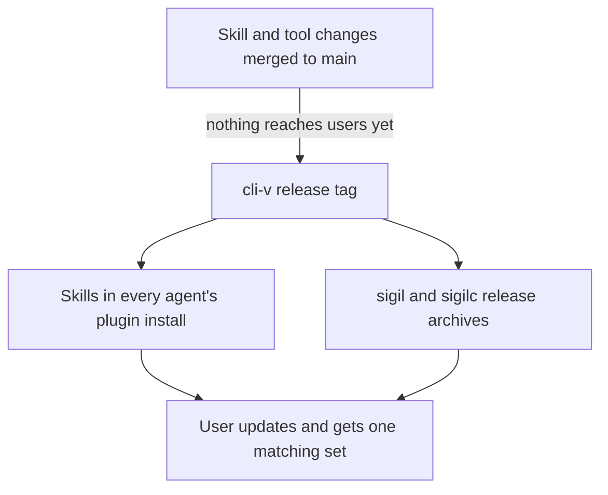
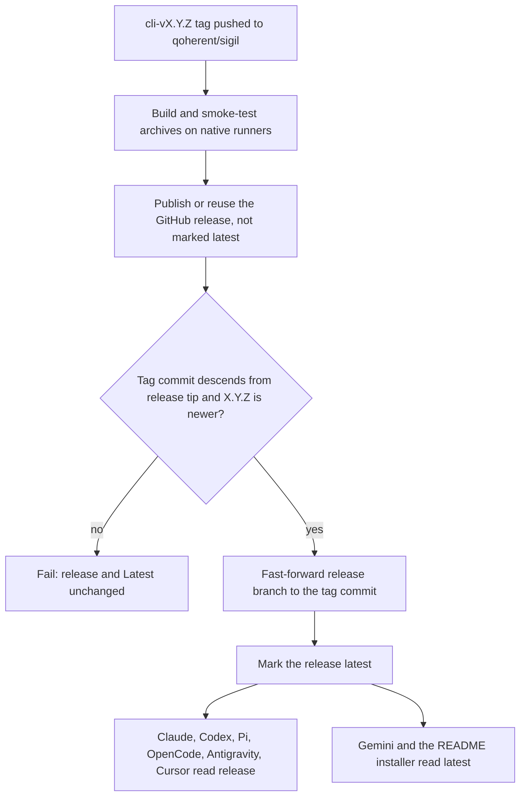

# Skill Release Alignment and Contributor Guide - Plan

## Goal Capsule

- **Objective:** Sigil users always run skills, `sigil` and `sigilc` from the same release, and a new teammate can set up, change a skill, test it and release it by following the docs alone.
- **Product authority:** This plan owns two connected areas: skills shipping only with a CLI release, and the contributor guide for working on skills. One-step project setup for Sigil users and broader release-flow simplification are not active scope (see How This Work Fits Together).
- **Means:** A `release` branch that the CLI release job advances after each publish, which every agent install follows (KTD1, KTD3), plus a three-page contributor guide under `docs/contributing/` (KTD7).
- **Execution:** Implement U1–U6 in dependency order and satisfy the Verification Contract. Contract (`.sigil`) edits stay short and human-readable.
- **Stop conditions:** Stop and report if an agent the plan claims can follow releases cannot install from the `release` branch in its smoke check, or if the release workflow cannot advance `release` without a force push.
- **Open blockers:** None for planning. The release steps run end to end only when the first `cli-v0.9.0` release is cut, and a maintainer must add the `release` branch ruleset (Dependencies / Assumptions).
- **Product Contract preservation:** changed: R6 widened to warn on a release mismatch and AE2 reworded so `sigilc` is matched by archive rather than by its own version string (user-approved during planning; `sigilc --version` reports the compiler's version, not the release); a Scope Boundary names the Cursor team-marketplace exception to R1 (user-approved). R19 and AE9 added during planning review (user-directed): a build-from-source install path covers the window before the first release. Outstanding Questions resolved into KTD1–KTD10. Other IDs and meaning unchanged.

---

## Product Contract

### Summary

Skills reach users only when a `cli-v*` release is cut, together with `sigil` and `sigilc` at one version, and every agent's install follows the latest release instead of `main`.
A new contributor guide covers environment setup with checkout-built tools, loading Sigil from the checkout in each agent, the rules for changing a skill, running evals and benchmarks, and cutting a release.

### Problem Frame

The native-skill-installation work made Sigil easy for end users to install, but did nothing for the people who build it.
Before that change, contributors symlinked skill folders into their home skills folder by hand; nothing in the repo describes that or any replacement, and the team now needs to onboard teammates who know none of the workflow.
No doc explains loading skills from a checkout into an agent, when to bump a skill's `VERSION`, how a skill change reaches users, or how a release is cut.
`CONTRIBUTING.md` says only not to bump versions as a side effect and to do it in "the release-cut commit".
Eval instructions exist for four of the seven skills, and the benchmark has its own guide, but nothing ties these together for a newcomer.

A second problem surfaced while scoping the guide: end users install the plugin straight from the repository, so a skill merged to `main` likely reaches them without any release, while `sigil` and `sigilc` change only on a tag.
That lets a newer skill run against an older `sigilc`, and it means the documented release process would not describe how skills actually ship.

### Key Decisions

- **Skills ship only with a CLI release.** Skills, `sigil` and `sigilc` become one release set, so users never mix versions and the guide describes one release path. Governs R1, R2, R3. (session-settled: user-directed — chosen over skills reaching users on merge to `main`: skill releases should match `sigilc`.)
- **Every skill-only fix is a full CLI patch release.** One version line is simpler to explain than a lighter skill-only release, at the cost of a rebuild per fix. Governs R4. (session-settled: user-approved — chosen over a separate skill-only release path: fewer rules for contributors.)
- **Release alignment lives in this plan.** The guide's release section would be wrong soon after landing if the release behavior changed in a later plan. (session-settled: user-approved — chosen over a separate plan before or after the guide: avoids documenting a flow that is about to change.)
- **The contributor guide is documentation only.** The repo just removed an installer, and a setup command adds upkeep the team does not need yet. Governs R17. (session-settled: user-directed — chosen over a runnable setup command: the user scoped it to environment requirements and working on skills with links.)
- **Contributors load Sigil from the checkout through each agent's own plugin loading, with symlinks as the fallback.** Developers then use the same packaging users do, so manifest mistakes surface before a release. Governs R9. (session-settled: user-approved — chosen over symlinks everywhere and over the repo setting itself up: exercises the real plugin path and works outside the Sigil repo.)
- **Development runs only the checkout's copies.** Two same-named copies of a skill, or an installed `sigilc` beside the checkout build, make an agent silently use stale code. Governs R8, R10. (session-settled: user-approved — chosen over project-level-only dev setup and over a warning note: one copy, no guessing.)
- **Compute skills warn on a release mismatch and offer the matching installer.** A user who updates skills without rerunning the installer would otherwise run new skills on an old `sigilc` without knowing it. Governs R6. (session-settled: user-approved — chosen over refusing to run until the versions match and over handling only a missing `sigilc`: keeps "never replace silently" while making skew visible.)
- **The guide documents how to cut a release.** Teammates do not know the release process, and the aligned flow from R1–R4 is what they must follow. Governs R16. (session-settled: user-approved — chosen over leaving release steps to a later plan.)

### Requirements

**Release alignment**

- R1. A skill change merged to `main` does not change what an existing install gives a user; skills reach users only through a `cli-v*` release.
- R2. Each release ships the skills, `sigil` and `sigilc` as one set under one version, the CLI version every plugin manifest already carries.
- R3. Installing or updating Sigil in each of the six supported agents gets the latest release, not the tip of `main`; where an agent cannot follow releases, its install guide names the closest workaround and the remaining gap.
- R4. A fix that touches only skills ships as a CLI patch release; there is no skill-only release.
- R5. The install guides tell a user who installed from `main` before this change how to move, once, to the release-following install.
- R6. When a compute skill finds `sigilc` missing, or finds the installed tools came from a different release than the skills, it says so and offers the installer for the skills' own release, running it only if the user agrees.
- R19. The install guides give a build-from-source path that works before any release exists: build `sigil` and `sigilc` from a clone of `main`, put them on `PATH`, and load the skills from that clone; the guides say this path runs unreleased code and how to move to a release-following install once a release exists.

**Contributor environment**

- R7. A teammate new to the skills can go from a fresh clone to an edited skill running in their agent using only the guide.
- R8. The guide lists the required tools and versions, and shows how to build `sigil` and `sigilc` from the checkout and put them on `PATH` so agents and the compute skills use the checkout builds.
- R9. For each of the six agents, the guide shows how to load Sigil from the checkout so a skill edit takes effect in a new session, using symlinks only where the agent cannot load a folder.
- R10. Before loading the checkout, the guide has the contributor remove or disable the released plugin and any old `sigil skill install` copies, and it explains how to switch back to the released install.
- R11. The guide gives a quick way to confirm the agent is using the checkout copy of the skills and tools, not a released one.

**Working on skills**

- R12. The guide explains what a skill is made of and the rules it must keep (frontmatter, `VERSION`, `compatibility.json`, the agent adapter, required sibling skills, links only into declared dependencies, the synced language pack that is never hand-edited) and names the check that catches each rule.
- R13. The guide states when to bump a skill's `VERSION` and `compatibility.json`, how to choose patch or minor, what changelog entry to write, and that the change reaches users at the next CLI release per R1.
- R14. The guide explains how to run an observed eval for any of the seven skills and where to record the result, linking each skill's existing eval instructions where they exist.
- R15. The guide explains how to run the benchmarks by linking the existing benchmark guide and adding only what a newcomer needs first.
- R16. The guide explains how a release is cut under R1–R4: who cuts it, the steps, which workflows run, and how to confirm users can update to it.
- R17. The contributor guide adds no setup command, installer or script; it is documentation over existing tasks and agent features.
- R18. The guide is reachable from `README.md` and `CONTRIBUTING.md`, and it links existing docs rather than copying them.

### Release Shape

One `cli-v*` tag is the single source every user-facing surface reads from.

### Key Flows

- F1. A contributor's first skill change
  - **Trigger:** A teammate clones the repo to change a skill.
  - **Steps:** Install the listed tools; build `sigil` and `sigilc` from the checkout and put them on `PATH`; remove the released plugin; load Sigil from the checkout in their agent; confirm the checkout copy is active; edit the skill and bump its version per the rules; run the skill checks and the relevant eval; record the result; open a PR.
  - **Outcome:** The change is merged to `main` and waits for the next release.
  - **Covered by:** R7–R15, R18
- F2. Cutting a release
  - **Trigger:** A maintainer decides merged changes should reach users.
  - **Steps:** Set the release version; cut the `cli-v*` release per the guide; the release workflows build and publish; confirm an agent install updates to the new version.
  - **Outcome:** Users who update get the new skills, `sigil` and `sigilc` together.
  - **Covered by:** R1–R4, R16

### Acceptance Examples

- AE1. **Covers R1.** Given a user installed Sigil 0.9.0 in Claude Code, when a skill change is merged to `main` and no release is cut, then updating the plugin still gives them the 0.9.0 skills.
- AE2. **Covers R2, R3, R4.** Given only a skill wording fix was merged, when a maintainer cuts `cli-v0.9.1`, then a user who updates gets the fixed skill, `sigil --version` and the plugin report 0.9.1, and the `sigilc` they install comes from the `cli-v0.9.1` release archive.
- AE3. **Covers R3.** Given an agent cannot follow releases, when a user reads its install guide, then the guide states the workaround and what the user gives up.
- AE4. **Covers R9.** Given a contributor uses an agent that copies plugins on install, when they edit a skill, then the guide's refresh step makes the edit visible in a new session.
- AE5. **Covers R10, R11.** Given a contributor has the released Sigil plugin installed, when they follow the setup, then the agent lists exactly one copy of each Sigil skill, and the confirmation step shows it is the checkout copy.
- AE6. **Covers R8.** Given a contributor has built `sigilc` from the checkout and followed the setup, when a compute skill checks for `sigilc`, then it finds the checkout build and does not offer the released installer.
- AE7. **Covers R5.** Given a user installed from `main` before this change, when they follow their agent's install guide, then after one reinstall their install follows releases.
- AE8. **Covers R6.** Given a user's skills belong to 0.9.1 and `sigil --version` reports 0.9.0, when a compute skill starts, then it names both versions, offers the 0.9.1 installer, and runs it only after the user agrees; a declined offer still lets the run continue.
- AE9. **Covers R19.** Given no Sigil release exists yet, when a user follows the build-from-source path, then `sigil`, `sigilc` and the seven skills all come from their clone of `main`, and a compute skill finds `sigilc` without offering an installer.

### Success Criteria

- A teammate who has not worked on the skills completes F1 from the guide alone, without asking anyone, before the guide is considered done.
- After the first aligned release, every agent the plan claims can follow releases is shown updating to it.

### Scope Boundaries

- One-step project setup that gives a Sigil user the CLI, `sigilc` and skills together is a later plan.
- Simplifying how a release is cut (a single release command, marketplace submissions) is a later plan; this plan documents and aligns the existing flow.
- No skill-only release path.
- Existing eval, benchmark and release workflow docs are linked, not rewritten; only the gaps a newcomer hits are filled.
- The Cursor team-marketplace import reads only the repository's default branch, so it is the one install route that does not satisfy R1; its guide says so and recommends the release-following local plugin instead.
- The three skills without eval instructions (`sigil-egglog`, `sigil-evaluate`, `sigil-understand`) are covered by the guide's general eval steps, not new per-skill eval READMEs.

<!-- ce-section: work-relationships -->
### How This Work Fits Together

This plan covers release alignment for skills and the contributor guide. The breakdown below is the current understanding of the wider developer-experience work, not a committed roadmap.

- Builds on the native skill installation work (`docs/plans/2026-10-13-1248-feat-native-skill-installation-plan.md`), which is not yet merged; its install guides and plugin manifests are what R3 and R5 change.
- Project setup for Sigil users
  - Depends on this plan's release alignment, since a one-step setup should install one matching release.
  - Still to decide: whether it is a command, an installer extension or docs.
- Release-flow simplification
  - Depends on this plan, which defines what a release contains.
  - Shares the release section of the contributor guide, which it would update.

### Dependencies / Assumptions

- The native skill installation branch lands before or with this work.
- No aligned release exists yet; the only release tag ever cut is `cli-v0.1.0`, so R16's steps get their first full run at `cli-v0.9.0`.
- Research confirmed per agent how installs follow a branch or release (KTD3); Antigravity's ref handling and Cursor's local-plugin refresh are documented but unverified.
- The Cursor, Gemini/Antigravity and OpenCode 1.x steps cannot be tried on the current maintainer machine; a teammate with those agents checks them.
- A maintainer with admin rights on `qoherent/sigil` adds a ruleset on `release` (no direct pushes, force pushes or deletion; only the release automation may bypass). The plan documents it but cannot apply it.

### Sources / Research

- `CONTRIBUTING.md` (Prerequisites, Set up the repository, Versions and compatibility) — the current setup steps and version rules.
- `docs/install/` — the end-user install guides that R3 and R5 change.
- `skills/*/evals/README.md` — existing eval instructions for `sigil-align`, `sigil-compute-align`, `sigil-compute-design` and `sigil-write`; results are recorded under `docs/skill-evaluation/`.
- `scripts/slotted-benchmark/README.md` and the `slotted-benchmark` tasks in `deno.json`.
- `.github/workflows/release.yml`, `native-release.yml` and `vscode-release.yml` — tag-triggered release workflows (`core-v*`, `cli-v*`, `vscode-v*`).
- `scripts/plugin-manifests.ts` — already ties every plugin manifest version to the CLI version.
- Agent install and update behavior: code.claude.com/docs/en/plugins (marketplace `owner/repo#ref`, version-keyed cache, `--plugin-dir`); Codex `codex plugin marketplace add --ref` and `marketplace upgrade` (openai/codex `codex-rs/core-plugins/src`); Pi `packages/coding-agent/docs/packages.md` and `package-manager.ts` (`@ref`, in-place local paths); OpenCode v1.19.0 `packages/core/src/npm.ts` (git specs cached by spec string, never re-fetched); Gemini CLI `packages/cli/src/config/extensions/github.ts` (default install takes `releases/latest`, update compares release tags) and `extensions link`; antigravity.google/docs/plugins; cursor.com/docs/plugins and Cursor forum threads on team-marketplace refresh.
- `packages/sigilc/src/main.rs` — `--version` prints the compiler's own Cargo version, so release matching uses `sigil --version` (KTD6).

---

## Planning Contract

### Key Technical Decisions

- KTD1. **A `release` branch follows the published CLI release.** After `native-release.yml` publishes `cli-vX.Y.Z`, it fast-forwards `release` to the tagged commit; every branch-capable agent install points at `release`. Rejected: tag pins rewritten in six guides every release (version literals spread across docs), and a mirror repository (a second repo to maintain). Governs R1, R3, per the Key Decision on shipping with a CLI release.
- KTD2. **Publishing is ordered, guarded and safe to rerun.** Steps run in order and each skips when already done: publish the GitHub release with `--latest=false`, so its assets are downloadable while nothing follows it yet; fast-forward `release` (refusing when the tag commit does not descend from the current `release` tip or the version is not newer); then mark the release latest. The push uses a token minted for a dedicated GitHub App with contents and workflows write, because the default workflow token cannot be named as a ruleset bypass actor and cannot move a branch across workflow-file changes. The job checks out full history so the ancestry check sees the commits it compares. A dispatch run checks out the tag, never the dispatching branch, and the job runs only in `qoherent/sigil`. The fast-forward guard lives in a small tested script so it is not untested shell. A failure before the branch moves leaves every agent on the previous release; a failure after it leaves only Gemini and the README installer one release behind, with every pinned installer URL already resolvable.
- KTD3. **Each agent follows releases by its own mechanism.**

  | Agent | Install source | Update |
  |---|---|---|
  | Claude Code | marketplace `qoherent/sigil#release` | `/plugin marketplace update sigil`, then `/plugin update sigil@sigil`; the manifest version gates the copy |
  | Codex | `codex plugin marketplace add qoherent/sigil --ref release` | `codex plugin marketplace upgrade sigil` (reinstalls on a new revision) |
  | Pi | `git:github.com/qoherent/sigil@release` | `pi remove` then `pi install` the same source (the documented way; `pi update` fast-forwards in code but is undocumented for refs) |
  | OpenCode 1.x | `sigil@git+https://github.com/qoherent/sigil.git#release` | delete that spec's cache folder and restart; OpenCode never re-fetches a git spec |
  | Gemini CLI | default install (takes the latest GitHub release) | `gemini extensions update sigil` |
  | Antigravity | clone `release` to a persistent folder, `agy plugin install <folder>` | pull the folder, reinstall |
  | Cursor | clone `release` to a persistent folder, copy it into `~/.cursor/plugins/local/sigil` | pull, re-copy, reload the window |

  Gemini CLI and Antigravity share one install guide and count as one of the six supported agents; they get separate rows because they install differently. Gemini works only if every non-CLI release stays `--latest=false`, which `vscode-release.yml` already does and the release guide makes a rule. Governs R3, R5.
- KTD4. **Cursor's release-following route is the local plugin, not the team marketplace.** Team import reads only the default branch, so it is documented as the R1 exception (Scope Boundaries). Governs R3.
- KTD5. **The skills' installer offer names the exact release, enforced like a manifest version.** `computed-evaluation.md` gives `releases/download/cli-vX.Y.Z/install.sh` (and `.ps1`), and the plugin-manifest check fails when that version differs from `packages/cli/deno.json`. Updating it happens only in the release-cut commit and does not count as a skill change needing a `VERSION` bump; CONTRIBUTING's version-literal exception names it. Governs R2, R6.
- KTD6. **Release matching compares `sigil --version` with the pinned release.** `sigilc --version` reports the compiler's own version (0.3.0), so the skill reads `sigil --version`, which the same installer always places beside `sigilc`. If `sigil` is absent but `sigilc` responds, the skill says it cannot confirm the match and continues. A contributor's checkout launcher reports the same version as the pin, so development raises no warning. Governs R6. (session-settled: user-approved — chosen over refusing to run until the versions match and over handling only a missing `sigilc`: keeps "never replace silently" while making skew visible.)
- KTD7. **The contributor guide is a `docs/contributing/` section of an index plus three pages:** environment setup, working on skills, releasing. It sits beside `docs/install/`, which serves users, and `CONTRIBUTING.md` keeps repository-wide rules and links in. Governs R7–R18.
- KTD8. **Each agent loads the checkout through its own folder loading; symlinks go only in that agent's private folder.**

  | Agent | Load the checkout | After an edit |
  |---|---|---|
  | Claude Code | `claude --plugin-dir <checkout>` with the installed `sigil@sigil` disabled | `/reload-plugins` |
  | Codex | remove the `sigil` git marketplace, `codex plugin marketplace add <checkout>`, `codex plugin add sigil@sigil` | `codex plugin remove` then `add`, restart (Codex copies on install) |
  | Pi | `pi remove` the git source, `pi install <checkout>` | none; loaded in place |
  | OpenCode 1.x | remove the git entry; `"plugin": ["<checkout>"]` in the global config | restart |
  | Gemini CLI | `gemini extensions uninstall sigil`, `gemini extensions link <checkout>` | restart the session |
  | Antigravity | uninstall, `agy plugin install <checkout>` | reinstall, restart (unverified whether it copies) |
  | Cursor | copy the checkout's plugin into `~/.cursor/plugins/local/sigil` (symlinks out of that folder are skipped) | re-copy, reload the window |

  Symlinks into `~/.agents/skills` are ruled out: five agents read that folder, so one link would duplicate the skills across them. Governs R9, R10.
- KTD9. **Evals run with no Sigil plugin loaded.** The tested agent sees only the temporary catalog the eval procedure builds, never the dev-loaded checkout, and evals never run inside the checkout, where fixtures hold the expected answers. Governs R14.
- KTD10. **Skill version rules follow the repository's history.** A minor bump for a new capability, a new or removed required sibling, or a changed hand-back contract. A patch bump for any other change to text an agent follows in `SKILL.md`, `references/` or `agents/`. No bump for eval fixtures, a pure rename, or the KTD5 pin. The bump rides in the same commit as the change, and `compatibility.json` changes only with the language version or sibling set. This replaces CONTRIBUTING's contradictory PR-checklist line. Governs R13.

### High-Level Technical Design

The publish job's order keeps every agent on one release even when a step fails.

A rerun after any step skips what is already done: an existing release is reused, an already-advanced branch is a no-op, and a release already marked latest is left as it is.

### System-Wide Impact

- **Existing users:** anyone who installed from `main` keeps getting `main` until they follow the migration steps (R5); agents cache by version, so a re-add alone is not enough.
- **Release process:** each CLI release now also moves a branch every agent reads, so a bad release reaches users through both the archives and the plugin; the KTD2 guards stop a partial publish from splitting them.
- **Contributors:** skill text now names the CLI release, so the release-cut commit edits a skill file without a skill version bump (KTD5).
- **Other releases:** a VS Code or JSR release created as "latest" would move Gemini users to it; the release guide forbids that.

### Risks & Dependencies

| Risk | Mitigation |
|---|---|
| `release` pushed by hand leaks unreleased skills to every user | Ruleset limits writes to the release automation (Dependencies / Assumptions); the script refuses a tip that is not an earlier release |
| The ruleset blocks the workflow's own push | The push uses the dedicated release App's token, and that App is the ruleset's only bypass actor; first run verified before announcing the guides |
| Gemini installs the release's source tarball wrongly because the release carries platform archives | Smoke-check on the first release with a teammate who has Gemini CLI; fall back to `--ref release` in the guide |
| Antigravity and Cursor local-plugin behavior is undocumented | Guides mark those steps unverified until a teammate confirms them |
| OpenCode 2.x does not run the 1.x plugin | Out of scope, as before; the OpenCode guide keeps saying 2.x is unsupported |
| A hotfix from an older line cannot fast-forward `release` | The script refuses rather than force-pushing; the release guide requires merging hotfixes back to `main` |

### Sequencing

U1 and U2 are independent. U3 needs U2's pin check. U4 needs U1's branch behavior to document. U5 needs U3 and U4. U6 needs U5's pages to link.

---

## Implementation Units

### U1. Advance a `release` branch from the CLI release job

**Goal:** Publishing `cli-vX.Y.Z` moves `release` to that commit, safely and only in `qoherent/sigil`.

**Requirements:** R1, R2, R3, R4; AE1, AE2. Follows KTD1, KTD2.

**Dependencies:** None.

**Files:**
- Create `scripts/advance-release-branch.ts`, `scripts/advance-release-branch_test.ts`
- Modify `.github/workflows/native-release.yml`
- Modify `.github/release.sigil`
- Modify `deno.json` (add the test to `test`, the script to `fmt` coverage if not already)

**Approach:**
1. The script takes the tag and remote, and fast-forwards `release` to the tag commit. It creates `release` when absent, succeeds without change when `release` already points at the tag, and refuses (non-zero, reason named) when the tag commit does not descend from `release` or the tag's version is not newer than the version at the `release` tip. It never force-pushes.
2. In the publish job, per KTD2:
   - add `if: github.repository == 'qoherent/sigil'`;
   - check out `cli-v<version>` explicitly for dispatch runs in the build and publish jobs, with full history in the publish job, and assert HEAD is that tag's commit;
   - create the release with `--latest=false` (reuse an existing one);
   - mint the release App's token and run the script with it;
   - then `gh release edit --latest`.

   Grant `contents: write` only to the publish job; the App's credentials are secrets scoped to that job.
3. In `.github/release.sigil`, add short facts: skills reach users only through the `release` branch, which follows the latest published CLI release, and publication is draft, advance, then latest.

**Execution note:** Prove the script against throwaway git repositories before wiring it into the workflow.

**Patterns to follow:** `scripts/plugin-manifests.ts` (exported helper plus `import.meta.main` runner) and its temp-copy tests; the existing version checks in `native-release.yml`.

**Test scenarios:**
- A new repository with no `release` branch: the script creates it at the tag commit.
- `release` behind the tag on the same line: fast-forwarded to the tag commit.
- `release` already at the tag: exits zero with no push.
- A tag commit that does not descend from `release` (a hotfix cut from an older line): refuses and names the reason; `release` unchanged.
- A tag version equal to or older than the version at the `release` tip: refuses.
- The tag does not exist: refuses before touching the branch.
- A depth-1 clone that lacks the history to compare: fails with a message naming missing history, not a false "does not descend" refusal.

**Verification:** The script tests pass; `deno task check` covers the script; the workflow change passes review (it cannot run outside GitHub); `.github/release.sigil` adds no new diagnostics. The first real run must advance `release` across this unit's own workflow-file change, which proves the App token's permissions.

### U2. Check the installer pin with the plugin manifests

**Goal:** The release the skills point users at always equals the CLI release.

**Requirements:** R2, R6. Follows KTD5.

**Dependencies:** None.

**Files:**
- Modify `scripts/plugin-manifests.ts`, `scripts/plugin-manifests_test.ts`
- Modify `CONTRIBUTING.md` (version-literal exception)

**Approach:**
1. Add the pinned installer file to the check: every `releases/download/cli-v<version>/install.{sh,ps1}` reference in `skills/sigil-compute-design/references/computed-evaluation.md` must name the CLI version, at least one must exist, and no `releases/latest/download` reference may remain there.
2. Extend the CONTRIBUTING exception sentence to name the pin and state it needs no skill `VERSION` bump.

**Patterns to follow:** the existing per-file error messages in `checkPluginManifests`.

**Test scenarios:**
- The committed files pass.
- A pin naming another version fails and names the file.
- A `releases/latest` installer URL in the contract fails.
- A contract with no pinned installer URL fails.

**Verification:** `deno task test:plugin-manifests` passes; a release build refuses a mismatched pin through the same helper.

### U3. Compute skills offer the matching release

**Goal:** Users learn when their tools and skills come from different releases and are offered the matching installer.

**Requirements:** R6, R19; AE6, AE8. Follows KTD5, KTD6.

**Dependencies:** U2.

**Files:**
- Modify `skills/sigil-compute-design/SKILL.md`, `skills/sigil-compute-design/references/computed-evaluation.md`, `skills/sigil-compute-design/VERSION`
- Modify `skills/sigil-compute-align/SKILL.md`, `skills/sigil-compute-align/references/computed-alignment.md`, `skills/sigil-compute-align/VERSION`
- Modify `skills/sigil-compute-design/evals/computed-evaluation-fixture.md`, `skills/sigil-compute-align/evals/computed-alignment-fixture.md`

**Approach:**
1. In "Confirm the tool first": state the release this skill set belongs to (the pin), switch the installer commands to the pinned URLs, and add the release check per KTD6 after `sigilc` responds. On a mismatch, name both versions and offer the pinned installer; a declined offer continues the run. Review preparation hands the mismatch back to `sigil-evaluate`/`sigil-write` the same way it hands back a missing `sigilc`.
2. When the pinned installer download fails, say the release may not be published yet and point the user to building from source per the install guide (R19), instead of retrying.
3. `sigil-compute-align` keeps deferring to the design contract.
4. Bump `sigil-compute-design` and `sigil-compute-align` by patch per KTD10.
5. Update scenario 17 (design) and scenario 14 (align) to the pinned installer, and add a mismatch variant to each.

**Test scenarios:**
- Covers AE8. Eval fixture: `sigil --version` reports an older release than the pin; the host names both, offers the pinned installer, does not run it, and continues on decline.
- Eval fixture: `sigil` absent, `sigilc` present; the host says the match cannot be confirmed and continues.
- Covers AE6. Eval fixture: checkout launcher and checkout `sigilc` on PATH; no warning, no offer.
- Eval fixture: user agrees to install while the pinned release does not exist; the host reports the release is not published and points to building from source, without retrying.
- `deno task test:skill` and `scripts/skill-foundation_test.ts` pass with the bumped versions.

**Verification:** Skill checks pass; the three fixture variants are run with fresh agents per the skill evaluation procedure and recorded in `docs/skill-evaluation/sigil-compute-design.md`.

### U4. Point every install guide at releases

**Goal:** A fresh install or update in each agent gets the latest release, and early adopters can move over once.

**Requirements:** R1, R3, R5, R19; AE1, AE3, AE7, AE9. Follows KTD3, KTD4.

**Dependencies:** U1. The build-from-source section links the contributor setup page from U5; land them together or add the link when U5 lands.

**Files:**
- Modify `docs/install/README.md`, `docs/install/claude-code.md`, `docs/install/codex.md`, `docs/install/pi.md`, `docs/install/opencode.md`, `docs/install/gemini-antigravity.md`, `docs/install/cursor.md`

**Approach:**
1. Replace each install and update command with the KTD3 form, and remove every "current branch" and "ahead of the latest release" statement.
2. Rewrite the index's "two things to know" so it states that every route follows releases, names the Cursor team-marketplace exception, and says to rerun the installer after an update so `sigil` and `sigilc` match.
3. Add a "Moving from an earlier install" section to the index: uninstall, remove the marketplace or source, clear the agent's plugin cache, reinstall from the release-following source, with each guide naming its own cache path. This sits beside the existing `sigil skill install` cleanup.
4. Antigravity and Cursor use a persistent clone folder, never `/tmp`.
5. Add a "Build from source" section to the index for use before the first release or to try unreleased changes (R19): clone `main`, build `sigil` with `deno task build:cli` and `sigilc` with `deno task build:sigilc`, put both on `PATH`, then load the skills from the clone using each agent's checkout-loading steps, linked from the contributor setup page rather than repeated. It ends with how to switch to the release-following install once a release exists.

**Execution note:** Smoke-check with a local `release` branch: install in Claude Code, Codex and Pi from a test repository whose `release` lags `main`, and confirm each gets the `release` content.

**Test scenarios:**
- Covers AE1. Claude Code installed from a `release` that lags `main` gets the `release` skills; updating after a `main`-only commit offers nothing.
- Codex and Pi installed from `release` list the `release` content, not `main`'s.
- Covers AE7. An install made from `main` follows the migration steps and ends up on `release`.
- Covers AE9. Following "Build from source" on a machine with no Sigil installed leaves `command -v sigil sigilc` pointing at the clone's builds and the skills loaded from the clone.
- Every link in `docs/install/` resolves.

**Verification:** Smoke results for Claude Code, Codex and Pi recorded in the PR; links resolve; no guide mentions installing from the default branch except the Cursor team-marketplace exception.

### U5. Write the contributor guide

**Goal:** A new teammate can set up, change a skill, test it and cut a release from the guide alone.

**Requirements:** R7–R18; F1, F2; AE4, AE5, AE6. Follows KTD7, KTD8, KTD9, KTD10.

**Dependencies:** U3, U4.

**Files:**
- Create `docs/contributing/README.md`, `docs/contributing/setup.md`, `docs/contributing/skills.md`, `docs/contributing/releasing.md`

**Approach:**
1. `README.md`: who the section is for, the three pages, and the first-change path (F1) as a short checklist linking into them.
2. `setup.md`:
   - The tool table linked from CONTRIBUTING's Prerequisites.
   - `sigil` through the CLI launcher and `sigilc` through `deno task build:sigilc`, with `packages/sigilc/target/debug` placed before `~/.local/bin` on PATH; a note that GUI agents do not read shell rc files; and a rebuild of `sigilc` after pulling or switching branches.
   - Cleanup: remove the released plugin, old `sigil skill install` copies, and stale hand-made `sigil*` links in each agent's skill folders, including dangling ones.
   - Per-agent loading per KTD8.
   - Confirmation by path, not version: `command -v sigil sigilc`, plus each agent's listing that shows the checkout as the source.
   - Switching back to the released install.
3. `skills.md`:
   - The anatomy of a skill and a rules table pairing each rule with the check that catches it (`test:skill`, `skill-foundation_test.ts`, `sync-skill-language.ts --check`, `test:plugin-manifests`).
   - The version and changelog rules per KTD10.
   - Running an observed eval for any skill per KTD9, linking the four eval READMEs and naming the record files.
   - Benchmarks: link the benchmark README and name its prerequisites and output folder.
4. `releasing.md`:
   - Who may cut a release.
   - The release-cut commit: CLI version, manifests, installer pin, the `CHANGELOG.md` heading fold, `COMPATIBILITY.md` rows.
   - `deno task test`, then tag and push to `qoherent/sigil`.
   - What `release.yml` and `native-release.yml` do, per KTD2.
   - Confirming an update in each agent.
   - Rules: merge a hotfix back into `main`, keep other releases `--latest=false`, and the one-time setup (the release App and its secrets, the ruleset; the first run creates `release`).

**Execution note:** Mostly documentation; prove it by walking F1 on this machine with Claude Code, Codex and Pi, and by having a teammate follow the guide cold (Success Criteria).

**Test scenarios:**
- Covers AE5. With the released plugin installed, following setup leaves one copy of each skill, and the confirmation shows the checkout path.
- Covers AE4. In Codex, an edit appears in a new session after the documented reinstall.
- Covers AE6. With the setup's PATH, `command -v sigilc` resolves to the checkout build and a compute skill raises no offer.
- Every link in `docs/contributing/` resolves.

**Verification:** F1 walked end to end on Claude Code, Codex and Pi, with results recorded in the PR; links resolve; the guide adds no script or command (R17).

### U6. Repoint and correct the repository docs

**Goal:** Contributors reach the guide from the usual entry points, and no doc contradicts the new release flow.

**Requirements:** R13, R18. Follows KTD5, KTD7, KTD10.

**Dependencies:** U5.

**Files:**
- Modify `CONTRIBUTING.md`, `README.md`, `docs/quickstart.md`, `COMPATIBILITY.md`, `CHANGELOG.md`, `scripts/slotted-benchmark/README.md`

**Approach:**
1. `CONTRIBUTING.md`: add the guide to Contents and Set up the repository; point Versions and compatibility at `skills.md` and `releasing.md`; replace the PR-checklist version line with the KTD10 rule; fix the stale `docs/` row in Repository boundaries.
2. `README.md`: link the guide from "Where To Start" and "Setup for development", and mention building `sigilc`.
3. `docs/quickstart.md`: drop the claim that releases ship the skill catalog.
4. `COMPATIBILITY.md`: correct every skill row to its current `VERSION`, add `sigil-align`, and remove the deleted legacy skill.
5. `CHANGELOG.md`: merge the duplicate `## Unreleased` heading into the top one and add this change's entry.
6. `scripts/slotted-benchmark/README.md`: fix the "builds `sigilc` and `sigilc`" typo.

**Test scenarios:**
- Test expectation: none -- documentation only; U5's walkthrough and the link check cover it.

**Verification:** Every link in the edited files resolves; `CHANGELOG.md` has one `## Unreleased`; the `COMPATIBILITY.md` versions match each skill's `VERSION`.

---

## Verification Contract

| Gate | Command or check | Applies to |
|---|---|---|
| Format | `deno task fmt` | all |
| Lint | `deno task lint` | U1, U2 |
| Type check | `deno task check` | U1, U2 |
| Release-branch script | `deno test` on `scripts/advance-release-branch_test.ts` against temporary git repositories | U1 |
| Manifest and pin check | `deno task test:plugin-manifests` | U2 |
| Skill checks | `deno task test:skill`; `deno test --allow-read --allow-write scripts/skill-foundation_test.ts` | U3 |
| Full suite | `deno task test` | all |
| Contract check | the repository's Sigil workspace check, no new diagnostics against `main` | U1 |
| Skill evals | the U3 fixture variants with fresh agents, recorded under `docs/skill-evaluation/` | U3 |
| Install smoke | Claude Code, Codex and Pi installing from a test repository whose `release` lags `main` | U4 |
| Contributor walkthrough | F1 on Claude Code, Codex and Pi from the guide alone | U5 |
| Links | every relative link in `docs/install/`, `docs/contributing/` and the edited top-level docs resolves | U4, U5, U6 |

---

## Definition of Done

- U1–U6 complete, each unit's Verification met, and every Verification Contract gate passes.
- Smoke and walkthrough results, and the agents that could not be tested here, are recorded in the PR description.
- No live doc tells users to install from the default branch, except the Cursor team-marketplace exception and the opt-in build-from-source path (R19).
- Abandoned or experimental code from the work is removed from the diff.
- After merge, outside this change: a maintainer creates the release GitHub App (contents and workflows write), stores its credentials as secrets for the publish job, adds the `release` ruleset with that App as the only bypass actor, then cuts `cli-v0.9.0`, whose run creates `release`. The install guides are announced only after that run is green and an update has been confirmed in each agent the plan claims.
